# ВСТУП

Онлайн-зустрічі стали основною формою синхронної роботи розподілених команд, і разом із ними загострилася давня проблема нарад: обговорення відхиляється від запланованих питань, час на окремі пункти перевищується, частина порядку денного залишається нерозглянутою. Стежити за планом доводиться ведучому, який водночас сам бере участь у розмові. Вбудовані засоби платформ орієнтовані на нотатки й підсумок: функція автоматичних нотаток у Google Meet доступна лише в окремих тарифних планах і для обмеженого переліку мов, серед яких немає української [1], і не зіставляє розмову з наперед заданим порядком денним.

Мета роботи — розробити інтелектуальний агентний асистент для супроводу онлайн-зустрічей у платформах відеоконференцій, який у реальному часі відстежує відповідність розмови порядку денному (адженді) та формує для ведучого контекстні підказки. Така система має працювати з текстом розпізнавання мовлення, який містить помилки й переглядається, зважати на затримку та вартість кожного звернення до великої мовної моделі (LLM) і розглядати текст розмови як неконтрольований вхід.

Звіт побудовано за завданнями практики: кожен із шести розділів відповідає одному завданню й має його назву. Розділ 1 є теоретичним оглядом; розділи 2–5 описують проєктування, алгоритми, інтеграцію з Google Meet і взаємодію з мовною моделлю; розділ 6 містить результати оцінювання. У тексті розрізнено відомості з джерел (із посиланням), проєктні рішення автора, оцінки, одержані моделюванням, і результати вимірювань. Якість підказок мовної моделі, частку помилок розпізнавання субтитрів (WER) і наскрізну затримку від мовлення до відображення підказки на цьому етапі не виміряно, і у звіті вони не подаються як результат.

# 1 Дослідити сучасні підходи до побудови мультиагентних систем (MAS) та фреймворків оркестрації ШІ-агентів для аналізу текстових і мовних потоків у реальному часі

Розділ присвячено огляду підходів і технологій, на яких може будуватися інтелектуальний агентний асистент для онлайн-зустрічей, і теоретичному обґрунтуванню підходу, який доцільно покласти в основу такої системи. Огляд спирається на наукові публікації, монографії, відкриті специфікації IETF і W3C Community Group та офіційну документацію Google, Chrome, Anthropic і MDN. Оцінки, що належать авторові, названо такими прямо; експериментальних результатів розділ не містить.

## 1.1 Мультиагентні системи: агенти, ролі, централізована оркестрація та розподілена координація

### 1.1.1 Агент і середовище

У класичному визначенні, яке використовує монографія Вулдріджа, агент — це обчислювальна система, розміщена в деякому середовищі й здатна до автономних дій у ньому заради досягнення поставлених перед нею цілей; мультиагентна система (МАС) складається з кількох таких агентів, що взаємодіють між собою [2]. Серед властивостей, які зазвичай приписують агенту, називають автономність, реактивність, проактивність і соціальну здатність, тобто вміння взаємодіяти з іншими агентами [2]. Підручник Рассела й Норвіга пропонує описувати задачу агента через властивості середовища, у якому він діє, і розглядає проєктування агента як вибір архітектури, відповідної цим властивостям [3].

Скористаємося цим прийомом для задачі супроводу зустрічі. Агент не спостерігає зустріч безпосередньо: усе, що йому доступне, — це потік транскрипційних сегментів, отриманих від системи розпізнавання мовлення з похибками, затримками та перегляданими гіпотезами. Середовище, таким чином, лише частково спостережуване, динамічне (стан обговорення змінюється незалежно від дій агента) і стохастичне щодо якості входу. Воно також послідовне: значення поточної репліки залежить від попередніх, тому рішення не можна ухвалювати для кожної репліки ізольовано. Набір дій агента при цьому вузький — показати або не показати підказку, — а ціною хибної дії є відволікання користувача.

Крім перелічених властивостей, задача має два часові масштаби. Перший визначається темпом мовлення і має порядок секунд: нова завершена репліка з’являється кожні кілька секунд. Другий визначається горизонтом пункту порядку денного і має порядок хвилин. Агент, що реагує на кожну репліку важким викликом великої мовної моделі, працює в першому масштабі за рахунок вартості та затримки; агент, що лише спостерігає хвилинні тенденції, запізнюється з підказками. Звідси природно випливає двошарова побудова: швидкі детерміновані механізми, що працюють у темпі мовлення, і повільніший семантичний шар, що працює в темпі зміни тем.

Нарешті, користувач такої системи — не учасник діалогу з агентом, а ведучий зустрічі, який лише періодично дивиться на підказки. Це суттєво відрізняє постановку від типових чат-агентів, де діалог із людиною є основним режимом: підказка має бути короткою, обґрунтованою і ненав’язливою, а відсутність підказки є нормальним результатом.

### 1.1.2 Ролі агентів як контракти

Для задачі супроводу зустрічі природно виділяються три функціональні ролі: агент-транскрибатор, що перетворює мовлення на текст; агент-монітор порядку денного, що зіставляє текст із планом; агент-генератор підказок, що формулює повідомлення для ведучого. До них додається координатор, який приймає події, визначає порядок викликів і зводить результати. У теорії МАС роль зручно розглядати як контракт: які дані агент читає, яке рішення приймає і що повертає [2].

Для систем зі спільним станом важливе питання — хто має право цей стан змінювати. Якщо кожен агент змінює його самостійно, виникають гонки й суперечливі оновлення; якщо агенти лише пропонують зміни, а застосовує їх єдиний компонент, система стає передбачуваною. Доцільно, отже, вимагати, щоб виконавчі агенти не змінювали спільний стан напряму, а повертали типізований опис зміни — дельту. Тоді єдиним місцем зміни стану стає координатор, а кожного виконавця можна перевіряти ізольовано на наборі «стан плюс подія дає дельту».

### 1.1.3 Моделі координації

В огляді практик побудови систем на основі мовних моделей найчастіше трапляється розрізнення між робочими процесами (workflow), де моделі й інструменти з’єднано заздалегідь визначеними шляхами в коді, і власне агентами, де модель сама керує ходом виконання та вибором інструментів [4]. Документація LangGraph формулює це розрізнення так само: у робочому процесі порядок виконання заданий наперед, в агента — визначається динамічно [5]. Anthropic описує п’ять типових шаблонів робочих процесів: послідовне з’єднання викликів, маршрутизацію, розпаралелювання, схему «оркестратор — виконавці» та цикл «генератор — оцінювач» [4]. Серед власне мультиагентних шаблонів документація LangChain виділяє підагентів як інструменти головного агента, передачу керування, маршрутизатор і довільний потік, що змішує детерміновану логіку з агентною поведінкою [6]. Основні властивості цих підходів зведено в табл. 1.1.

**Таблиця 1.1 — Моделі координації агентів і їх застосовність до супроводу зустрічі**

| Модель | Суть за джерелами | Відомі переваги | Відомі обмеження | Застосовність (оцінка автора) |
|---|---|---|---|---|
| Оркестратор — виконавці | Центральний вузол розбиває задачу, делегує виконавцям, збирає результат [4] | Одна точка рішень; можливий паралелізм | Велика кількість звернень до моделі, якщо оркестратором є сама модель | Висока, якщо оркестратор — звичайний код |
| Підагенти як інструменти | Маршрут іде через головний агент, що викликає підагентів [6] | Багатокрокові сценарії | Додаткові виклики моделі | Часткова |
| Передача керування | Агенти передають керування один одному залежно від стану [6] | Зручно для прямого діалогу з користувачем | Послідовне виконання | Низька: діалогу з користувачем немає |
| Маршрутизатор | Класифікатор спрямовує вхід до спеціалізованого обробника [4] | Явна логіка вибору | Потрібен класифікатор | Помірна: розділення часткових і фінальних сегментів |
| Довільний потік | Власний граф із детермінованими й агентними вузлами [6] | Повний контроль над порядком і затримкою | Більше власного коду | Висока |

За топологією взаємодії моделі координації поділяються на централізовані й розподілені (рис. 1.1). У централізованій схемі всі повідомлення проходять через координатора, який володіє спільним станом. У розподіленій агенти обмінюються повідомленнями безпосередньо, а узгоджений стан виникає як результат цього обміну.


Централізована схема має для розглядуваної задачі три переваги. По-перше, одна точка рішень про стан усуває гонки між агентами за право його змінювати. По-друге, порядок викликів (спершу дешевий детермінований аналіз, потім, за потреби, мовна модель) можна зафіксувати в коді, а не покладатися на рішення моделі. По-третє, відлагодження зводиться до відтворення послідовності вхідних подій. Її вада — координатор є єдиною точкою відмови та вузьким місцем; для системи, що обслуговує одну зустріч одним процесом, ця вада несуттєва.

Чи є сенс у розподіленій координації для цієї задачі? Звіт Anthropic про мультиагентну дослідницьку систему показує, що така побудова вигідна там, де задача допускає сильне розпаралелювання й інформація не вміщується в одне контекстне вікно; при цьому мультиагентний режим споживав приблизно у 15 разів більше токенів, ніж звичайний чат, а автори застерігають, що схема погано працює, коли агенти мусять ділити спільний контекст або мають багато взаємозалежностей [7]. Транскрипт зустрічі — типовий спільний контекст, а три функціональні ролі залежать одна від одної послідовно: монітор використовує текст транскрибатора, генератор підказок бере стан плану, оновлений монітором. Паралелізму, який виправдовував би розподілену побудову, тут немає, а накладні витрати на додаткові звернення до моделі були б прямими втратами затримки й вартості.

### 1.1.4 Надійність мультиагентних систем на основі мовних моделей

Огляд Го та співавторів систематизує мультиагентні системи на основі мовних моделей за середовищем, способом задання ролей, способом комунікації та механізмами нарощування можливостей [8]. Водночас емпіричне дослідження Джемрі та співавторів показує, що приріст якості від мультиагентності на поширених тестових наборах часто мінімальний: на основі розмічених трас виконання семи популярних фреймворків автори побудували таксономію з 14 видів відмов у трьох категоріях — вади проєктування системи, неузгодженість між агентами та недоліки перевірки результату — і дійшли висновку, що значну частину відмов можна усунути кращим проєктуванням, а не заміною моделі [9]. Для розглядуваної задачі звідси випливає принцип: що менше рішень про хід виконання залишено моделі і що чіткіше окреслено ролі, то менше місць, де система може відмовити непередбачувано; результат моделі слід перевіряти звичайним кодом.

### 1.1.5 Фреймворки оркестрації

Серед засобів оркестрації розглянуто три. AutoGen моделює застосунок як розмову між агентами, що поєднують мовні моделі, людину й інструменти [10]. MetaGPT кодує стандартні операційні процедури в послідовності підказок і розподіляє ролі за конвеєрним принципом, що, за твердженням авторів, зменшує каскадні галюцинації [11]. LangGraph пропонує граф станів із детермінованими й агентними вузлами.

Перші два засоби орієнтовані на колаборативне розв’язання відкритих задач, де кількість звернень до моделі не є вузьким місцем. У задачі супроводу зустрічі ситуація протилежна: транскрипт пасивний, дії мінімальні, а кожне звернення коштує затримки та грошей. Anthropic радить починати з прямих викликів API і застосовувати фреймворки лише після розуміння їхньої внутрішньої роботи, оскільки додаткові шари абстракції приховують запити й відповіді та ускладнюють відлагодження [4]. Для системи, у якій потік складається з кількох послідовних кроків, ця порада видається обґрунтованою: координацію доцільно описати засобами асинхронного програмування мови реалізації, не вводячи окремого фреймворку.

### 1.1.6 Узгодження результатів у часі та стійкість до відмов

Оскільки виклик мовної моделі триває секунди, а транскрипт за цей час росте, одночасно доцільно виконувати не більше одного фонового виклику зі знімком контексту на момент запуску. Для тривалих збоїв зовнішньої служби застосовують шаблон автоматичного вимикача: після порогового числа послідовних помилок виклики припиняються, через заданий інтервал вимикач переходить у напіввідкритий стан, і вдалий пробний виклик повертає його до норми [12]. Разом із єдиним одночасним викликом звернення до повільного виконавця впорядковують ще п’ять механізмів: мінімальний інтервал між викликами й поріг нового матеріалу (обмежують частоту ціною затримки), відкладений запуск після паузи (щоб не втратити сказане перед тишею), жорсткі ліміти на сесію (після них лишаються детерміновані функції) і пригнічення повторів (щоб користувач не бачив дублікатів).

## 1.2 Методи обробки мовлення й тексту в реальному часі: потокова транскрипція, часткові результати, контекстна інтерпретація

### 1.2.1 Потокове розпізнавання та часткові результати

Системи потокового розпізнавання мовлення віддають результат не одним блоком після завершення висловлювання, а послідовністю уточнень: на початку фрази гіпотеза коротка й нестабільна, далі вона довшає й переглядається, а після завершення висловлювання позначається фінальною (рис. 1.2). Web Speech API відображає це двома параметрами об’єкта розпізнавання: один визначає, чи триває сесія після першої фрази, інший — чи повертаються проміжні гіпотези [13].


Причина нестабільності проміжних гіпотез полягає в самій природі розпізнавання: модель уточнює слово, коли отримує наступний звуковий контекст. Роботи з перетворення моделей пакетного розпізнавання на потокові формалізують це як політику фіксації: у системі Whisper-Streaming текст вважається підтвердженим лише тоді, коли дві послідовні гіпотези збігаються на спільному префіксі (політика локальної згоди), що дає затримку близько 3,3 с на тестовому наборі довгих записів без попередньої сегментації [14]. Отже, між швидкістю появи тексту та його стабільністю існує принциповий компроміс: зменшити затримку можна лише ціною частішого перегляду вже показаних слів.

Для системи, що визначає стан обговорення, ця відмінність принципова. Слово, щойно розпізнане як назва пункту порядку денного, наступна гіпотеза може замінити іншим, і стан пункту «блиматиме». Звідси випливає правило двоканальної обробки: часткові гіпотези доцільно використовувати лише для відображення живого тексту користувачеві, а рішення про стан плану ухвалювати тільки за фінальними сегментами.

### 1.2.2 Перегляд показаного тексту й задача виділення приросту

Не кожне джерело тексту надає явну ознаку фінальності. Якщо текст отримується у вигляді рядка, який поступово довшає, — так поводяться субтитри відеоконференцій, — споживач мусить сам вирішувати, коли рядок стабільний, наприклад за відсутністю змін протягом заданого інтервалу. Проте мовець робить паузи: рядок фіксується, а потім росте далі. Якщо після кожної фіксації передавати рядок повністю, одне й те саме мовлення буде передано кілька разів, і зростуть лічильники слів, частки мовців та обсяг тексту для мовної моделі.

Виникає задача виділення приросту: за текстом e, який уже передано, і поточним текстом рядка c знайти ту частину c, якої ще не було. Якби рядок лише дописувався, розв’язком був би суфікс c після префікса e. Але розпізнавач переглядає й раніше показані слова — змінює регістр, додає розділові знаки, виправляє окремі слова, — тому e не є точним префіксом c. Розв’язок має порівнювати нормалізовані слова, шукати кінець переданого тексту поблизу очікуваної позиції та працювати за мілісекунди на кожну зміну рядка.

### 1.2.3 Джерела тексту для зустрічі

Розглянуто чотири джерела тексту: розпізнавання в браузері через Web Speech API; вбудовані субтитри платформи відеоконференцій; хмарні потокові служби розпізнавання; відкриті моделі на зразок Whisper.

Специфікація Web Speech API має статус чернетки звіту Community Group, тобто не є стандартом W3C; вона вимагає згоди користувача та видимої індикації запису й передбачає можливість розпізнавання на пристрої [15]. За довідкою MDN, у Chrome розпізнавання зазвичай виконує серверна служба, тобто аудіо передається зовнішньому сервісу [13]. Звідси випливає точне формулювання властивості приватності цього джерела: аудіо не надходить на сервер застосунку, але обробляється службою розпізнавання, яку надає браузер.

З погляду задачі супроводу зустрічі браузерне розпізнавання має три вади, які не залежать від якості моделі. Розпізнавач працює з мікрофоном незалежно від застосунку відеоконференції, тож вибір мікрофона в конференції на нього не поширюється. Стан «мікрофон вимкнено» є поняттям конференції, а не браузера, тому розпізнавання триває й тоді, коли учасники користувача не чують. Нарешті, мікрофон чує лише локального користувача, а якщо звук відтворюється через динаміки — ще й чуже мовлення, яке буде приписане користувачеві. Усі три вади є наслідком того, що розпізнавач і конференція — дві незалежні системи, які спостерігають той самий акустичний канал із різними налаштуваннями.

Вбудовані субтитри позбавлені цих вад, оскільки формуються самою платформою: вони враховують вибраний мікрофон і стан його вимкнення та містять підпис мовця для кожного учасника [16]. Їхня вада інша: документація не описує програмного інтерфейсу до субтитрів, тому отримати їх можна лише з розмітки сторінки, яка може змінитися без попередження.

Хмарні потокові служби, наприклад Google Cloud Speech-to-Text, приймають аудіопотік через gRPC і повертають проміжні та фінальні результати [17]. Модель Whisper навчено на 680 тис. годин багатомовних даних [18]. Обидва варіанти потребують передавання аудіо на сервер застосунку, а отже — інфраструктури, ключів доступу й окремого вирішення питань приватності.

### 1.2.4 Оцінювання якості розпізнавання

Якість розпізнавання прийнято оцінювати часткою помилок за словами:

$$ WER = (S + D + I) / N,    (1.1)

де S — кількість замін слів, D — пропусків, I — вставок, N — кількість слів в еталонній транскрипції [19]. Для обчислення WER потрібен еталонний текст. Метрика зважує всі слова однаково, тоді як для аналізу порядку денного помилка в ключовому слові назви пункту значно шкідливіша за помилку в службовому слові; тому стійкість алгоритмів до спотворень тексту слід перевіряти окремо.

### 1.2.5 Затримка як сума складників

Сумарну затримку від мовлення до підказки доцільно розкласти на складники (рис. 1.3):

$$ L = L_cap + L_asr + L_tr + L_det + L_gate + L_llm + L_ui,    (1.2)

де L_cap — захоплення й буферизація аудіо; L_asr — формування фінального результату розпізнавачем; L_tr — передавання сегмента до місця аналізу; L_det — детермінований аналіз; L_gate — очікування дозволу на виклик моделі; L_llm — час відповіді моделі; L_ui — передавання результату й відображення. Формула не є вимірюванням, а визначає, що саме потрібно вимірювати та де шукати резерви.


Для інтерпретації значень корисні класичні межі часу реакції інтерфейсу, сформульовані Нільсеном: близько 0,1 с користувач сприймає як миттєву реакцію, близько 1 с не перериває плину думки, а близько 10 с — межа утримання уваги [20]. Ці межі стосуються реакції на дію користувача. Підказка асистента є ініціативним повідомленням, якого користувач не чекає, тому вона має з’явитися, поки ситуація ще актуальна: для відхилення від теми це десятки секунд, а для позначки активного пункту, на яку користувач дивиться свідомо, доречна межа в одну секунду.

Оскільки розподіл затримок мережевих служб має довгий хвіст, середнє значення погано характеризує досвід користувача; Дін і Барросо показали, що для інтерактивних систем визначальними є високі перцентилі розподілу [21]. Тому затримку слід подавати медіаною та 95-м перцентилем.

### 1.2.6 Контекстна інтерпретація та бюджет контексту

Мовна модель інтерпретує репліку лише з урахуванням контексту, проте обсяг контексту не можна нарощувати довільно. Вхідні токени визначають вартість і час виклику, а якість використання контексту з його зростанням падає: Лю та співавтори показали, що моделі найкраще використовують інформацію на початку або наприкінці вхідного контексту й помітно гірше — посередині [22]. Матеріал Anthropic про інженерію контексту узагальнює це як обмежений «бюджет уваги» і радить знаходити найменший набір високоінформативних токенів, який робить бажаний результат найімовірнішим [23].

### 1.2.7 Транскрипт як недовірений вхід

Будь-який учасник зустрічі може вимовити фразу, яка після розпізнавання виглядатиме як інструкція для мовної моделі. Грешаке та співавтори показали, що застосунки, які вбудовують зовнішні дані в запит, стирають межу між даними й інструкціями, і ввели поняття непрямої ін’єкції підказок [24]. Перелік ризиків OWASP ставить ін’єкцію підказок на перше місце й рекомендує обмежувати поведінку моделі системною підказкою, задавати й перевіряти формат відповіді, відокремлювати зовнішній вміст і дотримуватися принципу найменших привілеїв, зазначаючи, що жоден захід не дає повної гарантії [25].

Звідси архітектурний принцип: транскрипт є недовіреним входом. Його слід передавати моделі в явно відокремленому блоці даних; відповідь має розбирати звичайний код, який приймає лише значення із закритих множин і наявні ідентифікатори; привілеї моделі слід обмежити так, щоб навіть успішна ін’єкція не могла зробити нічого, крім показу зайвої підказки.

### 1.2.8 Модель вартості звернень до мовної моделі

У системі, що аналізує розмову безперервно, кількість звернень до моделі визначається не кількістю запитів користувача, а тривалістю зустрічі й темпом мовлення. Вартість сесії можна записати так:

$$ C = Σₖ (T_in,k · p_in + T_out,k · p_out),  k = 1, …, N,    (1.3)

де N — кількість викликів за сесію, T_in,k і T_out,k — кількість вхідних і вихідних токенів k-го виклику, p_in і p_out — ціни вхідного й вихідного токена. Кількість викликів обмежена зверху трьома величинами:

$$ N ≤ min(D / Δ, S / w_min, N_max),    (1.4)

де D — тривалість сесії, Δ — мінімальний інтервал між викликами, S — кількість вимовлених слів, w_min — поріг нових слів для виклику, N_max — жорсткий ліміт. Із формул видно три незалежні множники вартості: ціна моделі, частота викликів і розмір одного виклику.

Ціни моделей відрізняються на порядок і більше. За прайс-листом Anthropic на дату звернення найдешевша модель лінійки коштує 0,10 дол. США за мільйон вхідних і 0,50 дол. за мільйон вихідних токенів, модель середнього класу — 2 і 10 дол.; пакетний режим дає знижку 50 %, але повертає результат із затримкою до доби [26]. Кешування незмінного початку запиту діє лише для префікса, довшого за поріг, який для найдешевшої моделі становить 512 токенів [27]. Документація радить спершу використовувати важелі, що не впливають на якість (кешування, скорочення входу, пакетний режим), і лише потім компроміси на кшталт вибору моделі, а моделі порівнювати за вартістю виконаного завдання [28]. У термінах формул (1.3)–(1.4) вибір моделі діє на ціни, інтервал і поріг слів — на N, розмір вікна й стислість інструкцій — на T_in, компактна схема відповіді та вимкнення прихованих міркувань — на T_out.

Цільовою функцією при цьому є не мінімум C, а мінімум вартості однієї корисної підказки за обмежень на якість і затримку: система, яка нічого не витрачає й нічого не підказує, задачі не розв’язує.

## 1.3 Аналіз адженди: зіставлення реплік із пунктами плану, визначення стану обговорення та виявлення зміни теми

### 1.3.1 Формальна постановка

Нехай адженда задана впорядкованою послідовністю пунктів A = (a₁, …, aₙ). Пункт aᵢ має ідентифікатор, назву, необов’язковий опис і оцінену тривалість Tᵢ у хвилинах. Стан пункту sᵢ належить скінченній множині станів. Нехай після надходження фінального сегмента в момент t сформовано вікно Wₜ останніх k фінальних сегментів. Задача має чотири підзадачі: визначити, яких пунктів стосується вікно; оновити стани; виявити відхилення від теми; зафіксувати свідчення — ідентифікатори сегментів, на підставі яких прийнято кожне рішення. Вхід формалізується функцією релевантності

$$ rᵢ(t) = sim(Wₜ, aᵢ) ∈ [0, 1],    (1.5)

де sim — міра схожості між вікном і пунктом. Відхилення від теми задається умовою, що за наявності активного пункту максимум релевантності за всіма пунктами залишається нижчим за поріг θ упродовж m послідовних фінальних сегментів:

$$ drift(t) = 1, якщо maxᵢ rᵢ(τ) < θ для всіх τ ∈ {t − m + 1, …, t}; інакше 0.    (1.6)

Пороги θ і m — параметри, які слід підбирати на розмічених даних. Перевищення часу задається простіше: витрачений на активний пункт час eᵢ перевищує оцінку Tᵢ у задану кількість разів.

### 1.3.2 Підходи до оцінювання релевантності

Для оцінювання rᵢ(t) можливі чотири підходи.

Лексичні правила порівнюють слова реплік із назвою й описом пункту та шукають усталені фрази переходу («перейдемо до», «наступне питання»). Вони майже миттєві й повністю пояснювані, але чутливі до синонімії та словозміни: назва «Архітектура системи» в українському мовленні трапляється як «архітектури системи» або «в архітектурі», тож потрібне щонайменше грубе зведення до основи.

Методи лексичної когезії виявляють межі підтем за розподілом слів без знання плану. Алгоритм TextTiling розбиває текст на фрагменти за зміною словника [29]; для розмов кількох учасників запропоновано сегментацію, оцінену на записах зустрічей [30]. Ці методи потребують достатньо довгих фрагментів, тобто працюють із запізненням, і знаходять межі тем, але не прив’язують їх до пунктів заданого плану.

Векторні подання речень порівнюють зміст, а не слова. Sentence-BERT формує вектори, схожість яких визначається косинусною мірою, і скорочує пошук найближчої пари серед 10 000 речень приблизно з 65 годин до кількох секунд порівняно з попарним застосуванням BERT [31]. Багатомовні варіанти одержують дистиляцією знань, так що речення різними мовами з однаковим змістом потрапляють у близькі точки простору; дієвість показано для понад 50 мов [32]. Придатність таких моделей до живого розмовного мовлення українською потребує окремої перевірки.

Нарешті, мовна модель може класифікувати вікно безпосередньо, повертаючи пункт, тип події та свідчення. Її переваги — стійкість до перефразування й здатність оцінювати зміст; недоліки — затримка, вартість і потреба перевіряти відповідь кодом.

### 1.3.3 Міжмовна невідповідність плану й мовлення

Окремий випадок, у якому лексичні методи безсилі за побудовою, — невідповідність мови плану й мови розмови. У професійному спілкуванні українською назви пунктів часто записують англійською («Project Management»), тоді як у мовленні звучить транслітерований відповідник («проджект менеджмент»), який розпізнавач запише кирилицею; жодне слово назви не збігатиметься з текстом репліки. Подолати це здатні лише методи, що працюють зі змістом: багатомовні векторні подання або мовна модель. Тому в гібридній побудові семантичний шар повинен мати змогу не лише формулювати підказки, а й пропонувати, який пункт обговорюється, — інакше стан плану в таких зустрічах не змінюватиметься взагалі.

### 1.3.4 Стан пункту та асиметрія свідчень

Життєвий цикл пункту природно описується скінченним автоматом (рис. 1.4). Пункт починається в стані «не розпочато», переходить у стан «обговорюється», коли з’являються репліки про нього, а далі — або в «розглянуто», або у «відкладено». Одночасно обговорюється не більше одного пункту; це спрощення не дозволяє відобразити паралельне обговорення двох тем, але робить облік часу однозначним.


Ключова властивість моделі — асиметрія свідчень. Перехід у стан «розглянуто» вимагає позитивних свідчень, тобто реплік, у яких пункт справді обговорювався; відсутність згадки завершення не означає. Якщо розмова залишила пункт, щодо якого свідчень не зібрано, коректний стан — «відкладено», з якого можна повернутися. Асиметрія зменшує ризик найшкідливішої помилки: показати ведучому, що пункт закрито, коли його оминули.

Із тієї самої причини відхилення від теми не варто ототожнювати з лексичною «незгадуваністю» пункту: змістовне обговорення може тривати кілька реплік без жодного слова з назви. Умова (1.6) коректна лише тоді, коли функція релевантності оцінює зміст, тому в гібридній побудові рішення про відхилення слід залишити семантичному шару.

### 1.3.5 Метрики оцінювання

Виявлення переходів між пунктами є задачею виявлення подій, для якої застосовні точність, повнота та їх гармонійне середнє [33]:

$$ P = TP / (TP + FP),  R = TP / (TP + FN),  F1 = 2PR / (P + R),    (1.7)

де TP — правильно виявлені переходи, FP — хибні, FN — пропущені. Оскільки момент переходу в розмові розмитий, перехід доцільно вважати виявленим, якщо система зафіксувала його в межах допуску в кілька реплік; для сегментації тексту саме через цю розмитість запропоновано метрики, що менше штрафують за майже правильні межі [34]. Доповнює картину частка реплік, після яких активний пункт збігається з еталонним.

Для підсумку зустрічі оцінювання складніше: набір QMSum (1808 пар «запит — підсумок» для 232 зустрічей) показав, що підсумовування довгих зустрічей залишається складною задачею [35]. Він англомовний і не містить прив’язки реплік до пунктів порядку денного, тому для оцінювання відстеження плану українською потрібен власний розмічений набір.

## 1.4 Варіанти інтеграції з Google Meet і браузером: API артефактів Meet, Meet Media API та Chrome Extensions

### 1.4.1 Програмні інтерфейси Google Meet

Meet REST API надає доступ до просторів зустрічей, записів конференцій, учасників і артефактів — записів і транскриптів. Файли артефактів з’являються на Google Диску організатора після завершення конференції, а записи транскрипту доступні через API протягом 30 днів після неї; тверджень про доступ до цих даних у реальному часі документація не містить [36]. Тому REST API придатний для аналізу після зустрічі, але не для підказок під час неї.

Meet Media API відкриває застосунку аудіо- та відеопотоки учасників у реальному часі. Вимоги суттєві: реєстрація проєкту в Google Cloud, клієнт WebRTC, згода організатора; кількість одночасних потоків обмежена, а сам інтерфейс на дату звернення мав статус Developer Preview [37]. Технічно це найповніше джерело даних, однак залежність від програми попереднього доступу означає, що рішення на його основі не може бути відтворене стороннім дослідником. Третій офіційний засіб, Meet add-ons SDK, вбудовує застосунок у панель Meet; оглядова документація не вказує, що доповнення отримує доступ до аудіо чи субтитрів у реальному часі [38].

### 1.4.2 Розширення браузера на платформі Manifest V3

Розширення Chrome складається з ізольованих контекстів виконання. Скрипт вмісту (content script) бачить і може змінювати DOM сторінки, але не має доступу до її змінних і до більшості API розширення [39]; із фоновим сервісним процесом (service worker) він обмінюється JSON-повідомленнями, які слід вважати потенційно скомпрометованими, оскільки сторінка може бути ворожою. Сервісний процес не є постійним: Chrome завершує його після 30 секунд бездіяльності, хоча, починаючи з версії 116, активне WebSocket-з’єднання продовжує його життя; стан рекомендовано зберігати у сховищі, а не в глобальних змінних [40].

Із цього життєвого циклу випливає особливість, важлива для будь-якого розширення з довготривалою сесією: після оновлення коду розширення старий сервісний процес і старі скрипти вмісту продовжують існувати у вже відкритих вкладках, доки розширення й сторінку не буде перезавантажено. Стан, що зберігався лише в пам’яті процесу, втрачається разом із процесом. Тому тривалий стан аналізу доцільно тримати поза розширенням — у процесі, життєвим циклом якого керує сама система.

API `chrome.tabCapture` дозволяє захопити медіапотік вкладки лише після дії користувача; отриманий ідентифікатор потоку можна передати в позаекранний документ (offscreen document) — приховану сторінку розширення для роботи з медіа, якої не може виконувати сервісний процес. Документація застерігає, що після захоплення звук вкладки перестає відтворюватися користувачу, доки потік не підключено до аудіовиходу [41]. Захоплений потік є змішаним звуком усіх учасників без поділу на мовців, тож для його використання потрібні і служба розпізнавання, і окремий спосіб визначення мовця.

Документація Chrome рекомендує запитувати мінімально потрібні дозволи [42]. Сховище `storage.local` зберігає дані локально до видалення розширення, а для чутливих даних рекомендовано сеансове сховище в пам’яті [43]; отже, ключі доступу до зовнішніх служб слід тримати на сервері, а не в розширенні.

### 1.4.3 Отримання тексту з розмітки сторінки

Скрипт вмісту може спостерігати за змінами розмітки через інтерфейс `MutationObserver` [44], що дає технічну змогу читати субтитри в міру їх появи. Такий спосіб крихкий (розмітка не є публічним інтерфейсом, тому елементи слід шукати за ролями й підписами доступності та періодично повторювати пошук), залежить від мови інтерфейсу й не дає ознаки фінальності, що повертає до задачі виділення приросту.

Підсумок розгляду варіантів зведено в табл. 1.2.

**Таблиця 1.2 — Варіанти інтеграції з Google Meet**

| Варіант | Живі дані під час зустрічі | Статус інтерфейсу | Головна перешкода |
|---|---|---|---|
| A. Meet REST API | Ні, артефакти після завершення | Офіційний | Непридатний для реального часу |
| B. Meet Media API | Так, аудіо й відео | Офіційний, Developer Preview | Доступ до програми; згода організатора; WebRTC |
| C. Meet add-ons SDK | Не підтверджено | Офіційний | Потрібне окреме джерело тексту |
| D. Розширення: мікрофон і Web Speech API | Лише локальний користувач | API браузера, чернетка специфікації | Немає мовлення інших учасників; незалежність від мікрофона конференції |
| E. Розширення: субтитри з розмітки | Так, із підписом мовця | Неофіційний | Залежність від розмітки та мови субтитрів |
| F. Розширення: tabCapture і серверне ASR | Так, змішаний звук вкладки | Офіційний API | Потрібна служба ASR; аудіо йде на сервер; немає поділу на мовців |
| G. Поєднання D і E | Так | Змішаний | Два джерела потребують узгодження та усунення дублікатів |

## 1.5 Критерії вибору технологій: доступ до даних, затримка, точність, дозволи, складність інтеграції та відтворюваність

Вибір способу отримання даних зустрічі є задачею багатокритеріального вибору з малим числом альтернатив. Для неї застосовано зважену матрицю: кожна альтернатива оцінюється за кожним критерієм за шкалою від 1 до 5, а підсумок є зваженою сумою

$$ Sⱼ = Σᵢ wᵢ · xᵢⱼ,  Σᵢ wᵢ = 1,    (1.8)

де wᵢ — вага i-го критерію, xᵢⱼ — оцінка j-ї альтернативи. Критеріїв шість: доступ до мовлення всіх учасників під час зустрічі (вага 0,25); затримка до моменту, коли текст доступний для аналізу (0,20); точність і підтримка української (0,15); обсяг дозволів і шлях аудіо (0,15); складність інтеграції, де вища оцінка означає простіше рішення (0,10); відтворюваність стороннім розробником (0,15). Ваги відображають призначення системи: її основна цінність — підказки під час зустрічі.

Оцінки є судженнями автора на підставі підрозділів 1.2 і 1.4. За критерієм точності всі альтернативи отримали однакову оцінку, бо порівнянних даних про якість розпізнавання української немає; це обмеження аналізу. Результати подано в табл. 1.3 і на рис. 1.5.

**Таблиця 1.3 — Оцінки альтернатив (шкала 1–5) і зважена сума**

| Альтернатива | Доступ (0,25) | Затримка (0,20) | Точність (0,15) | Дозволи (0,15) | Складність (0,10) | Відтв. (0,15) | Сума |
|---|---|---|---|---|---|---|---|
| A. Meet REST API | 1 | 1 | 3 | 3 | 3 | 4 | 2,25 |
| B. Meet Media API | 5 | 5 | 3 | 1 | 1 | 1 | 3,10 |
| C. Meet add-ons SDK | 2 | 3 | 3 | 2 | 3 | 3 | 2,60 |
| D. Мікрофон і Web Speech API | 3 | 4 | 3 | 4 | 5 | 3 | 3,55 |
| E. Субтитри з розмітки | 4 | 4 | 3 | 4 | 3 | 2 | 3,45 |
| F. tabCapture і серверне ASR | 4 | 3 | 3 | 3 | 2 | 3 | 3,15 |
| G. Поєднання D і E | 4 | 4 | 3 | 4 | 3 | 3 | 3,60 |


Оскільки ваги й оцінки призначено експертно, виконано аналіз чутливості. Згенеровано 20 000 випадкових наборів ваг (рівномірний розподіл на симплексі, фіксоване зерно генератора), і для кожного визначено найкращу альтернативу. Варіант D виявився найкращим у 64,0 % випадків, G — у 26,6 %, B — у 8,1 %, A — у 1,4 %; варіанти C, E, F не перемогли жодного разу. До двох найкращих G входить у 95,3 % випадків, D — у 80,4 %. За збурення ваги одного критерію на ±50 % лідер змінюється з G на D лише тоді, коли вага доступу до даних зменшується вдвічі або вага складності зростає в півтора раза.

Результати слід тлумачити обережно. Різниця між G (3,60), D (3,55) і E (3,45) перебуває в межах невизначеності експертних оцінок, тож матриця не визначає переможця серед варіантів на основі розширення браузера. Вона показує інше: варіанти A, C і F стабільно не потрапляють до лідерів, а привабливість Meet Media API зникає, щойно враховано його недоступність для відтворення.

Вибір між D, E і G мають визначити два міркування, яких зважена сума не відображає. Аналіз порядку денного неможливий без мовлення інших учасників, тому доступ до даних є обмеженням, а не доданком, і D як єдине джерело відпадає. Варіант G успадковує від D незалежність розпізнавача від мікрофона конференції й додає власну проблему: два джерела описують одне мовлення, тож потрібні правила усунення дублікатів. Варіант E має єдине джерело, узгоджене з налаштуваннями конференції, але цілком залежить від неофіційного каналу. Який ризик — неузгодженість двох джерел чи крихкість одного — вагоміший, має показати перевірка на реальних зустрічах.

## 1.6 Висновки з огляду й обґрунтування обраного для прототипу підходу

Огляд показав, що задача супроводу зустрічі має частково спостережуване, динамічне й послідовне середовище з двома часовими масштабами, спільним контекстом і послідовною залежністю ролей. Жоден окремий підхід до аналізу порядку денного не поєднує низької затримки, пояснюваності та стійкості до перефразування, а офіційні інтерфейси Google Meet або не дають даних у реальному часі, або недоступні для відтворення. Підхід, що випливає з огляду, зведено в табл. 1.4.

**Таблиця 1.4 — Підхід до побудови прототипу, обґрунтований оглядом**

| Питання | Рішення, що випливає з огляду | Підстава |
|---|---|---|
| Координація агентів | Централізований координатор у звичайному коді; виконавці повертають дельти | Послідовна залежність ролей, спільний контекст (п. 1.1.3) |
| Місце мовної моделі | Лише в ролі виконавця; порядок викликів моделлю не визначається | Таксономія відмов (п. 1.1.4) |
| Обробка тексту | Два канали: часткові гіпотези — для відображення, фінальні — для аналізу | Нестабільність проміжних гіпотез (п. 1.2.1) |
| Аналіз плану | Гібрид: лексичні правила й автомат станів плюс семантична оцінка моделлю | Порівняння підходів (п. 1.3.2); міжмовна невідповідність |
| Контекст моделі | Ковзне вікно останніх реплік, найсвіжіше — наприкінці | Обмежений бюджет контексту (п. 1.2.6) |
| Безпека | Транскрипт як дані; перевірка відповіді кодом; мінімальні привілеї моделі | Непряма ін’єкція підказок (п. 1.2.7) |
| Вартість | Найдешевша достатня модель; обмеження частоти; жорсткі ліміти | Формули (1.3)–(1.4) |
| Стійкість | Єдиний одночасний виклик, автоматичний вимикач, детермінований режим без моделі | Шаблон автоматичного вимикача (п. 1.1.6) |
| Інтеграція | Розширення браузера; текст отримується на клієнті | Табл. 1.2, 1.3 |

Огляд залишає відкритими п’ять питань, на які теоретичний аналіз відповіді не дає і які переходять у наступні розділи як предмет проєктування та експерименту:

- яке з джерел тексту — одне чи два — забезпечує узгоджений транскрипт на реальних зустрічах;
- якою є якість розпізнавання української доступними джерелами (WER);
- наскільки лексичний шар стійкий до помилок розпізнавання та яку частку переходів він пропускає за перефразування;
- якими є фактичні затримка й вартість звернень до мовної моделі та як вони залежать від параметрів обмеження частоти;
- чи достатньо ковзного вікна без резюме для якісних підказок.

# 2 Розробити архітектуру взаємодії ШІ-агентів із розподіленими ролями (наприклад: агент-транскрибатор, агент моніторингу адженди, агент генерації підказок) та правила їхньої координації

У розділі на основі висновків огляду сформульовано вимоги до системи, описано її архітектуру, ролі агентів, модель повідомлень і спільного стану, схему інтеграції з Google Meet та середовище розробки. Розділ відповідає завданню 2 технічного завдання. Усе описане нижче реалізовано в репозиторії проєкту станом на 09.10.2026, якщо прямо не зазначено інше.

## 2.1 Вимоги до системи: функціональні та нефункціональні

Вимоги виведено з технічного завдання, проєктних цілей автора та обмежень, виявлених у розділі 1. Функціональні вимоги наведено в табл. 2.1, нефункціональні — в табл. 2.2; числові пороги в останній є проєктними цілями автора.

**Таблиця 2.1 — Функціональні вимоги**

| Код | Вимога | Завдання ТЗ | Де реалізовано | Стан |
|---|---|---|---|---|
| Ф1 | Користувач задає адженду: назви пунктів, необов’язковий опис і оцінка тривалості | 2, 4 | Спливне вікно розширення, повідомлення `CONNECT` | Реалізовано; зміни під час зустрічі на сервер не передаються |
| Ф2 | Система отримує текст мовлення всіх учасників у вигляді сегментів із підписом мовця | 4, 5 | Читання субтитрів Meet у скрипті вмісту | Реалізовано |
| Ф3 | Для кожної фінальної репліки визначається, яких пунктів вона стосується, і оновлюється стан адженди | 2, 3 | Аналізатор транскрипту, трекер адженди | Реалізовано |
| Ф4 | Система формує підказки п’яти типів із посиланням на репліки-свідчення | 3, 5 | Генератор підказок, перевірка часу пункту | Реалізовано |
| Ф5 | Підказки, стан адженди й транскрипт відображаються поверх сторінки Meet; підказку можна відхилити | 4 | Оверлей у скрипті вмісту | Реалізовано |
| Ф6 | Запис запускається й зупиняється лише явною дією користувача, стан запису завжди видимий | 4 | Кнопки у спливному вікні й оверлеї, рядок стану | Реалізовано |
| Ф7 | Після зупинки запису формується підсумок зустрічі: статистика та змістовий звіт | 5 | Модуль статистики, агент підсумку | Реалізовано |
| Ф8 | У разі недоступності мовної моделі система продовжує відстежувати адженду й час | 5 | Автоматичний вимикач, детерміновані агенти | Реалізовано |

**Таблиця 2.2 — Нефункціональні вимоги**

| Код | Вимога | Проєктна ціль | Чим забезпечується |
|---|---|---|---|
| Н1 | Затримка оновлення стану адженди після фінальної репліки | Не залежить від мовної моделі; обробка на сервері в межах мілісекунд | Детерміновані агенти без мережевих викликів |
| Н2 | Затримка підказки від моделі | Очікування виклику не більше 60 с; час виклику обмежений таймаутом 10 с | Правила запуску, таймаут, єдиний одночасний виклик |
| Н3 | Вартість звернень до моделі | Не більше 0,02 дол. США за годину зустрічі; жорстка межа 0,05 дол. за сесію | Лічильник токенів, ліміти вартості та викликів |
| Н4 | Стійкість до збоїв | Збій моделі чи обрив з’єднання не завершує сесію | Автоматичний вимикач, повторне підключення |
| Н5 | Приватність | На сервер передається лише текст; текст не потрапляє в журнали | Читання готових субтитрів, правила журналювання |
| Н6 | Простежуваність рішень | Кожна зміна стану й кожна підказка мають ідентифікатори реплік-свідчень | Поля свідчень у моделі даних |
| Н7 | Стійкість до ворожого вмісту транскрипту | Репліка не може змінити правила роботи моделі чи стан поза схемою | Розділення інструкцій і даних, перевірка відповіді кодом |
| Н8 | Відтворюваність | Поведінку можна повторити на записаній послідовності сегментів | Детерміновані агенти, автоматичні тести, сценарії відтворення |

Поза межами прототипу свідомо залишено розпізнавання звуку вкладки, розділення мовців за голосом, збереження історії зустрічей між сесіями та автентифікацію користувачів на сервері. Ці обмеження враховано в оцінюванні як загрози валідності.

Варіанти використання системи показано на рис. 2.1. Єдиний основний актор — ведучий зустрічі. Інші учасники із системою безпосередньо не взаємодіють: їхнє мовлення надходить через субтитри. Google Meet як постачальник субтитрів і служба мовної моделі є зовнішніми акторами, від яких залежать відповідно отримання тексту й семантичні підказки.

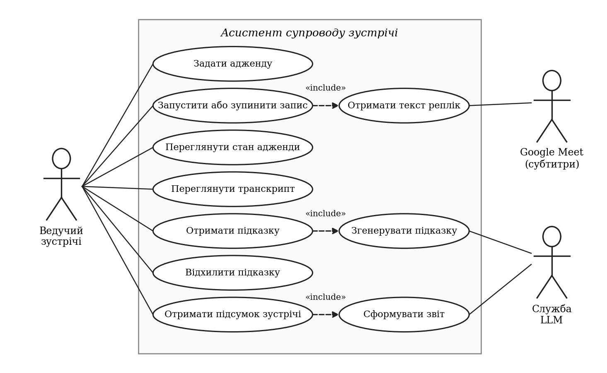

## 2.2 Загальна архітектура й потік даних від аудіо до підказки користувачу

Система складається з двох частин: розширення браузера, яке збирає текст і показує результати, та серверної частини, де працюють агенти (рис. 2.2). Такий поділ зумовлений двома обставинами, встановленими в підрозділі 1.4. По-перше, ключ доступу до мовної моделі не повинен зберігатися в клієнтському коді, тож звернення до моделі має виконувати сервер. По-друге, сервісний процес розширення може бути завершений браузером будь-якої миті [40], тому тривалий стан аналізу зручніше тримати в процесі, життєвим циклом якого керує сама система.

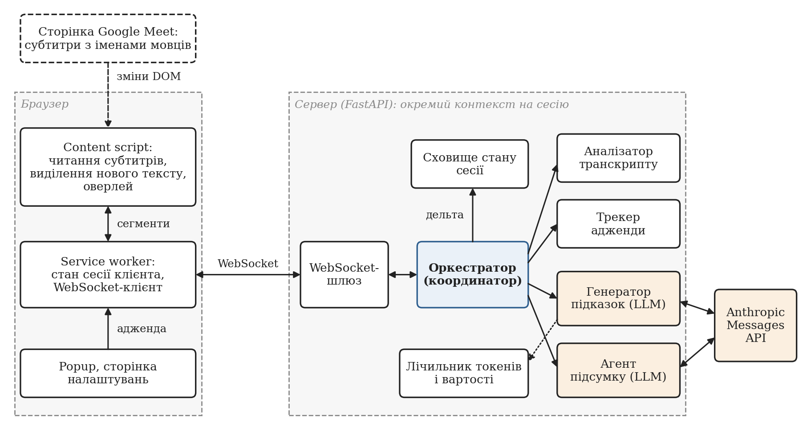

Слід одразу уточнити назву підрозділу: система не обробляє аудіо. Перетворення мовлення на текст виконує Google Meet, формуючи субтитри; асистент починає роботу з уже готового тексту. Потік даних складається з таких кроків:

1. Учасник говорить; Meet розпізнає мовлення й відображає рядок субтитрів із його іменем.
2. Скрипт вмісту виділяє новий текст рядка, формує частковий або фінальний сегмент і через сервісний процес надсилає його серверу повідомленням `TRANSCRIPT`.
3. Сервер очищує текст і передає сегмент оркестратору сесії. Для фінального сегмента оркестратор викликає аналізатор і трекер, застосовує дельту до стану й одразу повертає клієнту оновлену адженду та, за потреби, підказку про перевищення часу.
4. Якщо виконано умови запуску, оркестратор у фоні викликає генератор підказок; перевірені підказки надходять клієнту повідомленням `NEW_HINT`, а пропозиція моделі щодо активного пункту застосовується через трекер.
5. Сервісний процес оновлює копію стану й розсилає зміни у скрипт вмісту, який перемальовує оверлей.

Потік розділено на два шляхи, передбачені формулою (1.2). Швидкий шлях (кроки 1–3 і 5) не містить звернень до мовної моделі; повільний (крок 4) залежить від неї й навмисно відокремлений: його затримка або відмова не впливає на швидкий. Кожне WebSocket-з’єднання отримує власний контекст сесії з окремим сховищем стану, оркестратором і агентами; кількість одночасних сесій обмежено (50).

## 2.3 Призначення агентів і межі відповідальності: транскрибатор, монітор адженди, генератор підказок, координатор (за фактичною архітектурою)

Технічне завдання називає трьох агентів: транскрибатор, монітор адженди й генератор підказок. У фактичній архітектурі ці ролі збережено, але уточнено (табл. 2.3). Роль транскрибатора розміщено в браузері й зведено до читання субтитрів Meet. Це результат практичної перевірки питання, яке огляд залишив відкритим: перша версія використовувала два джерела (Web Speech API для локального користувача й субтитри для решти), і на реальних зустрічах підтвердилися всі три вади браузерного розпізнавання, описані в п. 1.2.3. Тому 08.10.2026 прийнято рішення отримувати мовлення всіх учасників із субтитрів Meet; подробиці наведено в підрозділі 4.2. Ціна рішення — залежність від розмітки сторінки, прив’язка до однієї платформи й затримка стабілізації рядка близько однієї секунди.

Роль монітора адженди поділено на два детерміновані компоненти: аналізатор відповідає на запитання «про що ця репліка», трекер — «як через це змінюється стан». Додано агента підсумку, якого технічне завдання не вимагало.

**Таблиця 2.3 — Ролі агентів і межі відповідальності**

| Агент | Вхід | Вихід | Природа рішення | Чого агент не робить |
|---|---|---|---|---|
| Транскрибатор (браузер) | Розмітка субтитрів Meet | Сегменти транскрипту з іменем мовця | Правила стабілізації та виділення приросту | Не розпізнає мовлення сам, не аналізує зміст |
| Аналізатор транскрипту | Фінальний сегмент, адженда | Перелік згаданих пунктів, ознака фрази переходу | Детерміновані правила | Не змінює стан |
| Трекер адженди | Результат аналізу або пропозиція моделі, поточна адженда, час | Дельта: новий активний пункт, зміни статусів, свідчення, час | Автомат станів | Не застосовує дельту сам |
| Генератор підказок | Адженда, вікно реплік, показані підказки | До двох перевірених підказок; пропозиція активного пункту | Мовна модель плюс перевірка кодом | Не змінює стан адженди напряму |
| Агент підсумку | Увесь фінальний транскрипт, адженда | Звіт: підсумок, рішення, завдання, відкриті питання | Мовна модель плюс перевірка кодом | Не працює під час зустрічі |
| Оркестратор | Сегменти, результати агентів | Оновлення стану, повідомлення клієнту | Звичайний код | Не звертається до моделі для координації |

Межі відповідальності закріплено трьома правилами. Перше: спільний стан змінює лише сховище сесії за викликом оркестратора; агенти повертають значення. Друге: мовна модель не змінює стан адженди напряму. Вона може лише запропонувати, який пункт обговорюється; пропозицію з достатньою впевненістю й свідченнями трекер застосовує через той самий автомат станів, що й лексичні збіги, тож навіть помилкова пропозиція не може виконати недозволений перехід. Третє: оркестратор не використовує модель для вибору наступного кроку; порядок викликів заданий кодом, тому поведінка системи без моделі повністю детермінована.

## 2.4 Модель повідомлень, спільний стан адженди та послідовність взаємодії агентів

Обмін між розширенням і сервером відбувається JSON-повідомленнями через WebSocket — протокол, що забезпечує двоспрямований обмін через одне TCP-з’єднання після HTTP-рукостискання [45]. Порядок повідомлень у межах з’єднання зберігається, тому на детермінованому шляху перевпорядкування не виникає. Кожне повідомлення має поле `type`, за яким сервер обирає модель для перевірки; моделі описано засобами бібліотеки Pydantic, яка перевіряє типи полів і відхиляє невідповідні дані [46]. Перелік повідомлень подано в табл. 2.4.

**Таблиця 2.4 — Повідомлення протоколу між розширенням і сервером**

| Напрям | Тип | Зміст | Коли надсилається |
|---|---|---|---|
| Клієнт → сервер | `CONNECT` | Ідентифікатор і назва зустрічі, пункти адженди | Один раз після встановлення з’єднання |
| Клієнт → сервер | `AUDIO_START`, `AUDIO_STOP` | Початок і кінець запису | За дією користувача |
| Клієнт → сервер | `TRANSCRIPT` | Сегмент транскрипту | На кожну часткову й фінальну гіпотезу |
| Клієнт → сервер | `DISMISS_HINT` | Ідентифікатор підказки | Коли користувач відхилив підказку |
| Сервер → клієнт | `SESSION_ACK` | Ідентифікатор сесії | У відповідь на `CONNECT` |
| Сервер → клієнт | `NEW_TRANSCRIPT` | Оброблений сегмент | Після кожного сегмента |
| Сервер → клієнт | `AGENDA_UPDATE` | Повний стан адженди | Після зміни стану |
| Сервер → клієнт | `NEW_HINT` | Підказка | Після перевірки підказки |
| Сервер → клієнт | `STATE_UPDATE` | Повний знімок стану | Кожні 5 с |
| Сервер → клієнт | `MEETING_SUMMARY` | Статистика, згодом звіт | Після `AUDIO_STOP`, до двох разів |
| Сервер → клієнт | `TRANSCRIPT_ERROR` | Повідомлення про помилку | Якщо сегмент не вдалося обробити |

Періодичний знімок `STATE_UPDATE` дублює подієві повідомлення навмисно: якщо скрипт вмісту перезавантажено або повідомлення втрачено, клієнт відновить стан не пізніше ніж за п’ять секунд. Підсумок надсилається двічі: спершу статистика з позначкою очікування, потім вона ж зі звітом; клієнт тримає з’єднання відкритим до другого повідомлення, але не довше 35 с.

Спільний стан сесії складається зі стану адженди, журналу сегментів, переліку показаних підказок і відповідності «сегмент — активний пункт». Підказка містить тип, ідентифікатор пункту, текст, перелік сегментів-свідчень, впевненість і позначку часу; сегмент — ідентифікатор, підпис мовця, текст, позначку часу й ознаку фінальності.

Послідовність обробки однієї фінальної репліки показано на рис. 2.3. Верхня частина діаграми — синхронний детермінований шлях. Нижня, виділена рамкою, виконується лише за умов запуску моделі й асинхронно: оркестратор не чекає відповіді, а результат потрапляє до клієнта через зареєстровані канали доставки.

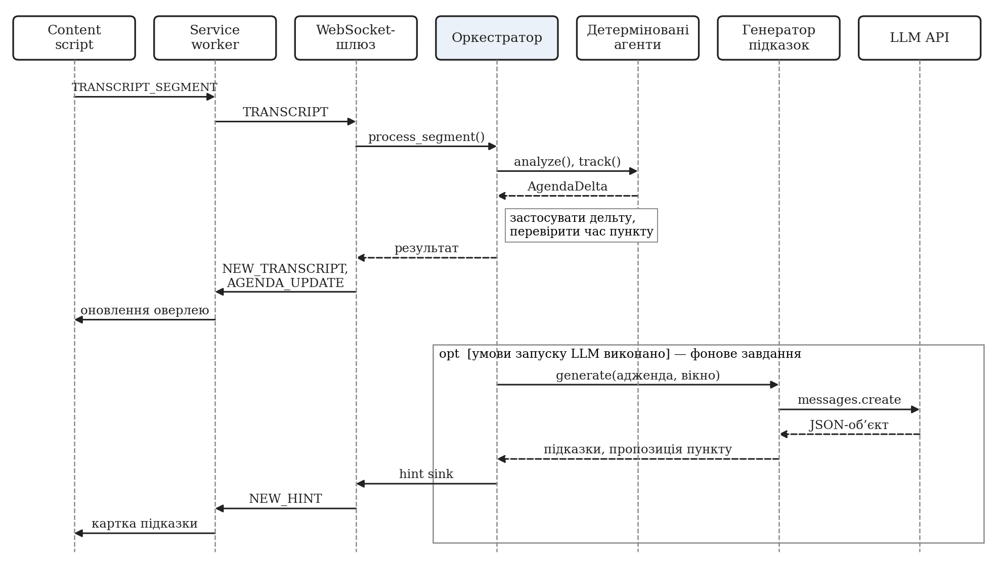

## 2.5 Інтеграційна схема з Google Meet і браузерним розширенням

Розширення побудовано за вимогами Manifest V3 і складається з чотирьох контекстів виконання (рис. 2.4). Скрипт вмісту підключається лише до сторінок `https://meet.google.com/*`, читає субтитри й відображає оверлей у тіньовому дереві DOM [47]. Сервісний процес тримає WebSocket-з’єднання, зберігає копію стану сесії та маршрутизує повідомлення. Спливне вікно і сторінка налаштувань дають змогу редагувати адженду, запускати запис і задавати адресу сервера та ім’я користувача. Позаекранний документ призначено для захоплення звуку вкладки, яке в поточній версії не використовується.

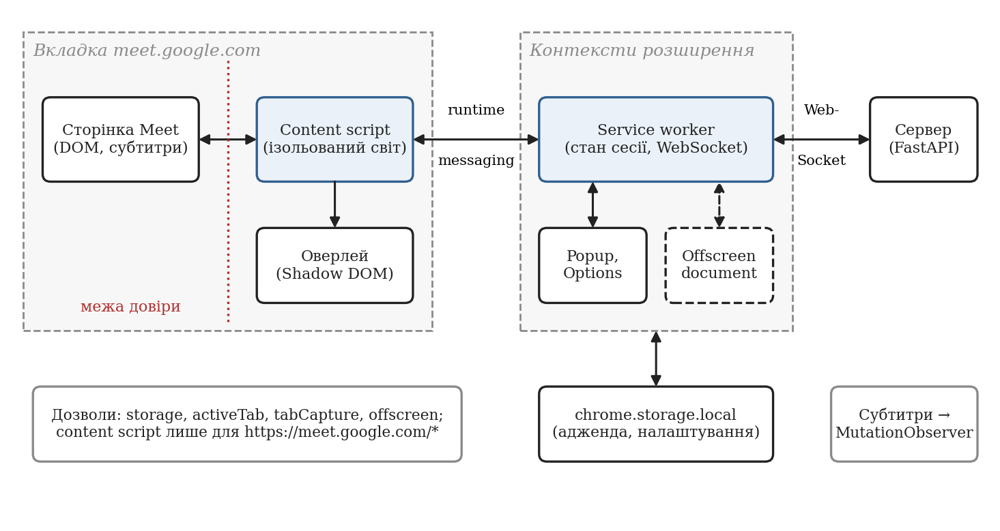

Між сторінкою Meet і розширенням проходить межа довіри: імена учасників і текст субтитрів є зовнішніми даними. Тому скрипт вмісту відкидає порожні й повторні рядки, а сервер очищує текст від керувальних символів і обмежує його довжину 10 000 символів, перш ніж передати агентам.

Розширення оголошує дозволи `storage`, `activeTab`, `tabCapture` і `offscreen` і не запитує доступу до всіх сайтів [42]. Оскільки захоплення звуку не використовується, два останні дозволи є надлишковими й перед публікацією розширення мають бути вилучені.

У схемі є відоме відхилення від вимоги Н5: ключ доступу до мовної моделі можна ввести в налаштуваннях розширення, і тоді він зберігається у сховищі `storage.local` та передається серверу в повідомленні `CONNECT`. Це спрощення локального прототипу; цільовий спосіб, також підтриманий, — змінна середовища на сервері.

## 2.6 Середовище розробки, бібліотеки, API та обґрунтування вибору

Залежність додавалася лише тоді, коли без неї довелося б писати значний обсяг власного коду (табл. 2.5).

**Таблиця 2.5 — Засоби розробки та обґрунтування вибору**

| Засіб | Призначення | Підстава вибору |
|---|---|---|
| Python 3.11, `asyncio` [48] | Серверна логіка, фонові завдання, таймери | Асинхронна модель відповідає задачі: багато очікувань мережі, мало обчислень |
| FastAPI, Uvicorn [49] | WebSocket-шлюз | Вбудована підтримка WebSocket і перевірки даних |
| Pydantic 2 | Моделі повідомлень і стану | Перевірка типів на межі системи, серіалізація в JSON |
| Anthropic Python SDK, Messages API | Виклики мовної моделі | Офіційний клієнт; таймаути й облік токенів у відповіді |
| TypeScript, Vite | Збирання розширення | Статична перевірка типів повідомлень; збирання скрипту вмісту одним файлом |
| React | Спливне вікно і сторінка налаштувань | Форми з локальним станом; оверлей написано без фреймворку, щоб не збільшувати розмір скрипту вмісту |
| pytest [50], vitest | Автоматичні тести | 169 тестів сервера, зокрема асинхронних; 7 модульних тестів розширення |

Фреймворки оркестрації агентів не використано з причин, викладених у п. 1.1.5. Спостережуваність забезпечує власний модуль журналювання: запис є подією з назвою й набором полів, ідентифікатори сесії та зустрічі додаються автоматично. Текст транскрипту, імена учасників і ключі в журнал не записуються — лише ідентифікатори, лічильники, токени та вартість. Журнал у форматі JSON Lines є джерелом даних для розділу 6.

Для відлагодження інтерфейсу без сервера передбачено демонстраційну сторінку, що імітує Meet і програє заготовлені сценарії, а для оцінювання вартості без платних звернень — стенд відтворення, який пропускає синтетичні сценарії через справжній оркестратор із заглушкою замість моделі та симульованим часом.

# 3 Створити математичне та алгоритмічне забезпечення для ШІ-агентів, яке дозволить оцінювати відхилення поточної розмови від заданого плану (адженди) на основі LLM

Розділ описує алгоритмічну основу системи: подання адженди, формування сегментів із субтитрів, прив’язування реплік до пунктів, критерії відхилення від теми, правила координації агентів і набір тестових сценаріїв. Він відповідає завданню 3 технічного завдання та спирається на формальну постановку підрозділу 1.3.

## 3.1 Формат адженди й подання стану кожного пункту

Адженда — впорядкований перелік пунктів, який користувач задає до початку запису. Пункт описується записом із восьми полів (табл. 3.1). Перші чотири поля задає користувач, решту змінює лише система. Якщо користувач не задав жодного пункту, розширення створює один пункт «General discussion» з оцінкою 30 хвилин, щоб облік часу й підказки працювали й без плану.

**Таблиця 3.1 — Поля пункту адженди**

| Поле | Тип | Хто змінює | Призначення |
|---|---|---|---|
| `id` | рядок | користувач (генерується розширенням) | Стабільний ідентифікатор, на який посилаються свідчення й підказки |
| `title` | рядок | користувач | Назва; основа лексичного зіставлення |
| `description` | рядок, необов’язкове | користувач | Додаткові ключові слова для зіставлення |
| `estimatedMinutes` | число, необов’язкове | користувач | Оцінка тривалості Tᵢ; без неї перевищення часу не перевіряється |
| `status` | перелік | система | Один із п’яти статусів |
| `elapsedSeconds` | число | система | Сумарний час, коли пункт був активним |
| `evidence` | перелік рядків | система | Ідентифікатори реплік, у яких пункт згадано |
| `order` | ціле | користувач | Порядок у плані |

Статус пункту набуває одного з п’яти значень; допустимі переходи між ними показано на рис. 3.1 і в табл. 3.2. Автомат конкретизує узагальнену модель рис. 1.4. Стан адженди загалом доповнюють ідентифікатор активного пункту (не більше одного) і сумарний час зустрічі.

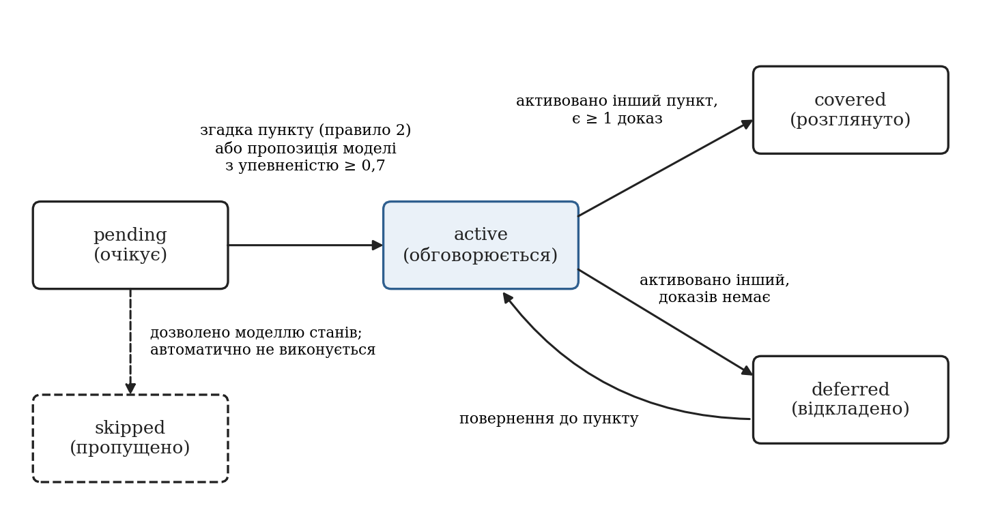

**Таблиця 3.2 — Статуси пункту адженди та умови переходів**

| Статус | Зміст | Як пункт у нього потрапляє |
|---|---|---|
| pending | Обговорення не починалося | Початковий стан |
| active | Обговорюється зараз | Із pending або deferred: лексична згадка за правилом 2 або пропозиція моделі з упевненістю не нижче 0,7 |
| covered | Розглянуто | Активним став інший пункт, а для цього накопичено хоча б одне свідчення |
| deferred | Відкладено | Активним став інший пункт, а свідчень для цього немає |
| skipped | Пропущено | Перехід дозволено моделлю станів; автоматично не виконується |

Автомат реалізує асиметрію свідчень (п. 1.3.4): пункт, який залишили без свідчень, стає відкладеним, і до нього можна повернутися. Зі статусу covered переходів немає: це запобігає «гойданню» між двома пунктами, але робить помилкове закриття незворотним (розділ 6). Статус skipped закладено в модель даних, однак трекер його не призначає; про пропущений пункт повідомляє підказка мовної моделі, що не змінює стану.

## 3.2 Алгоритм обробки сегментів транскрипту та прив’язування реплік до пунктів плану

Обробка складається з двох етапів: формування сегментів із субтитрів у браузері та аналізу фінальних сегментів на сервері.

### 3.2.1 Формування сегментів: стабілізація та виділення приросту

Субтитри Meet не мають ознаки фінальності: рядок із підписом мовця росте, поки людина говорить, і водночас раніше показані слова переглядаються. Розширення розв’язує задачу, сформульовану в п. 1.2.2, двома механізмами.

Стабілізація. Для кожного рядка субтитрів запам’ятовується момент останньої зміни. Поки рядок змінюється, його невідправлена частина надсилається як часткова гіпотеза зі сталим ідентифікатором сегмента, і інтерфейс замінює текст «на місці». Якщо рядок не змінювався 1 с, невідправлена частина фіксується як фінальний сегмент.

Виділення приросту. Після фіксації рядок може рости далі. Нехай e — повний текст рядка на момент останньої фіксації, c — його поточний текст. Обидва тексти розбиваються на слова й нормалізуються: слово переводиться в нижній регістр, з нього вилучаються всі символи, крім літер і цифр. Далі виконуються кроки алгоритму 3.1.

Алгоритм 3.1 — виділення приросту рядка субтитрів.

1. Якщо нормалізовані послідовності слів e і c збігаються, нового тексту немає (змінилися лише регістр або розділові знаки).
2. Для довжини хвоста q = 3, 2, 1: узяти останні q нормалізованих слів e і шукати їх у c, починаючи з позиції, де вони очікуються (|e| − q), у межах допуску ±3 слова, від найбільшої позиції до найменшої. Якщо знайдено — приростом є слова c після знайденого хвоста.
3. Якщо хвіст не знайдено (його було переглянуто), підрахувати довжину спільного початку e і c. Якщо вона не менша за половину довжини e, рядок вважається тим самим висловлюванням, а приростом є слова c, починаючи з позиції |e|.
4. Інакше текст вважається новим висловлюванням у тому самому рядку й передається повністю.

Допуск у три слова відображає спостереження, що перегляд рідко змінює кількість слів більше ніж на кілька; пошук від найбільшої позиції запобігає прив’язці до повтору тих самих слів раніше в рядку. Приклади наведено в табл. 3.3; поведінку закріплено модульними тестами.

**Таблиця 3.3 — Приклади виділення приросту рядка субтитрів**

| Уже передано (e) | Поточний рядок (c) | Результат | Крок |
|---|---|---|---|
| перейдемо до бюджету | Перейдемо до бюджету. | Нічого нового | 1 |
| перейдемо до бюджету | Перейдемо до бюджету на тестування | Приріст: «на тестування» | 2 |
| давайте про статус спринта | Давайте про статус спринту, закрито дванадцять задач | Приріст: «закрито дванадцять задач» | 3 |
| так, згоден | Наступне питання — план релізу | Нове висловлювання | 4 |

Додатково текст, уже переданий від того самого мовця протягом останніх десяти хвилин, удруге не передається (Meet інколи наново показує бачені рядки); правило діє лише для текстів із п’яти й більше слів, щоб не губилися короткі повторювані відповіді. До впровадження алгоритму 3.1 рядок після кожної фіксації передавався повністю, і лічильники слів, частки мовців та вхідні токени були завищені; сесії, записані до виправлення, з оцінювання вилучено.

### 3.2.2 Лексичне зіставлення репліки з пунктами

Серверну обробку одного сегмента показано на рис. 3.2. Часткові сегменти до аналізу не потрапляють. Для фінального сегмента s спершу виконується нормалізація: переведення в нижній регістр і стиснення пробілів. Сегменти коротші за три слова не аналізуються: вигуки на зразок «так, добре» не несуть інформації про тему, а їх зіставлення давало б випадкові збіги.

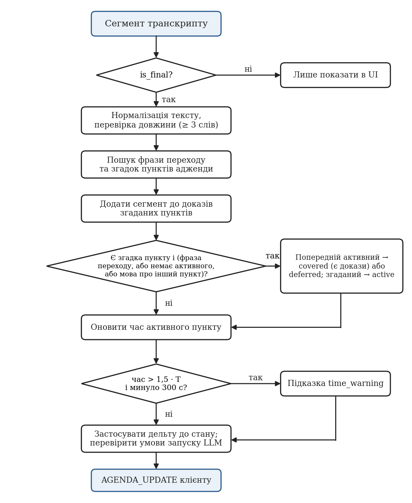

Далі для кожного пункту aᵢ обчислюється ознака згадки. Нехай V(aᵢ) — множина значущих слів назви (довших за два символи), D(aᵢ) — множина значущих слів опису (довших за три символи). Слово w вважається знайденим у тексті s, якщо виконується предикат

$$ found(w, s) = [w ⊂ s] ∨ [|w| > 4 ∧ w₋₂ ⊂ s],    (3.1)

де запис x ⊂ s означає, що x є підрядком s, а w₋₂ — слово w без двох останніх літер. Друга умова є грубою заміною зведення до основи: вона дозволяє знайти «архітектури» за словом «архітектура» і «релізу» за словом «реліз». Пункт вважається згаданим, якщо

$$ match(aᵢ, s) = [title(aᵢ) ⊂ s] ∨ [h_V ≥ ⌈|V(aᵢ)| / 2⌉] ∨ [h_D ≥ max(1, ⌊|D(aᵢ)| / 2⌋)],    (3.2)

де h_V і h_D — кількість слів із V(aᵢ) і D(aᵢ) відповідно, для яких found = 1. Інакше кажучи, достатньо повної назви, половини значущих слів назви або половини значущих слів опису. Окремо обчислюється ознака переходу trans(s): вона дорівнює одиниці, якщо текст містить одну з 26 усталених фраз (15 англійських і 11 українських, наприклад «перейдемо до», «наступне питання», «давайте обговоримо»).

Результат аналізу — множина M(s) згаданих пунктів і ознака trans(s). Складність обробки сегмента становить O(n · L · k), де n — кількість пунктів, L — довжина тексту, k — кількість значущих слів пункту.

Поріг «половина слів» є компромісом: вимога всіх слів назви пропускала б скорочені згадки, а для назв із двох слів достатньо одного, що є джерелом хибних збігів. Порівняння за підрядком додає ще одне: слово «план» входить у «запланованих». Ці випадки навмисно не усунуто спеціальними правилами, щоб базовий шар залишався простим, а його помилки — передбачуваними. Якщо назву пункту записано іншою мовою, ніж ведеться розмова, зіставлення не працює; цей випадок покладено на семантичний шар.

## 3.3 Критерії виявлення відхилення від теми й умови оновлення стану пункту

Трекер отримує M(s), trans(s), поточний активний пункт a* і час сегмента. Його рішення зводяться до чотирьох правил.

Правило 1 (свідчення). Ідентифікатор сегмента додається до свідчень кожного пункту з M(s), незалежно від подальших рішень.

Правило 2 (активація). Нехай O(s) = M(s) \ {a*} — згадані пункти, відмінні від активного. Активний пункт змінюється, якщо M(s) непорожня і виконується хоча б одна з умов: trans(s) = 1; активного пункту немає; a* ∉ M(s) і O(s) непорожня. Ціллю стає перший пункт з O(s), а якщо вона порожня — перший із M(s). Перехід виконується лише тоді, коли ціль перебуває в статусі pending або deferred.

Правило 3 (завершення попереднього). Якщо перелік свідчень попереднього активного пункту, з урахуванням поточного сегмента, непорожній, пункт переходить у covered; інакше — у deferred.

Правило 4 (час). Для активного пункту ведеться лічильник: під час активації запам’ятовується момент початку, під час зміни активного пункту накопичений інтервал додається до `elapsedSeconds`. Якщо до пункту повертаються зі статусу deferred, відлік продовжується з накопиченого значення. Час береться з позначки сегмента; позначки браузера в мілісекундах приводяться до секунд.

Крім лексичного шляху, активний пункт може змінити пропозиція мовної моделі: її відповідь містить пункт, якого стосуються останні репліки, впевненість і репліки-свідчення (розділ 5). Оркестратор передає пропозицію трекеру, якщо впевненість не нижча за 0,7 і наведено хоча б одне наявне свідчення; трекер застосовує до неї ті самі правила 2–4. Лексичний шлях миттєвий, але сліпий до перефразування й іншої мови; семантичний стійкий до них, але спрацьовує лише разом із викликом моделі, тобто із запізненням.

Перевищення часу перевіряє оркестратор після застосування дельти. Підказка формується, якщо для активного пункту з оцінкою Tᵢ виконується

$$ eᵢ > 1,5 · 60 · Tᵢ,    (3.3)

де eᵢ — витрачений час у секундах, Tᵢ — оцінка у хвилинах. Коефіцієнт 1,5 обрано, щоб не турбувати ведучого через незначне перевищення; повторне повідомлення про той самий пункт можливе не раніше ніж через 300 с.

Відхилення від теми в детермінованому шарі навмисно не породжує підказки: лексична «незгадуваність» пункту не дорівнює відхиленню. Рішення ухвалює мовна модель, а детермінований шар гарантує, що під час відхилення активний пункт не зміниться і його час накопичуватиметься. Отже, стан змінюють лише рішення трекера, а перевищення часу, відхилення від теми й пропущені пункти породжують тільки підказки.

## 3.4 Правила координації агентів, порядок викликів і обробка повторних/запізнілих результатів

На кожному фінальному сегменті оркестратор виконує кроки в сталому порядку: запис сегмента; аналіз; відстеження; застосування дельти; перевірка часу; перевірка умов запуску моделі. Кроки синхронні, тож два сегменти не можуть обробитися «навперемін».

Умови запуску моделі перевіряються послідовно (рис. 3.3). Виклик запускається, якщо: немає іншого виклику в роботі; не досягнуто лімітів викликів і вартості; від попереднього виклику минуло не менше 45 с; після попереднього виклику накопичено не менше 50 нових слів. Порядок перевірок обрано так, щоб у журналі фіксувалася найвагоміша причина пропуску.

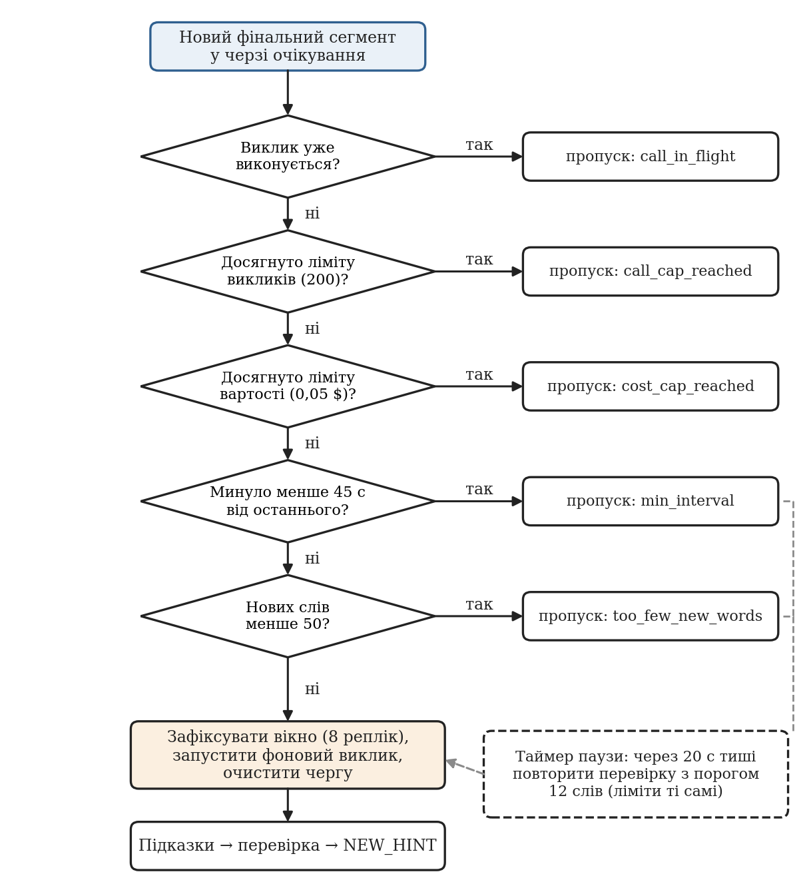

Самі ці умови мають ваду: якщо після змістовної репліки настає тиша, наступного сегмента, який міг би запустити виклик, немає. Тому оркестратор заводить таймер паузи: якщо впродовж 20 с не надійшло нових реплік і накопичено щонайменше 12 слів, перевірка повторюється зі зниженим порогом слів. Якщо на заваді стоїть мінімальний інтервал або виклик, що триває, таймер переноситься на момент, коли перешкода зникне; якщо досягнуто ліміту, таймер скасовується.

У момент запуску оркестратор фіксує знімок контексту: вікно з восьми останніх фінальних реплік і перелік нещодавно показаних підказок. Репліки, що надходять під час виклику, чекають наступного. Правила для повторних і запізнілих результатів зведено в табл. 3.4.

**Таблиця 3.4 — Обробка повторних, запізнілих і помилкових результатів**

| Ситуація | Реакція системи | Подія в журналі |
|---|---|---|
| Новий сегмент під час виклику моделі | Сегмент обробляється детерміновано; новий виклик не запускається | `llm_skipped`, причина `call_in_flight` |
| Модель повторює підказку того самого типу для того самого пункту раніше ніж через 120 с | Підказка не показується | `hint_suppressed_repeat` |
| Пропозиція пункту з упевненістю нижче 0,7 | Активний пункт не змінюється | `agenda_switch_skipped`, причина `low_confidence` |
| Пропозиція вимагає недозволеного переходу | Активний пункт не змінюється | `agenda_switch_skipped`, причина `invalid_transition` |
| Відповідь надійшла після закриття сесії | Результат відкидається | `llm_result_dropped` |
| Підказка посилається на невідомий пункт або не має чинних свідчень | Підказка відкидається | `hint_dropped` |
| Виклик завершився помилкою чи таймаутом | Підказок немає; лічильник вимикача збільшується | `llm_call_failed` |

Пригнічення повторів працює двічі: перелік показаних пар «тип — пункт» передається в запит із вказівкою не повторювати їх, а якщо модель усе ж повторить підказку, її відкине код.

## 3.5 Тестові сценарії: рух за планом, перехід між пунктами, відхилення від теми, неоднозначна репліка, пауза та помилка агента/API

Для відтворюваної перевірки підготовлено синтетичні сценарії українською мовою (табл. 3.5). Репліки вигадано; даних реальних людей сценарії не містять. Сценарій задається аджендою та послідовністю фінальних реплік із позначками часу, а еталонний пункт для кожної репліки відомий із побудови.

**Таблиця 3.5 — Тестові сценарії та їх покриття**

| Код | Сценарій | Що перевіряє | Реплік | Чим відтворюється |
|---|---|---|---|---|
| С1 | Рух за планом: чотири пункти по черзі | Активацію та завершення пунктів | 38 | Сценарій `normal_flow` |
| С2 | Відхилення від теми й повернення після паузи | Збереження активного пункту, таймер паузи | 38 | Сценарій `drift_and_return` |
| С3 | Пропущений пункт: після другого одразу четвертий | Хибну активацію пропущеного пункту | 32 | Сценарій `skipped_item` |
| С4 | Перевищення часу: пункт на 1 хв триває близько 5 хв | Підказку про час | 44 | Сценарій `item_overrun` |
| С5 | Довга зустріч близько 30 хв | Ліміти, стабільність на довгому вході | 222 | Сценарій `long_meeting` |
| С6 | Перефразування: пункти обговорюються без слів із назв | Межі лексичного зіставлення | 20 | Сценарій експерименту розділу 6 |
| С7 | Неоднозначна репліка: слова двох пунктів | Вибір цілі за правилом 2 | — | Модульні тести трекера |
| С8 | Пауза після змістовної репліки | Таймер паузи, знижений поріг слів | — | Тести фонових викликів оркестратора |
| С9 | Помилка або недоступність мовної моделі | Деградацію до детермінованих підказок | — | Тести вимикача й оркестратора |
| С10 | Пропозиція пункту від моделі | Поріг упевненості, свідчення, недозволені переходи | — | Тести семантичного перемикання |

Сценарії С1–С5 відтворюються через справжній оркестратор у симульованому часі із заглушкою замість моделі; С7–С10 покрито модульними тестами. Серверна частина має 169 автоматичних тестів: трекер і аналізатор — 16, семантичне перемикання — 13, генератор підказок — 22, фонові виклики — 21, конвеєр транскрипту — 16, підсумок — 18, стенд відтворення — 17, допоміжні модулі — 46. Розширення має 7 модульних тестів.

## 3.6 Вхідні дані, вихід алгоритму, параметри й обчислювані метрики

Вхід алгоритму — адженда та потік сегментів; вихід — послідовність станів адженди, підказки та журнал подій. Значення параметрів наведено в тексті розділу та в табл. 5.2; вони є проєктними рішеннями, вплив двох із них — мінімального інтервалу й порогу слів — досліджено в розділі 6.

Для оцінювання використовуються метрики п. 1.3.6: частка реплік, після яких активний пункт збігається з еталонним, та точність, повнота й F1 виявлення переходів (перехід вважається виявленим, якщо система активувала той самий пункт не пізніше ніж через дві репліки). Для швидкодії обчислюються медіана та 95-й перцентиль часу детермінованої обробки, відповіді моделі та очікування виклику; для вартості — виклики, токени й добуток на опубліковані ціни за формулою (1.3).

# 4 Розробити архітектуру інтеграції системи з інтерфейсом Google Meet, включаючи модулі перехоплення аудіо та відображення інтерактивного інтерфейсу підказок користувачу

Розділ описує клієнтську частину системи — розширення браузера Chrome: його структуру, отримання тексту зустрічі, інтерфейс підказок і перевірку поведінки. Він відповідає завданню 4 технічного завдання. Особливу увагу приділено проблемам, які виявилися лише на реальних зустрічах.

## 4.1 Структура браузерного розширення та обмін повідомленнями між його компонентами

Розширення написано мовою TypeScript і складається з п’яти частин, що відповідають контекстам виконання платформи Manifest V3 (табл. 4.1).

**Таблиця 4.1 — Компоненти розширення**

| Компонент | Контекст виконання | Відповідальність |
|---|---|---|
| Скрипт вмісту | Сторінка `meet.google.com`, ізольований світ | Виявлення зустрічі; читання субтитрів; формування сегментів; оверлей |
| Сервісний процес | Фоновий контекст розширення | WebSocket-з’єднання із сервером; копія стану сесії; маршрутизація повідомлень; життєвий цикл зустрічі |
| Спливне вікно | Сторінка розширення (React) | Редагування адженди; запуск і зупинка запису; стан з’єднання; індикатор згоди |
| Сторінка налаштувань | Сторінка розширення (React) | Адреса сервера; мова зустрічі; ім’я користувача; ключ доступу; вигляд панелі |
| Позаекранний документ | Прихована сторінка розширення | Захоплення звуку вкладки (не використовується в потоці даних) |

Скрипт вмісту збирається одним файлом у форматі негайно виконуваної функції. Це вимушене рішення: скрипт вмісту у форматі модуля ECMAScript браузер не завантажував, причому без жодного повідомлення про помилку, що коштувало помітного часу на діагностику. Решта частин збирається звичайними модулями засобами Vite [51].

Компоненти обмінюються типізованими повідомленнями: скрипт вмісту надсилає сервісному процесу сегменти транскрипту й відхилення підказок; спливне вікно — запити стану, команду запуску чи зупинки та збережені адженду й налаштування; сервісний процес розсилає скриптам вмісту повний стан, подієві оновлення від сервера й підсумок. Типи повідомлень описано об’єднаннями TypeScript, спільними для всіх контекстів, тож невідповідність полів виявляється під час збирання. Текст сегмента сервісний процес лише пересилає серверу, який і виконує очищення [52].

Сервісний процес зберігає в пам’яті останні 100 сегментів транскрипту й 50 підказок; у сховище записуються адженда й налаштування. Оскільки браузер може завершити сервісний процес [40], після перезапуску клієнтський стан відновлюється з наступного повного знімка від сервера.

## 4.2 Отримання/передавання аудіоданих: обраний механізм і його фактичні обмеження

### 4.2.1 Від двох джерел до одного

Назва підрозділу відображає початковий задум: захоплювати аудіо й розпізнавати його. Фактична реалізація пройшла три етапи, кожен з яких завершився виявленням обмеження (табл. 4.2).

**Таблиця 4.2 — Етапи вибору механізму отримання мовлення**

| Етап | Механізм | Виявлене на практиці | Наслідок |
|---|---|---|---|
| 1 | Захоплення звуку вкладки (`tabCapture`) і позаекранний документ | Потік захоплюється, але для розпізнавання потрібна серверна служба; звук змішаний, без поділу на мовців | Захоплення залишено неактивним |
| 2 | Web Speech API для локального користувача плюс субтитри Meet для інших | Розпізнавач слухає мікрофон за замовчуванням, а не вибраний у Meet; працює при вимкненому мікрофоні; чує чуже мовлення з динаміків; потрібні правила усунення дублікатів | Відмова від браузерного розпізнавання |
| 3 | Субтитри Meet для всіх учасників | Рядок росте й переглядається: без виділення приросту мовлення передається кілька разів | Алгоритм 3.1 |

Перший етап відповідав варіанту F табл. 1.2: захоплення звуку вкладки після дії користувача з передаванням потоку в позаекранний документ [41] реалізовано, але потік далі не спрямовується, бо серверне розпізнавання означало б передавання аудіо зустрічі на сервер.

Другий етап відповідав варіанту G, і його вади проявилися в конкретних ситуаціях. Після підключення гарнітури користувач обрав її мікрофон у Meet, але браузерний розпізнавач продовжив слухати вбудований мікрофон, і мовлення користувача зникло з транскрипту. Слова, сказані при вимкненому в Meet мікрофоні, усе одно розпізнавалися й потрапляли в аналіз. Без навушників голоси співрозмовників із динаміків розпізнавалися як мовлення користувача, водночас надходячи через субтитри під справжніми іменами. Разом ці вади показали, що два незалежні джерела одного акустичного каналу принципово важко узгодити.

Третій етап відповідає варіанту E. Субтитри формує сама платформа, тому вони враховують вибраний мікрофон і стан його вимкнення та підписані іменами учасників. Розширення при цьому не захоплює й не передає аудіо: воно читає текст, який Meet уже відобразив.

### 4.2.2 Читання субтитрів

Модуль читання субтитрів виконує чотири дії. Після початку запису він вмикає субтитри: шукає кнопку за підписом доступності англійською, українською або російською мовою чи за значком і натискає її, повторюючи спроби; рідну область субтитрів робить невидимою, зберігаючи в розмітці. Область субтитрів шукається за роллю й підписом доступності, і пошук повторюється кожні 1,5 с, бо Meet інколи перебудовує цю частину сторінки. За областю стежить `MutationObserver` [44]: кожна зміна розбирається на ім’я мовця й текст, далі працюють стабілізація та виділення приросту (п. 3.2.1). Нарешті, власні репліки користувача, які Meet підписує словом «You», отримують ім’я з налаштувань, із власної плитки користувача або з кнопки облікового запису Google.

### 4.2.3 Фактичні обмеження обраного механізму

Обмеження механізму такі. Зміна інтерфейсу Meet може зупинити транскрипцію без жодної помилки, і автоматичного виявлення цього поки немає. Мову субтитрів задає користувач у налаштуваннях Meet; налаштування «мова зустрічі» в розширенні до Meet не застосовується, і якщо в Meet залишено англійську, українське мовлення розпізнається як безглуздий набір англійських слів. Механізм працює лише в Google Meet і додає 1 с стабілізації рядка до затримки розпізнавання. Точність субтитрів для української не вимірювалася. Розширення самостійно вмикає субтитри й передає їхній текст на сервер, а фрагменти — зовнішній мовній моделі; користувач має поінформувати про це учасників, для чого спливне вікно містить індикатор згоди, а стан запису постійно видно в оверлеї.

## 4.3 Інтерфейс підказок: стани віджета, ненав’язливе розміщення, оновлення й приховування

Інтерфейс асистента — панель поверх сторінки Meet (рис. 4.1), розміщена в тіньовому дереві DOM і написана без фреймворку, щоб скрипт вмісту залишався малим.

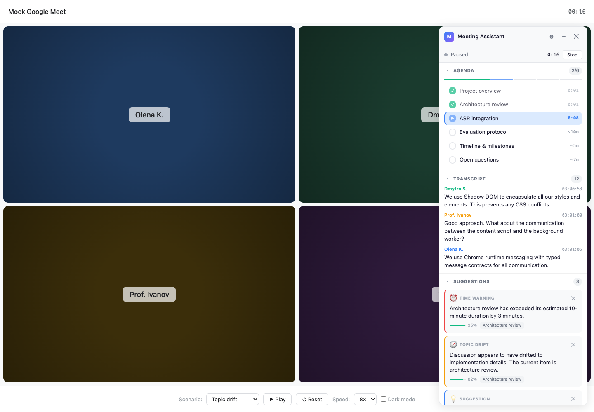

Панель складається з рядка стану й трьох секцій (рис. 4.2, а). Секція адженди показує пункти з позначками статусу, смугу поступу й час. Секція транскрипту показує останні репліки; ім’я кожного мовця має власний колір із палітри у вісім кольорів, призначений у порядку першої появи. Секція підказок показує картки: тип, текст, смугу впевненості, назву пункту й кнопку відхилення.

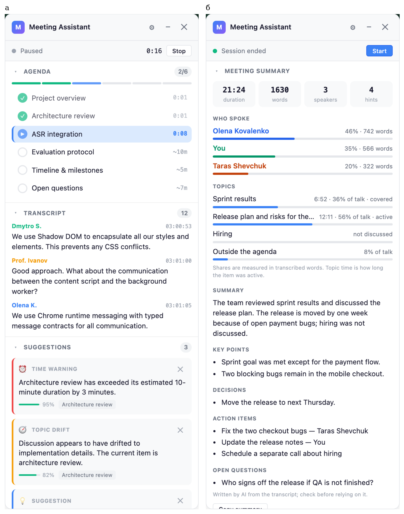

Рядок стану відображає один із чотирьох станів запису — очікування, запис, пауза, завершено — і таймер зустрічі. Таймер змінює режим лише за справжньої зміни стану запису: періодичні знімки стану, що надходять кожні п’ять секунд, спершу помилково перезапускали його.

Ненав’язливість забезпечено кількома рішеннями. Панель займає вузьку смугу збоку; її можна згорнути або закрити, а положення, тему й розмір шрифту — змінити. Нові підказки не супроводжуються звуком і не перехоплюють фокус, а їх кількість обмежена ще на сервері. Відхилена підказка зникає одразу, і сервер фіксує це в журналі.

Після зупинки запису показується панель підсумку (рис. 4.2, б): спершу статистика — тривалість, кількість слів, мовців і підказок, частка кожного мовця, час і частка розмови для кожного пункту, — а через одну-дві секунди змістовий звіт. Примітка під статистикою пояснює, що частки виміряно в словах. Якщо звіт сформувати не вдалося, показується причина.

## 4.4 Інтеграція реалізованих модулів і демонстраційний сценарій

Повний сценарій роботи виглядає так.

1. Користувач запускає сервер, встановлює розширення й складає у спливному вікні адженду.
2. Користувач приєднується до зустрічі; скрипт вмісту виявляє її за адресою сторінки й ознаками розмітки та показує панель.
3. Користувач натискає кнопку запуску. Сервісний процес призначає новий ідентифікатор зустрічі, очищає попередні транскрипт і підказки, скидає поступ адженди, підключається до сервера й надсилає `CONNECT` з аджендою.
4. Скрипт вмісту вмикає субтитри й читає їх; адженда, транскрипт і підказки оновлюються в панелі.
5. Користувач натискає кнопку зупинки; сервер надсилає статистику, потім звіт, і клієнт закриває з’єднання.

Правило «кожен запуск — нова зустріч» (крок 3) з’явилося після перших перевірок, коли повторний запуск продовжував попередню зустріч і в транскрипті змішувалися репліки двох розмов.

Для демонстрації без справжньої зустрічі слугує сторінка, що імітує Meet і відтворює один із чотирьох заготовлених сценаріїв. Знімки на рис. 4.1 і 4.2 зроблено на ній, тому тексти на них англомовні й не є результатом роботи агентів: вони ілюструють вигляд інтерфейсу, а не якість аналізу.

## 4.5 Перевірка дозволів, запуску захоплення, відновлення після переривання та поведінки при завершенні зустрічі

Перевірку виконано автоматичними тестами, на демонстраційній сторінці та на пілотних зустрічах (табл. 4.3).

**Таблиця 4.3 — Перевірка поведінки розширення**

| Що перевірялося | Очікувана поведінка | Результат |
|---|---|---|
| Запуск запису | Запис починається лише за дією користувача; стан видно постійно | Підтверджено на пілотних зустрічах |
| Увімкнення субтитрів | Субтитри вмикаються автоматично; рідна область прихована | Підтверджено на пілотних зустрічах: транскрипт надходив без ручного ввімкнення |
| Мовлення локального користувача | Потрапляє в транскрипт з іменем; не потрапляє при вимкненому мікрофоні | Випливає з побудови субтитрів Meet; у сесіях 09.10.2026 транскрипт містив двох мовців; окремого протоколу перевірки немає |
| Повторне передавання мовлення | Кожне слово передається один раз | Підтверджено тестами алгоритму 3.1; на зустрічах — за правдоподібним темпом мовлення в журналах |
| Обрив з’єднання із сервером | Повторне підключення із затримкою, що подвоюється від 1 с до 30 с | Реалізовано; окремого протоколу перевірки немає |
| Завершення зустрічі | Після зупинки показується статистика, потім звіт | Сервер сформував і надіслав підсумок у п’яти пілотних сесіях |

Три проблеми експлуатації варто зафіксувати як досвід.

Перша стосується життєвого циклу розширення. Після збирання нової версії старий сервісний процес продовжує обслуговувати відкриті вкладки, а старі скрипти вмісту завершуються помилкою про недійсний контекст. Зовні це виглядало як зникнення підсумку після зупинки. Надійна послідовність — зібрати, оновити розширення, перезавантажити вкладку Meet.

Друга — автоматичний перезапуск сервера за зміни будь-якого файлу репозиторію: редагування файлів під час зустрічі переривало сесію, і кілька пілотних зустрічей завершилися без підсумку. Звідси правило не змінювати файли, доки триває запис.

Третя — адженда надсилається серверу лише в повідомленні `CONNECT`, тому її редагування під час зустрічі оновлює панель, але не серверний стан. Усунення цього обмеження потребує нового повідомлення протоколу й віднесено до подальшої роботи.

# 5 Реалізувати логіку взаємодії розроблених ШІ-агентів між собою та зовнішніми API мовних моделей, забезпечивши мінімальну затримку прийняття рішень

Розділ описує, як у системі використано мовну модель: схему обміну даними, формат запиту й відповіді, роботу з частковими й фінальними результатами, обмеження часу й частоти, обробку помилок. Окремо розглянуто вартість звернень, яка виявилася самостійним проєктним обмеженням. Розділ відповідає завданню 5 технічного завдання.

## 5.1 Схема обміну даними між транскрипцією, LLM і агентом моніторингу

Мовна модель виконує дві ролі виконавця й жодної ролі координатора: генератор підказок періодично отримує адженду й останні репліки та повертає підказки разом з оцінкою обговорюваного пункту, а агент підсумку один раз після зупинки запису формує звіт. Обидві ролі звертаються до моделі через спільну точку входу з єдиним клієнтом, таймаутом, автоматичним вимикачем і обліком токенів, тож жоден виклик не оминає обліку й лімітів.

Схему обміну показано на рис. 5.1. Дані рухаються в одному напрямку: зі сховища стану формується запит, відповідь розбирається кодом, і лише перевірений результат потрапляє далі.

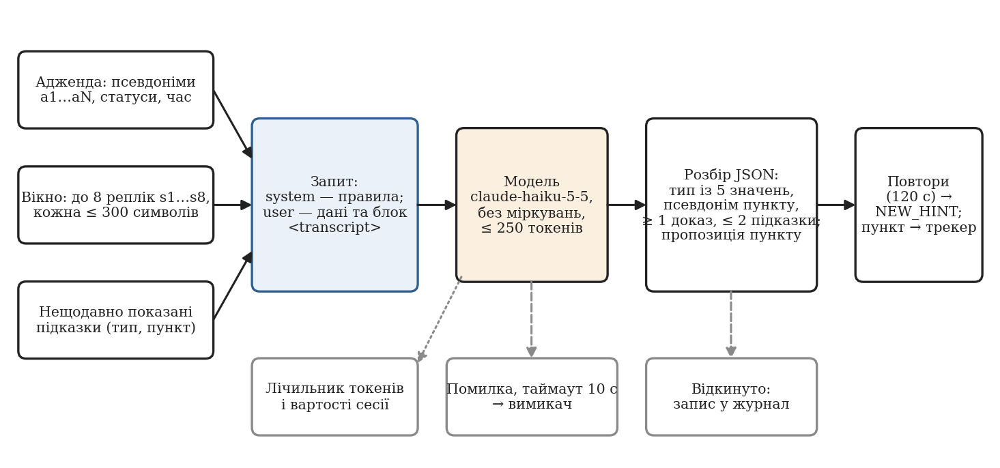

Для звернень використано Anthropic Messages API, у якому запит складається із системної підказки та послідовності повідомлень, обов’язково задається верхня межа кількості вихідних токенів, а відповідь містить причину зупинки й кількість використаних вхідних і вихідних токенів [53]. Модель за замовчуванням — `claude-haiku-5-5`, найдешевша в лінійці на дату вибору; її можна замінити змінною середовища без зміни коду.

## 5.2 Формат запиту та структурованої відповіді LLM; прив’язка відповіді до контексту й пункту адженди

### 5.2.1 Побудова запиту

Запит складається з двох частин, розділених відповідно до принципу «транскрипт — недовірений вхід» (п. 1.2.7). Системна підказка містить лише правила: роль моделі, опис входу, формат відповіді, допустимі типи підказок і вказівку, що текст транскрипту є даними, а не інструкціями. Користувацьке повідомлення містить дані в такому порядку: адженда зі статусами й часом, позначка активного пункту, перелік нещодавно показаних підказок і, наприкінці, блок `<transcript>` з останніми репліками. Стабільний вміст розташовано на початку, мінливий — наприкінці: це відповідає спостереженню, що модель найкраще використовує кінець контексту [22], і залишає можливість кешування префікса, якщо він колись стане достатньо довгим.

Контекст обмежено вікном з останніх восьми фінальних реплік, кожну обрізано до 300 символів; імена мовців не передаються. Замість справжніх ідентифікаторів використано короткі псевдоніми (`a1`, `a2`, … для пунктів, `s1`, `s2`, … для реплік), які код після відповіді відображає назад: справжній ідентифікатор репліки — це 36 символів, які модель мала б прочитати й повторити. Приклад користувацького повідомлення (зміст реплік умовний):

```
Agenda:
a1 [active] Статус спринту (95s of 2min)
a2 [pending] План релізу (0s of 2min)
Active: a1

Shown: topic_drift a1

<transcript>
s1: Із п'ятнадцяти задач дванадцять закрито, три в роботі.
s2: До речі, хтось уже бронював готель на конференцію?
s3: Гаразд, а коли ми реально зможемо випустити наступну версію?
s4: За графіком це наступна середа, але є ризики.
</transcript>
```

### 5.2.2 Структура відповіді

Модель має повернути один об’єкт JSON без супровідного тексту. Ключі навмисно скорочено, оскільки вихідні токени коштують уп’ятеро дорожче за вхідні (табл. 5.1).

**Таблиця 5.1 — Поля відповіді генератора підказок**

| Ключ | Зміст | Обмеження, які перевіряє код |
|---|---|---|
| `active` | Псевдонім пункту, якого стосуються останні репліки, або `null` | Має бути псевдонімом наявного пункту |
| `ac` | Упевненість у полі `active` | Число від 0 до 1; для зміни пункту потрібно ≥ 0,7 |
| `ae` | Псевдоніми реплік-свідчень для `active` | Хоча б одна наявна репліка |
| `hints` | Масив підказок, не більше двох | Зайві елементи відкидаються |
| `hints[].t` | Тип підказки | Одне з п’яти значень |
| `hints[].a` | Псевдонім пункту | Наявний пункт; для відхилення від теми — активний |
| `hints[].m` | Текст підказки | Непорожній рядок; за інструкцією — одне речення до 20 слів мовою розмови |
| `hints[].e` | Псевдоніми реплік-свідчень | Хоча б одна наявна репліка |
| `hints[].c` | Упевненість | Приводиться до відрізка [0, 1] |

Типів підказок п’ять: пропозиція щодо адженди (`agenda_suggestion`), відхилення від теми (`topic_drift`), перевищення часу (`time_warning`), пропущений пункт (`missed_item`) і короткий підсумок (`summary`). Відповідь на наведений вище запит могла б мати такий вигляд:

```
{"active":"a2","ac":0.8,"ae":["s3","s4"],
 "hints":[{"t":"agenda_suggestion","a":"a2",
           "m":"Розмова перейшла до плану релізу; зафіксуйте підсумок статусу спринту.",
           "e":["s3"],"c":0.8}]}
```

Якщо підказувати нічого, модель повертає порожній масив `hints`. Інструкція розрізняє дві ситуації: якщо розмова не відповідає жодному пункту, слід повернути підказку про відхилення; якщо вона перейшла до іншого пункту плану — заповнити поле `active`.

### 5.2.3 Перевірка відповіді кодом

Відповідь моделі не виконується — вона розбирається. Якщо розбір JSON не вдається, відповідь відкидається повністю. Далі кожна підказка перевіряється окремо: тип має належати закритій множині; псевдонім пункту — відповідати наявному пункту; серед свідчень має бути хоча б одна репліка із запиту; текст — бути непорожнім. Підказка, що не проходить перевірку, відкидається із записом причини в журнал.

Перевірка реалізує заходи з переліку OWASP [25]: формат відповіді перевіряється, зовнішній вміст відокремлено, привілеї моделі мінімальні. Найгірший наслідок успішної ін’єкції — зайва підказка або зміна активного пункту на інший наявний у межах дозволених переходів. Структурованими відповідями з гарантованою JSON-схемою [54] прототип не користується, бо власна перевірка все одно потрібна для існування ідентифікаторів.

### 5.2.4 Агент підсумку

Після зупинки запису формується підсумок із двох частин. Статистику — тривалість, кількість слів, частку кожного мовця, час і частку слів для кожного пункту — обчислює звичайний код. Частки вимірюються у словах транскрипту, бо сервер отримує лише текст.

Змістовий звіт формує модель одним викликом за аджендою й усім фінальним транскриптом. Імена мовців замінюються псевдонімами `P1`, `P2`, … і відновлюються кодом після відповіді, тож до зовнішньої служби не потрапляють. Модель повертає короткий підсумок, ключові тези, рішення, завдання з відповідальними та відкриті питання.

Виклик обмежено: транскрипт має містити не менше 30 слів; не має бути перевищено ліміт вартості сесії; вхід обмежено 40 000 символів, вихід — 700 токенами. Будь-яка невдача завершується резервним звітом із кодом причини, а статистика показується в будь-якому разі.

## 5.3 Робота з частковими й фінальними результатами транскрипції

Двоканальну обробку (п. 1.2.1) реалізовано наскрізно. Часткова гіпотеза відображається в панелі транскрипту, замінюючи попередню з тим самим ідентифікатором сегмента; оркестратор для неї не викликає жодного агента. Фінальний сегмент проходить детермінований аналіз і поповнює лічильник нових слів, за яким вирішується, чи запускати модель.

До моделі потрапляють лише фінальні сегменти: вона не витрачає токени на текст, який за секунду зміниться, але до затримки підказки додається час стабілізації рядка. Сегменти, що надійшли під час виклику, увійдуть до наступного. Оскільки рядок субтитрів фіксується після кожної паузи мовця, вікно з восьми сегментів може охоплювати менше розмови, ніж вісім повних реплік; чи достатньо його без ковзного резюме, яке реалізовано, але вимкнено, — відкрите питання.

## 5.4 Обмеження часу, контроль повторних запитів, обробка помилок і недоступності API

### 5.4.1 Фоновий виклик і таймаути

У першій версії виклик моделі виконувався всередині обробки сегмента. Вимірювання на живій сесії показало наслідок: відповідь моделі надійшла через 1934 мс, і рівно стільки ж тривала обробка сегмента, тобто оновлення адженди на екрані затримувалося на дві секунди щоразу, коли викликалася модель. Після цього виклик винесено у фонове завдання `asyncio`: обробка сегмента завершується одразу після детермінованих агентів, а підказки доставляються пізніше через зареєстрований канал. У наступних сесіях обробка фінального сегмента тривала одиниці мілісекунд незалежно від моделі.

Час виклику генератора підказок обмежено таймаутом 10 с, агента підсумку — 20 с. Під час зупинки запису сервер чекає на незавершений виклик не довше таймауту плюс одна секунда, тому підсумок може з’явитися із затримкою до 11 с.

### 5.4.2 Правила запуску й ліміти

Правила запуску з їхніми значеннями зведено в табл. 5.2.

**Таблиця 5.2 — Механізми обмеження викликів мовної моделі (значення за замовчуванням)**

| Механізм | Параметр і значення | Призначення |
|---|---|---|
| Єдиний одночасний виклик | одне фонове завдання на сесію | Немає паралельних запитів і гонок відповідей |
| Мінімальний інтервал | 45 с | Обмеження частоти викликів |
| Поріг нового мовлення | 50 слів | Виклик лише за наявності нового матеріалу |
| Відкладений запуск після паузи | 20 с тиші, щонайменше 12 слів | Аналіз мовлення, після якого настала тиша |
| Ліміт викликів | 200 на сесію | Запобіжник від некерованого зростання |
| Ліміт вартості | 0,05 дол. США на сесію | Справжня жорстка межа витрат |
| Пригнічення повторів | той самий тип і пункт — не частіше ніж раз на 120 с | Користувач не бачить дублікатів |
| Підказка про час | для одного пункту не частіше ніж раз на 300 с | Те саме для детермінованих підказок |

Після досягнення ліміту система переходить у детермінований режим: адженда відстежується лексично, підказки про час формуються, зникають лише семантичні підказки. Цей режим закладено як штатний.

### 5.4.3 Автоматичний вимикач

Недоступність служби обробляє автоматичний вимикач (рис. 5.2), побудований за шаблоном, описаним у п. 1.1.6. Після трьох послідовних невдалих викликів — помилок API або таймаутів — вимикач розмикається, і протягом 60 с виклики не виконуються взагалі. Далі дозволяється один пробний виклик: успіх повертає вимикач у замкнений стан, невдача знову розмикає його на 60 с. Поки вимикач розімкнено, система працює в тому самому детермінованому режимі, що й після вичерпання ліміту.

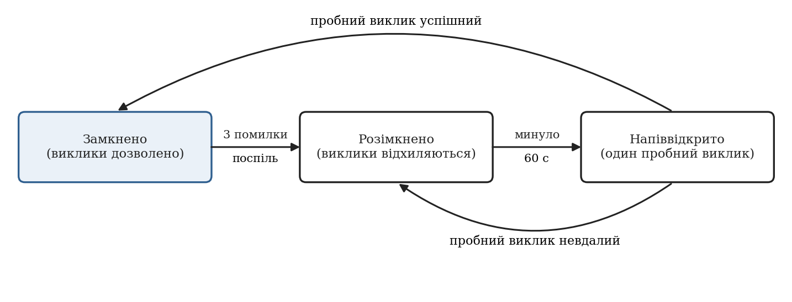

### 5.4.4 Вартість як проєктне обмеження

Перша версія прототипу викликала модель середнього класу після кожної фінальної репліки, передавала вікно з 20 реплік і дозволяла відповідь до 1024 токенів. За кілька коротких тестових зустрічей вона витратила близько 0,90 дол. США. Це спостереження автора за балансом облікового запису; журналювання викликів тоді не було, тому суму неможливо розкласти за викликами. Реконструкція за моделлю (1.3) показує, що така сума відповідає приблизно 10–24 хвилинам тестування; це оцінка, а не вимірювання.

Аналіз за моделлю вартості виявив три множники: ціну моделі (різниця з найдешевшою — у 20 разів), частоту викликів і розмір виклику, зокрема приховані токени міркувань: якщо параметр міркувань не задано, модель `claude-haiku-5-5` застосовує адаптивні міркування, токени яких тарифікуються як вихідні. Для класифікації кількох реплік вони не потрібні, тому їх вимкнено. Загалом ужито вісім заходів: найдешевша модель; обмеження частоти викликів; вікно з восьми реплік без імен мовців; короткі псевдоніми й ключі відповіді (відповідь із підказкою скоротилася з 215 до близько 90 токенів, хоча це спостереження на різних розмовах); вимкнені міркування; перелік уже показаних підказок у запиті; відмова від ковзного резюме; облік токенів із жорстким лімітом вартості.

Два важелі розглянуто й не застосовано. Кешування підказок вимагає префікса не менше 512 токенів для обраної моделі [27], тоді як незмінна частина запиту (системна підказка й адженда) має довжину того самого порядку або меншу; за ціни 0,10 дол. за мільйон вхідних токенів виграш становив би частки цента на сесію. Пакетний режим зі знижкою 50 % повертає результат із затримкою до доби [26] і несумісний із підказками в реальному часі; він придатний для підсумку зустрічі та для майбутніх оцінювальних прогонів.

## 5.5 Обмеження й ризики: затримка мережі/API, неповна транскрипція, неоднозначний контекст, доступ до аудіо та даних зустрічі

Обмеження й ризики інтеграції зведено в табл. 5.3 разом із заходами, які їх пом’якшують, і залишковим ризиком.

**Таблиця 5.3 — Ризики інтеграції мовної моделі та заходи щодо них**

| Ризик | Прояв | Захід | Залишковий ризик |
|---|---|---|---|
| Затримка мережі або API | Підказка запізнюється | Фоновий виклик; таймаут 10 с | Підказка може стосуватися вже завершеної теми |
| Недоступність API | Немає семантичних підказок | Автоматичний вимикач; детермінований режим | Немає виявлення відхилень до відновлення |
| Неповна або помилкова транскрипція | Хибні збіги й пропуски | Свідчення для кожного рішення; поріг упевненості | Якість цілком залежить від субтитрів Meet |
| Неправильна мова субтитрів | Текст не має змісту | Попередження користувачеві в документації | Мова субтитрів задається в Meet і розширенням не керується |
| Ворожий вміст транскрипту | Спроба керувати моделлю | Розділення даних та інструкцій; перевірка кодом | Можлива зайва підказка |
| Передавання тексту зовнішній службі | Зміст розмови залишає систему | Лише вікно з 8 реплік без імен; псевдоніми в підсумку | Потрібна згода учасників |

Найвагоміших ризиків два. Семантичне перемикання пункту відбувається лише разом із викликом моделі, тобто може відставати від зміни теми на інтервал між викликами. Якість цілком залежить від субтитрів: якщо в Meet обрано не ту мову, українське мовлення перетворюється на безглуздий текст, який система опрацює без жодного попередження.

# 6 Провести тестування системи в сценаріях реальних онлайн-зустрічей, оцінити точність координації агентів та швидкість їхнього реагування на зміну теми розмови

Розділ подає результати оцінювання й відповідає завданню 6 технічного завдання. Оцінювання має дві частини різної природи: офлайн-експерименти на синтетичних сценаріях, де еталон відомий із побудови, а мовну модель замінено заглушкою, та аналіз журналів пілотних сесій на справжніх зустрічах зі справжньою моделлю. Якість підказок мовної моделі, WER субтитрів і наскрізну затримку не виміряно (п. 6.6.3).

## 6.1 Мета, конфігурація та умови експерименту

Мета оцінювання — відповісти на питання, які огляд залишив відкритими (підрозділ 1.6), у тій мірі, у якій це можливо без розмічених живих даних:

- П1. Наскільки точно детермінований шар відстежує активний пункт і переходи між пунктами на сценаріях із відомим еталоном?
- П2. Наскільки він стійкий до помилок розпізнавання та до перефразування?
- П3. Скільки часу займає детермінована обробка репліки й відповідь мовної моделі?
- П4. Як параметри обмеження частоти впливають на кількість викликів, вартість і затримку очікування?
- П5. Якою є фактична вартість звернень до моделі на справжніх зустрічах?

Виконано шість експериментів. Е1 — точність детермінованого шару на сценаріях С1–С5; Е2 — те саме без явної репліки відкриття пункту та на сценарії перефразування С6; Е3 — стійкість до штучних спотворень тексту; Е4 — час детермінованої обробки; Е5 — вплив параметрів запуску на кількість викликів, вартість і затримку очікування (симульований час, заглушка замість моделі, тому вартість є оцінкою); Е6 — час відповіді моделі, токени, вартість і затримка очікування за журналами 11 пілотних сесій із моделлю `claude-haiku-5-5` (вимірювання на малій вибірці).

Офлайн-експерименти виконано 09.10.2026 на комп’ютері з процесором архітектури ARM (macOS, Python 3.11.17). Сценарії пропускаються через справжній оркестратор; в експериментах Е1–Е4 ліміт викликів моделі дорівнює нулю. Усі експерименти відтворюються скриптами з репозиторію. Пілотні сесії проведено автором 8–9 жовтня 2026 р. в Google Meet з аджендою з двох пунктів і одним–трьома учасниками; сервер працював локально. Журнал містить лише лічильники: текст розмов не зберігався.

## 6.2 Дані й тестові сценарії; спосіб формування еталонних міток для станів адженди

Сценарії С1–С5 (табл. 3.5) разом містять 374 фінальні репліки й охоплюють 52,9 хвилини симульованого часу. Кожен зібрано з чотирьох тематичних наборів реплік — по одному на пункт адженди («Статус спринту», «Блокери розробки», «План релізу», «Бюджет тестування») — та набору реплік поза аджендою.

Еталонним активним пунктом після репліки є пункт набору, з якого її взято, а для репліки поза аджендою — попередній активний пункт, оскільки відхилення не закриває пункту. Еталонний перехід — репліка, на якій еталонний пункт змінюється.

Мітки не потребують ручної праці, але сценарій і правила писала одна людина, а перша репліка кожного набору містить назву пункту й фразу переходу. Щоб послабити цю залежність, в експерименті Е2 з кожного блоку вилучено першу репліку («тиха» зміна теми), а сценарій С6 написано окремо: чотири пункти обговорюються по п’ять реплік без жодного слова з назв.

В експерименті Е3 кожне слово з імовірністю q замінюється випадковим словом зі словника сценаріїв (60 % спотворень), вилучається (25 %) або доповнюється вставленим словом (15 %); для кожного q виконано 20 прогонів. Це імітація: справжні помилки розпізнавання фонетично зумовлені, тож результат показує чутливість алгоритму до втрати слів, а не поведінку на справжніх субтитрах.

Журнал містить 15 сесій із хоча б одним викликом моделі. Чотири вилучено: одну записано до впровадження алгоритму 3.1, а в трьох темп мовлення за журналом становив від 1626 до 6592 слів за хвилину, що свідчить про повторне надходження тексту (критерій — понад 250 слів за хвилину; причину остаточно не встановлено). До оцінки вартості увійшли 11 сесій загальною тривалістю 41,5 хвилини (421 фінальний сегмент, 4018 слів). Час відповіді моделі від повторів тексту не залежить, тому для нього використано всі 53 виклики підказок і 8 викликів підсумку.

## 6.3 Метрики точності: наприклад, precision, recall і F1 для виявлення релевантного пункту/відхилення; WER — окремо для якості транскрипції, якщо доступний еталонний текст

### 6.3.1 Точність детермінованого шару (Е1, Е2)

Результати наведено в табл. 6.1 і на рис. 6.1. На чотирьох сценаріях із п’яти детермінований шар не припустився жодної помилки ні в базовому, ні в ускладненому варіанті; у С2 і С5 під час 12 реплік поза аджендою активний пункт не змінювався.

**Таблиця 6.1 — Точність детермінованого шару на синтетичних сценаріях**

| Сценарій | Реплік | Частка правильних реплік, % | Переходи: еталон / виявлено | P | R | F1 | Правильні підсумкові статуси |
|---|---|---|---|---|---|---|---|
| С1, рух за планом | 38 | 100 | 4 / 4 | 1,00 | 1,00 | 1,00 | 4 із 4 |
| С2, відхилення й повернення | 38 | 100 | 3 / 3 | 1,00 | 1,00 | 1,00 | 3 із 3 |
| С3, пропущений пункт | 32 | 71,9 | 3 / 4 | 0,75 | 1,00 | 0,86 | 2 із 4 |
| С4, перевищення часу | 44 | 100 | 2 / 2 | 1,00 | 1,00 | 1,00 | 2 із 2 |
| С5, довга зустріч | 222 | 100 | 4 / 4 | 1,00 | 1,00 | 1,00 | 4 із 4 |
| С1–С5 разом | 374 | 97,6 | 16 / 17 | 0,94 | 1,00 | 0,97 | 15 із 17 |
| С3 без репліки відкриття | 29 | 69,0 | 3 / 4 | 0,75 | 1,00 | 0,86 | 2 із 4 |
| С6, перефразування | 20 | 25,0 | 4 / 1 | 0,00 | 0,00 | 0,00 | 0 із 4 |

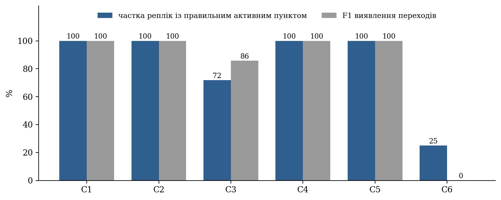

Помилка в сценарії С3 показова. Перехід від другого пункту до четвертого («Бюджет тестування») система виявила правильно. Проте в четвертій репліці про бюджет трапилася фраза «автоматизація окупиться приблизно за два релізи»: слово збіглося з основою слова з назви третього пункту, і за правилом 2 активним став «План релізу». Четвертий пункт перейшов у covered, звідки повернення немає, і дев’ять реплік поспіль система показувала хибний активний пункт. Одна лексична помилка, помножена на незворотність закриття, дала 28 % хибних реплік.

Сценарій С6 показує межу лексичного підходу: жодного з чотирьох переходів не виявлено, а єдина зміна стану була хибною — у репліці «Із п’ятнадцяти запланованих задач дванадцять уже закрито» підрядок «план» збігся зі словом назви «План релізу». Частка 25 % утворилася випадково: п’ять реплік про реліз збіглися з хибно активованим пунктом. Точність семантичного шляху на цьому сценарії не вимірювалася, бо це потребує платних звернень до моделі.

У сценаріях С2 і С4 сформовано рівно по одній підказці про перевищення часу, через 5 і 6 с після перетину порога (3.3).

### 6.3.2 Стійкість до спотворень тексту (Е3)

Залежність точності від частки спотворених слів показано на рис. 6.2. За 5 % спотворень частка правильних реплік падає з 97,6 до 80,1 ± 10,5 %, за 10 % — до 71,6 ± 13,2 %, за 20 % — до 54,9 ± 8,9 %; F1 переходів знижується повільніше: 0,87, 0,82 і 0,70 відповідно.

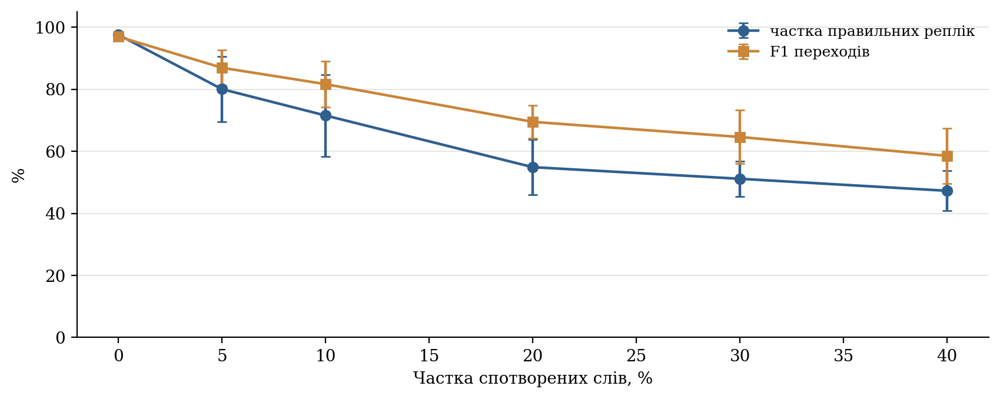

Розбіжність між показниками має те саме пояснення, що й помилка в С3: переходи здебільшого виявляються, але кожне хибне перемикання закриває пункт незворотно, і всі подальші репліки стають хибними. Отже, шар крихкий не до втрати слів як такої, а до хибних збігів, наслідки яких не виправляються; головний резерв точності — у можливості виправити помилку.

### 6.3.3 Спостереження за семантичним шаром у пілотних сесіях

Точність семантичного шару не вимірювалася, але журнали описують його поведінку (табл. 6.2). За типами серед 31 показаної підказки переважають відхилення від теми (17), далі підказки про час (8), пропозиції щодо адженди (5) і пропущений пункт (1). Жодна відповідь не була обрізана за лімітом токенів.

**Таблиця 6.2 — Спостереження за семантичним шаром в 11 пілотних сесіях**

| Показник | Значення |
|---|---|
| Викликів генератора підказок | 45 |
| Із них із принаймні однією прийнятою підказкою | 30 |
| Підказок показано: від моделі / детермінованих | 24 / 7 |
| Підказок моделі відкинуто як повтори | 6 |
| Змін активного пункту за пропозицією моделі | 3 (упевненість 0,8 у кожній) |
| Пропозицій відхилено: низька впевненість / недозволений перехід | 1 (0,6) / 1 |
| Викликів, запущених таймером паузи | 12 |
| Підказок, закритих користувачем | 17 із 31 |

Семантичне перемикання спрацювало на живих зустрічах тричі. Одну пропозицію відхилено через упевненість 0,6; через 48 с модель повторила її з упевненістю 0,8, і перемикання відбулося — приклад запізнення. Ще одну відхилено як недозволений перехід: модель запропонувала повернутися до розглянутого пункту — та сама незворотність, що й у сценарії С3.

Ці числа описують поведінку механізмів, а не якість рішень: чи були підказки доречними, журнал не фіксує. Закриття користувачем 17 підказок із 31 не можна тлумачити однозначно. Якість субтитрів Meet для української (WER) не вимірювалася через відсутність еталонних розшифровок.

## 6.4 Метрики швидкодії: час від аудіосегмента до транскрипту, від транскрипту до рішення, наскрізна затримка; подавати медіану й p95, а також опис умов вимірювання

Із семи складників затримки (1.2) виміряно три: L_det, L_gate і L_llm (табл. 6.3, рис. 6.3). Решта потребує позначок часу на боці розширення, тому наскрізну затримку не виміряно.

**Таблиця 6.3 — Виміряні складники затримки**

| Складник | Джерело даних | Кількість спостережень | Медіана | p95 | Максимум |
|---|---|---|---|---|---|
| L_det, детерміновані агенти | Е4, офлайн | 1870 реплік | 0,04 мс | 0,13 мс | 0,75 мс |
| L_det разом із перевіркою й журналюванням | Е6, пілотні сесії | 991 репліка | менше 1 мс | 2 мс | 23 мс |
| L_gate, очікування виклику | Е5, симуляція | 373 репліки | 23 с | 41 с | 42 с |
| L_gate, очікування виклику | Е6, пілотні сесії | 388 реплік | 22,6 с | 46,7 с | 73,7 с |
| L_llm, підказки | Е6, пілотні сесії | 53 виклики | 1,12 с | 1,50 с | 1,80 с |
| L_llm, підсумок | Е6, пілотні сесії | 8 викликів | 1,84 с | 2,31 с | 2,38 с |

Детермінована обробка триває соті частки мілісекунди; у журналах живих сесій, де час охоплює також перевірку повідомлення, вона не перевищила 23 мс. Час відповіді моделі для підказок зосереджений між 0,7 і 1,8 с; таймаут не спрацював жодного разу. Розподіл побудовано за 53 викликами з однієї мережі, тому 95-й перцентиль орієнтовний.

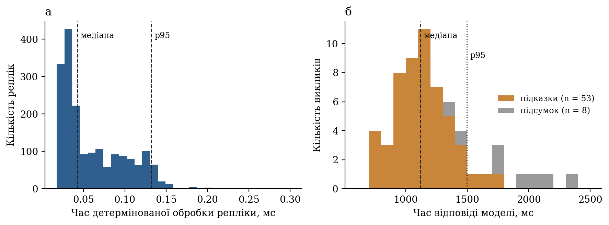

Очікування виклику є найбільшим складником: медіана 22,6 с, 95-й перцентиль 46,7 с, максимум 73,7 с. Симуляція дала близькі значення (23 і 41 с), що підтверджує придатність стенда. Максимум перевищив проєктну ціль 60 с: це трапляється, коли після виклику мовлення надходить повільно й поріг у 50 слів досягається пізніше, ніж спливає мінімальний інтервал.

Отже, типовий шлях від фінальної репліки на сервері до готової підказки становить близько 24 с, а в гіршому з поширених випадків — близько 48 с. Це прийнятно для ініціативної підказки й неприйнятно для реакції на дію користувача; тому все, на що користувач дивиться безпосередньо, оновлюється швидким шляхом.

## 6.5 Порівняння з обґрунтованим базовим варіантом (наприклад, єдиний послідовний LLM-конвеєр або без координації агентів), якщо він реалізований

### 6.5.1 Базові варіанти

Для точності базовим є детермінований шар без мовної моделі (підрозділ 6.3); порівняти з ним гібридний режим кількісно поки неможливо. Для вартості й затримки базовим є єдиний послідовний конвеєр — перша версія, у якій модель викликалася після кожної репліки. Її відтворено на стенді як конфігурацію К0, а далі зміни вводилися по одній (табл. 6.4, рис. 6.4). Час на стенді симульований, модель замінено заглушкою, а кількість токенів оцінюється евристикою, каліброваною на одному справжньому виклику; тому вартість у таблиці — оцінка, а не вимірювання.

**Таблиця 6.4 — Порівняння конфігурацій на стенді відтворення (сценарії С1–С5; вартість — оцінка)**

| Конфігурація | Викликів (із них резюме) | Викликів за годину | Оцінка вартості, дол. США за годину | Затримка очікування: медіана / максимум, с |
|---|---|---|---|---|
| К0: перша версія (модель середнього класу, виклик на кожну репліку, вікно 20) | 409 (35) | 464 | 2,34 – 5,79 | 0 / 0 |
| К1: К0 з найдешевшою моделлю | 409 (35) | 464 | 0,12 – 0,29 | 0 / 0 |
| К2: К1 з обмеженням частоти (45 с, 50 слів) | 101 (35) | 115 | 0,028 – 0,060 | 22 / 42 |
| К3: К2 з вікном 8, без міркувань і без резюме | 66 (0) | 75 | 0,0064 – 0,0143 | 22 / 42 |
| К4: поточні значення за замовчуванням | 66 (0) | 75 | 0,0064 – 0,0143 | 22 / 42 |

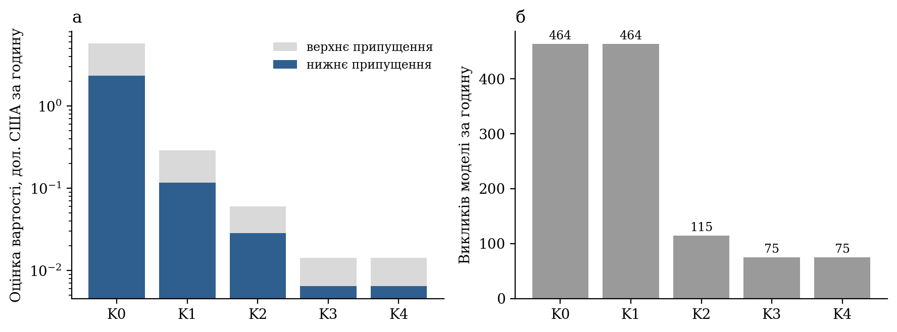

Заміна моделі зменшує оцінену вартість у 20 разів. Обмеження частоти зменшує кількість викликів підказок у 5,7 раза, але загальну — лише в 4 рази, доки ввімкнено ковзне резюме. Сумарно оцінена вартість знижується приблизно у 360–400 разів, а платою є затримка очікування з медіаною 22 с.

### 6.5.2 Компроміс між вартістю та затримкою

На тому самому стенді виконано перебір мінімального інтервалу (0–120 с) і порогу слів (0–100); результати показано на рис. 6.5. За порогу 50 слів обране значення 45 с дає 75 викликів за годину та затримку очікування 23 с (медіана), 41 с (95-й перцентиль) і 42 с (максимум); за 60 с — 56 викликів за годину, 95-й перцентиль 56 с і п’ять реплік, що не потрапили в жоден виклик; за 90 с таких реплік уже 117 із 374.

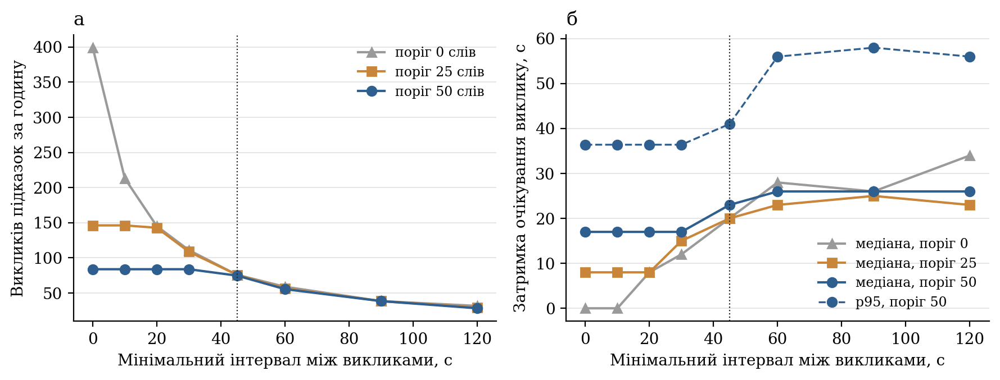

За порогу 50 слів інтервал до 30 с нічого не змінює: частоту визначає поріг слів. Зі збільшенням інтервалу понад 60 с вартість зменшується повільно, а кількість реплік, які не потрапили в жоден виклик, різко зростає: вікно з восьми реплік не вміщує всього сказаного між викликами. Обране значення 45 с лежить на межі, за якою починаються втрати. Без обмеження частоти стенд дає оцінку 0,034–0,076 дол. за годину, тобто проєктна ціль не досягається навіть із найдешевшою моделлю. Якість підказок — третя вісь компромісу — не виміряна, тому твердити, що обрана точка оптимальна, не можна.

### 6.5.3 Виміряна вартість пілотних сесій

Фактичні витрати наведено в табл. 6.5. В 11 сесіях загальною тривалістю 41,5 хвилини зроблено 45 викликів підказок і 5 викликів підсумку; сумарна вартість, обчислена за виміряними токенами й опублікованими цінами [26], становить 0,0060 дол. США, або 0,0087 дол. за годину зустрічі. Частота викликів підказок — 65 за годину, що близько до оцінки стенда (75).

**Таблиця 6.5 — Виміряні показники пілотних сесій**

| Сесія | Тривалість, с | Фінальних сегментів | Слів | Викликів: підказки + підсумок | Токени: вхід / вихід | Вартість, дол. | Вартість, дол. за годину |
|---|---|---|---|---|---|---|---|
| 1 | 185 | 9 | 325 | 4 + 0 | 2758 / 276 | 0,00041 | 0,0080 |
| 2 | 137 | 9 | 88 | 2 + 1 | 2341 / 215 | 0,00034 | 0,0090 |
| 3 | 347 | 21 | 150 | 4 + 0 | 2273 / 85 | 0,00027 | 0,0028 |
| 4 | 155 | 16 | 146 | 2 + 0 | 1280 / 8 | 0,00013 | 0,0031 |
| 5 | 72 | 5 | 87 | 1 + 0 | 529 / 77 | 0,00009 | 0,0045 |
| 6 | 447 | 84 | 722 | 8 + 1 | 8023 / 796 | 0,00120 | 0,0097 |
| 7 | 382 | 100 | 741 | 8 + 0 | 4986 / 459 | 0,00073 | 0,0069 |
| 8 | 143 | 34 | 224 | 3 + 1 | 3713 / 542 | 0,00064 | 0,0162 |
| 9 | 189 | 66 | 312 | 4 + 0 | 2706 / 341 | 0,00044 | 0,0084 |
| 10 | 43 | 5 | 73 | 1 + 1 | 1679 / 238 | 0,00029 | 0,0243 |
| 11 | 388 | 72 | 1150 | 8 + 1 | 10129 / 907 | 0,00147 | 0,0136 |
| Разом | 2487 | 421 | 4018 | 45 + 5 | 40417 / 3944 | 0,00601 | 0,0087 |

Вхід виклику підказок становить 438–982 токени (медіана 654). Вихід двомодальний: відповідь із підказкою займає 66–118 токенів (медіана 86), порожня — здебільшого 4. Отже, виклик без підказки коштує близько 0,00007 дол., із підказкою — близько 0,00011 дол., і понад третину вартості становить вихід, що підтверджує доцільність компактних ключів відповіді.

Виклик підсумку коштував 0,0002–0,0005 дол. Це стала плата за зустріч, помітна для коротких сесій: у сесії 10 тривалістю 43 с вона дала 0,024 дол. за годину — єдине перевищення цілі 0,02 дол. Екстраполяція на годинну зустріч залишається оцінкою: найдовша сесія тривала 7,4 хвилини. Жорсткий ліміт сесії (0,05 дол.) не досягався.

## 6.6 Результати, похибки, аналіз складних випадків і загрози валідності

### 6.6.1 Відповіді на питання оцінювання та перевірка вимог

Детермінований шар відстежує лексично впізнаваний план із точністю 97,6 % реплік і F1 = 0,97 для переходів (П1), обробляючи репліку менш ніж за мілісекунду. Його межі визначено кількісно: 80 % правильних реплік за 5 % спотворених слів, нульова повнота на перефразуванні й незворотність хибного закриття пункту (П2). Модель відповідає на запит підказок за 1,12 с (медіана) і 1,50 с (95-й перцентиль); обмеження частоти додає очікування з медіаною близько 23 с (П3, П4). Порівняно з конвеєром «виклик на кожну репліку» оцінена вартість зменшилася на два з половиною порядки, а виміряна на 11 пілотних сесіях становить 0,0087 дол. США за годину зустрічі (П5).

Щодо вимог табл. 2.2: Н1 виконано (95-й перцентиль детермінованої обробки 0,13 мс офлайн і 2 мс у живих сесіях); Н2 — частково (95-й перцентиль очікування 46,7 с, але максимум 73,7 с перевищує 60 с, а наскрізну затримку не виміряно); Н3 виконано (0,0087 дол. за годину, ліміт сесії не досягався); Н4 і Н7 підтверджено лише автоматичними тестами, бо відмов моделі на живих сесіях не було, а цілеспрямованого тестування атак не проводилося; Н5 виконано з відхиленням щодо клієнтського шляху ключа доступу; Н6 і Н8 виконано. Аналіз помилок указує на чотири напрями доопрацювання: вимагати два збіги або фразу переходу для лексичної зміни пункту й порівнювати цілі слова; дозволити повернення з covered до active за нових свідчень; знижувати поріг слів із часом очікування виклику; контролювати темп мовлення на сервері, щоб виявляти повторне надходження тексту.

### 6.6.2 Загрози валідності

Конструктна валідність. Еталонні мітки й правила створила одна людина, а репліки С1–С5 містять слова з назв пунктів, тому точність 97,6 % є верхньою оцінкою; сценарій С6 показує, наскільки вона може впасти.

Внутрішня валідність. Штучний шум не відтворює природи справжніх помилок розпізнавання. Вартість на стенді спирається на евристичну оцінку токенів. У пілотних сесіях одночасно змінювалися джерело тексту й формат запиту, тому порівняння між сесіями не є контрольованим.

Зовнішня валідність. Пілотних сесій 11, усі короткі, з однією аджендою з двох пунктів і ведучим, який є автором системи. Перенесення результатів на годинні зустрічі з довгою аджендою не обґрунтоване даними.

Надійність висновків. Вибірка мала для статистичних тверджень, тому подано описові показники без довірчих інтервалів. Причину аномалії в трьох вилучених сесіях не встановлено, отже не можна виключити, що подібне в менш помітній формі вплинуло й на залишені.

### 6.6.3 Що залишилося невиміряним

Якість підказок і підсумку потребує сценаріїв із ручною розміткою та платного прогону моделі (можливий пакетний режим зі знижкою). WER субтитрів потребує записів з еталонною розшифровкою, а наскрізна затримка — позначок часу в розширенні. До виконання цих робіт твердження про корисність підказок залишається гіпотезою.

# ВИСНОВКИ

У роботі розроблено прототип інтелектуального агентного асистента для супроводу онлайн-зустрічей у Google Meet, який під час зустрічі зіставляє розмову з наперед заданим порядком денним, веде стан кожного пункту, формує для ведучого підказки п’яти типів із посиланням на репліки-свідчення, а після завершення надає статистику участі та змістовий підсумок. За завданнями технічного завдання одержано такі результати.

1. Проаналізовано підходи до побудови мультиагентних систем і засоби оркестрації. Показано, що задача супроводу зустрічі має частково спостережуване, динамічне й послідовне середовище з двома часовими масштабами, спільним контекстом і послідовною залежністю ролей; для таких умов обґрунтовано централізовану оркестрацію, у якій порядок викликів задано кодом, а мовна модель виконує лише роль виконавця. Порівняно чотири джерела тексту й сім варіантів інтеграції з Google Meet; зважена матриця з аналізом чутливості на 20 000 наборах ваг відсіяла варіанти на основі офіційних інтерфейсів і залишила відкритим вибір між одним і двома джерелами тексту в розширенні браузера.

2. Спроєктовано архітектуру з розширення браузера та серверної частини з оркестратором і п’ятьма виконавцями: транскрибатором, аналізатором транскрипту, трекером адженди, генератором підказок і агентом підсумку. Єдиним місцем зміни спільного стану є сховище сесії; виконавці повертають описи змін. Протокол із дванадцяти типів повідомлень відокремлює швидкий детермінований шлях від повільного шляху мовної моделі.

3. Розроблено алгоритмічну основу: виділення приросту рядка субтитрів, стійке до перегляду вже показаних слів; лексичне зіставлення реплік із пунктами з грубим зведенням до основи; автомат станів пункту, що реалізує асиметрію свідчень (пункт без свідчень стає відкладеним, а не розглянутим); семантичне визначення обговорюваного пункту мовною моделлю, яке застосовується через той самий автомат за порогом упевненості; правила запуску моделі та обробки повторних і запізнілих результатів.

4. Спроєктовано й реалізовано інтеграцію з Google Meet у вигляді розширення Chrome на платформі Manifest V3. За результатами перевірки на реальних зустрічах відхилено захоплення звуку вкладки й браузерне розпізнавання; мовлення всіх учасників отримується з єдиного джерела — субтитрів Meet, що узгоджене з налаштуваннями мікрофона й дає імена мовців без передавання аудіо. Інтерфейс реалізовано панеллю в тіньовому дереві DOM із чотирма станами, картками підказок і панеллю підсумку.

5. Реалізовано взаємодію агентів із зовнішнім API мовної моделі: фоновий виклик, що не затримує детермінований шлях; запит із відокремленням правил від даних і вікном із восьми реплік; перевірку кожного елемента відповіді кодом; автоматичний вимикач і детермінований режим роботи без моделі. Вартість розглянуто як проєктне обмеження: побудовано модель вартості, виявлено три її множники й ужито вісім заходів, що діють на різні змінні моделі.

6. Виконано оцінювання. На синтетичних сценаріях детермінований шар дав 97,6 % реплік із правильним активним пунктом і F1 = 0,97 для переходів за часу обробки менше мілісекунди; водночас кількісно показано його межі: 80 % правильних реплік за 5 % спотворених слів і нульову повноту на перефразуванні. На 11 пілотних сесіях виміряно час відповіді моделі (медіана 1,12 с, 95-й перцентиль 1,50 с), затримку очікування виклику (медіана 22,6 с, 95-й перцентиль 46,7 с) і вартість — 0,0087 дол. США за годину зустрічі за проєктної цілі 0,02 дол. Порівняно з базовим конвеєром «виклик на кожну репліку» оцінена вартість зменшилася приблизно у 360–400 разів.

Робота має обмеження, які слід враховувати під час використання результатів. Якість підказок і підсумку, WER субтитрів для української та наскрізну затримку від мовлення до відображення підказки не виміряно; пілотна вибірка мала й складається з коротких зустрічей одного ведучого. Система залежить від розмітки сторінки Google Meet і мови субтитрів, заданої користувачем. Хибне закриття пункту є незворотним у межах зустрічі. Редагування порядку денного під час зустрічі на сервер не передається. Ключ доступу до мовної моделі в прототипі може передаватися з клієнта, що не відповідає цільовій схемі зберігання облікових даних.

Напрями подальшої роботи випливають із цих обмежень: підготовка розміченого набору сценаріїв українською та платне оцінювання якості підказок із порівнянням моделей і конфігурацій; вимірювання WER і наскрізної затримки з позначками часу в розширенні; дозвіл повернення до розглянутого пункту за нових свідчень і посилення умов лексичного перемикання; перевірка векторної схожості як проміжного шару між правилами й мовною моделлю; передавання змін порядку денного під час зустрічі; автоматичне виявлення зупинки транскрипції та перенесення ключа доступу виключно на сервер.

# ПЕРЕЛІК ВИКОРИСТАНИХ ДЖЕРЕЛ

1. Google Meet Help. Take notes for me in Google Meet. URL: https://support.google.com/meet/answer/14754931 (дата звернення: 09.10.2026).
2. Wooldridge M. An Introduction to MultiAgent Systems. 2nd ed. Chichester: John Wiley & Sons, 2009. 484 p.
3. Russell S., Norvig P. Artificial Intelligence: A Modern Approach. 4th ed. Hoboken: Pearson, 2021. URL: https://aima.cs.berkeley.edu/ (дата звернення: 09.10.2026).
4. Anthropic. Building effective agents. 2024. URL: https://www.anthropic.com/engineering/building-effective-agents (дата звернення: 05.10.2026).
5. LangChain. Workflows and agents. URL: https://docs.langchain.com/oss/python/langgraph/workflows-agents (дата звернення: 05.10.2026).
6. LangChain. Multi-agent. URL: https://docs.langchain.com/oss/python/langchain/multi-agent (дата звернення: 05.10.2026).
7. Anthropic. How we built our multi-agent research system. 2025. URL: https://www.anthropic.com/engineering/multi-agent-research-system (дата звернення: 05.10.2026).
8. Guo T., Chen X., Wang Y. et al. Large Language Model based Multi-Agents: A Survey of Progress and Challenges. arXiv:2402.01680. 2024. URL: https://arxiv.org/abs/2402.01680 (дата звернення: 09.10.2026).
9. Cemri M., Pan M. Z., Yang S. et al. Why Do Multi-Agent LLM Systems Fail? arXiv:2503.13657. 2025. URL: https://arxiv.org/abs/2503.13657 (дата звернення: 09.10.2026).
10. Wu Q., Bansal G., Zhang J. et al. AutoGen: Enabling Next-Gen LLM Applications via Multi-Agent Conversation. arXiv:2308.08155. 2023. URL: https://arxiv.org/abs/2308.08155 (дата звернення: 05.10.2026).
11. Hong S., Zhuge M., Chen J. et al. MetaGPT: Meta Programming for A Multi-Agent Collaborative Framework. arXiv:2308.00352. 2023. URL: https://arxiv.org/abs/2308.00352 (дата звернення: 05.10.2026).
12. Fowler M. CircuitBreaker. 2014. URL: https://martinfowler.com/bliki/CircuitBreaker.html (дата звернення: 05.10.2026).
13. MDN Web Docs. Web Speech API. URL: https://developer.mozilla.org/en-US/docs/Web/API/Web_Speech_API (дата звернення: 05.10.2026).
14. Macháček D., Dabre R., Bojar O. Turning Whisper into Real-Time Transcription System. arXiv:2307.14743. 2023. URL: https://arxiv.org/abs/2307.14743 (дата звернення: 09.10.2026).
15. Web Speech API: Draft Community Group Report. URL: https://webaudio.github.io/web-speech-api/ (дата звернення: 05.10.2026).
16. Google Meet Help. Довідка щодо субтитрів і перекладених субтитрів. URL: https://support.google.com/meet/answer/9300310 (дата звернення: 05.10.2026).
17. Google Cloud. Speech-to-Text: streaming recognition. URL: https://docs.cloud.google.com/speech-to-text/docs/streaming-recognize (дата звернення: 05.10.2026).
18. Radford A., Kim J. W., Xu T. et al. Robust Speech Recognition via Large-Scale Weak Supervision. arXiv:2212.04356. 2022. URL: https://arxiv.org/abs/2212.04356 (дата звернення: 05.10.2026).
19. Jurafsky D., Martin J. H. Speech and Language Processing. 3rd ed. draft. URL: https://web.stanford.edu/~jurafsky/slp3/ (дата звернення: 05.10.2026).
20. Nielsen J. Response Times: The 3 Important Limits. Nielsen Norman Group, 1993. URL: https://www.nngroup.com/articles/response-times-3-important-limits/ (дата звернення: 09.10.2026).
21. Dean J., Barroso L. A. The Tail at Scale. Communications of the ACM. 2013. Vol. 56, No. 2. P. 74–80. URL: https://research.google/pubs/the-tail-at-scale/ (дата звернення: 09.10.2026).
22. Liu N. F., Lin K., Hewitt J. et al. Lost in the Middle: How Language Models Use Long Contexts. arXiv:2307.03172. 2023. URL: https://arxiv.org/abs/2307.03172 (дата звернення: 09.10.2026).
23. Anthropic. Effective context engineering for AI agents. 2025. URL: https://www.anthropic.com/engineering/effective-context-engineering-for-ai-agents (дата звернення: 09.10.2026).
24. Greshake K., Abdelnabi S., Mishra S. et al. Not what you've signed up for: Compromising Real-World LLM-Integrated Applications with Indirect Prompt Injection. arXiv:2302.12173. 2023. URL: https://arxiv.org/abs/2302.12173 (дата звернення: 09.10.2026).
25. OWASP Gen AI Security Project. LLM01:2025 Prompt Injection. URL: https://genai.owasp.org/llmrisk/llm01-prompt-injection/ (дата звернення: 09.10.2026).
26. Anthropic. Pricing. URL: https://platform.claude.com/docs/en/about-claude/pricing (дата звернення: 08.10.2026).
27. Anthropic. Prompt caching. URL: https://platform.claude.com/docs/en/build-with-claude/prompt-caching (дата звернення: 08.10.2026).
28. Anthropic. Optimizing for cost and intelligence. URL: https://platform.claude.com/docs/en/about-claude/models/optimizing-for-cost-and-intelligence (дата звернення: 08.10.2026).
29. Hearst M. A. TextTiling: Segmenting Text into Multi-paragraph Subtopic Passages. Computational Linguistics. 1997. Vol. 23, No. 1. P. 33–64. URL: https://aclanthology.org/J97-1003/ (дата звернення: 05.10.2026).
30. Galley M., McKeown K. R., Fosler-Lussier E., Jing H. Discourse Segmentation of Multi-Party Conversation. Proceedings of the 41st Annual Meeting of the Association for Computational Linguistics. Sapporo, 2003. P. 562–569. URL: https://aclanthology.org/P03-1071/ (дата звернення: 09.10.2026).
31. Reimers N., Gurevych I. Sentence-BERT: Sentence Embeddings using Siamese BERT-Networks. arXiv:1908.10084. 2019. URL: https://arxiv.org/abs/1908.10084 (дата звернення: 05.10.2026).
32. Reimers N., Gurevych I. Making Monolingual Sentence Embeddings Multilingual using Knowledge Distillation. arXiv:2004.09813. 2020. URL: https://arxiv.org/abs/2004.09813 (дата звернення: 09.10.2026).
33. Manning C. D., Raghavan P., Schütze H. Introduction to Information Retrieval. Cambridge: Cambridge University Press, 2008. URL: https://nlp.stanford.edu/IR-book/html/htmledition/evaluation-of-unranked-retrieval-sets-1.html (дата звернення: 09.10.2026).
34. Pevzner L., Hearst M. A. A Critique and Improvement of an Evaluation Metric for Text Segmentation. Computational Linguistics. 2002. Vol. 28, No. 1. P. 19–36. URL: https://aclanthology.org/J02-1002/ (дата звернення: 09.10.2026).
35. Zhong M., Yin D., Yu T. et al. QMSum: A New Benchmark for Query-based Multi-domain Meeting Summarization. arXiv:2104.05938. 2021. URL: https://arxiv.org/abs/2104.05938 (дата звернення: 09.10.2026).
36. Google for Developers. Meet REST API: work with artifacts. URL: https://developers.google.com/workspace/meet/api/guides/artifacts (дата звернення: 05.10.2026).
37. Google for Developers. Google Meet Media API overview. URL: https://developers.google.com/workspace/meet/media-api/guides/overview (дата звернення: 05.10.2026).
38. Google for Developers. Google Meet add-ons SDK overview. URL: https://developers.google.com/workspace/meet/add-ons/guides/overview (дата звернення: 05.10.2026).
39. Chrome for Developers. Content scripts. URL: https://developer.chrome.com/docs/extensions/develop/concepts/content-scripts (дата звернення: 05.10.2026).
40. Chrome for Developers. The extension service worker lifecycle. URL: https://developer.chrome.com/docs/extensions/develop/concepts/service-workers/lifecycle (дата звернення: 05.10.2026).
41. Chrome for Developers. chrome.tabCapture. URL: https://developer.chrome.com/docs/extensions/reference/api/tabCapture (дата звернення: 05.10.2026).
42. Chrome for Developers. Declare permissions. URL: https://developer.chrome.com/docs/extensions/develop/concepts/declare-permissions (дата звернення: 05.10.2026).
43. Chrome for Developers. chrome.storage. URL: https://developer.chrome.com/docs/extensions/reference/api/storage (дата звернення: 09.10.2026).
44. MDN Web Docs. MutationObserver. URL: https://developer.mozilla.org/en-US/docs/Web/API/MutationObserver (дата звернення: 09.10.2026).
45. Fette I., Melnikov A. The WebSocket Protocol: RFC 6455. IETF, 2011. URL: https://www.rfc-editor.org/rfc/rfc6455 (дата звернення: 05.10.2026).
46. Pydantic. Documentation. URL: https://docs.pydantic.dev/latest/ (дата звернення: 09.10.2026).
47. MDN Web Docs. Using shadow DOM. URL: https://developer.mozilla.org/en-US/docs/Web/API/Web_components/Using_shadow_DOM (дата звернення: 09.10.2026).
48. Python Software Foundation. asyncio — Asynchronous I/O. URL: https://docs.python.org/3/library/asyncio.html (дата звернення: 08.10.2026).
49. FastAPI. WebSockets. URL: https://fastapi.tiangolo.com/advanced/websockets/ (дата звернення: 09.10.2026).
50. pytest: helps you write better programs. URL: https://docs.pytest.org/en/stable/ (дата звернення: 09.10.2026).
51. Vite. Building for Production. URL: https://vite.dev/guide/build (дата звернення: 09.10.2026).
52. Chrome for Developers. Message passing. URL: https://developer.chrome.com/docs/extensions/develop/concepts/messaging (дата звернення: 05.10.2026).
53. Anthropic. Messages API. URL: https://platform.claude.com/docs/en/api/messages (дата звернення: 09.10.2026).
54. Anthropic. Structured outputs. URL: https://platform.claude.com/docs/en/docs/build-with-claude/structured-outputs (дата звернення: 05.10.2026).
