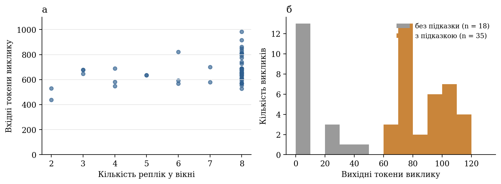
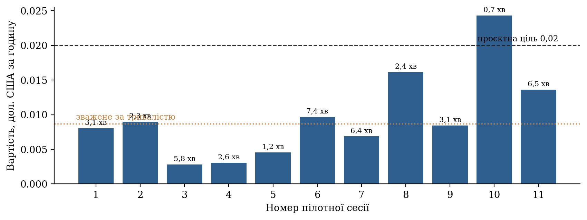

# 7 ЕКСПЕРИМЕНТАЛЬНЕ ОЦІНЮВАННЯ

Розділ подає результати оцінювання системи й відповідає завданню 6 технічного завдання. Оцінювання складається з двох частин різної природи, які в тексті послідовно розрізнено: офлайн-експерименти на синтетичних сценаріях, де еталон відомий із побудови, а мовну модель замінено заглушкою; та аналіз журналів пілотних сесій на справжніх зустрічах у Google Meet зі справжньою моделлю. Перша частина дає відтворювані оцінки точності детермінованого шару й правил координації; друга — виміряні час відповіді моделі, кількість токенів і вартість. Якість підказок мовної моделі, WER субтитрів і наскрізну затримку не виміряно; причини й план їх вимірювання наведено в підрозділі 7.6.

## 7.1 Мета, конфігурація та умови експерименту

Мета оцінювання — відповісти на питання, які огляд залишив відкритими (підрозділ 2.6), у тій мірі, у якій це можливо без розмічених живих даних:

- П1. Наскільки точно детермінований шар відстежує активний пункт і переходи між пунктами на сценаріях із відомим еталоном?
- П2. Наскільки він стійкий до помилок розпізнавання та до перефразування?
- П3. Скільки часу займає детермінована обробка репліки й відповідь мовної моделі?
- П4. Як параметри обмеження частоти впливають на кількість викликів, вартість і затримку очікування?
- П5. Якою є фактична вартість звернень до моделі на справжніх зустрічах?

Перелік експериментів і їхній статус наведено в табл. 7.1.

**Таблиця 7.1 — Експерименти та характер одержаних даних**

| Код | Що досліджується | Дані | Мовна модель | Характер результату |
|---|---|---|---|---|
| Е1 | Точність детермінованого шару | Сценарії С1–С5 | Не викликається | Вимірювання на синтетичних даних |
| Е2 | Те саме без явної фрази відкриття пункту; перефразування (С6) | Варіанти С1–С5, сценарій С6 | Не викликається | Вимірювання на синтетичних даних |
| Е3 | Стійкість до спотворень тексту | С1–С5 зі штучним шумом | Не викликається | Вимірювання на синтетичних даних |
| Е4 | Час детермінованої обробки | С1–С5, п’ять прогонів | Не викликається | Вимірювання на одній машині |
| Е5 | Вплив параметрів запуску на кількість викликів, вартість, затримку очікування | С1–С5, симульований час | Заглушка | Оцінка (токени — за евристикою) |
| Е6 | Час відповіді моделі, токени, вартість, затримка очікування | Журнали 11 пілотних сесій | `claude-haiku-5-5` | Вимірювання, мала вибірка |

Офлайн-експерименти виконано 09.10.2026 на комп’ютері з процесором архітектури ARM під керуванням macOS, інтерпретатор Python 3.11.17. Сценарії пропускаються через справжній оркестратор із конфігурацією за замовчуванням; в експериментах Е1–Е4 ліміт викликів моделі встановлено в нуль, тому працює лише детермінований шар. Усі експерименти відтворюються скриптами з каталогу звіту в репозиторії; результати зберігаються у файлах JSON, з яких побудовано рисунки цього розділу.

Пілотні сесії проведено автором 8–9 жовтня 2026 р. в Google Meet з аджендою з двох пунктів; учасників було від одного до трьох. Мову й зміст розмов журнал не фіксує. Сервер працював локально; модель — `claude-haiku-5-5` з параметрами табл. 5.2. Журнал сервера містить лише лічильники: текст розмов не зберігався.

## 7.2 Дані й тестові сценарії; спосіб формування еталонних міток для станів адженди

Синтетичні сценарії С1–С5 описано в табл. 4.6. Разом вони містять 374 фінальні репліки й охоплюють 52,9 хвилини симульованого часу. Кожен сценарій зібрано з чотирьох тематичних наборів реплік — по одному на пункт адженди («Статус спринту», «Блокери розробки», «План релізу», «Бюджет тестування») — та набору реплік поза аджендою.

Еталонні мітки випливають із побудови сценарію. Для кожної репліки відомо, з якого тематичного набору її взято; еталонним активним пунктом після репліки є пункт цього набору, а для репліки поза аджендою — попередній активний пункт, оскільки відхилення від теми не закриває пункту. Еталонний перехід — це репліка, на якій еталонний активний пункт змінюється. Еталонний підсумковий статус пункту: covered для пунктів, які обговорювалися й були залишені, active для останнього, pending для тих, до яких не дійшли.

Такий спосіб має очевидну перевагу — мітки не потребують ручної праці й не містять помилок розмітника — і таку саму очевидну ваду: сценарій і правила писала одна людина. Репліки першого рядка кожного тематичного набору містять назву пункту й фразу переходу, тобто саме те, що шукають лексичні правила. Щоб послабити цю залежність, додано два ускладнення. В експерименті Е2 з кожного блоку вилучено першу репліку, яка називає пункт («тиха» зміна теми). Сценарій С6 написано окремо: чотири пункти обговорюються по п’ять реплік кожен без жодного слова з назв (наприклад, пункт «Бюджет тестування» представлено реплікою «Залишилося питання грошей на перевірку якості в наступному кварталі»).

В експерименті Е3 текст кожної репліки спотворюється: кожне слово з імовірністю q замінюється випадковим словом зі словника сценаріїв (60 % спотворень), вилучається (25 %) або доповнюється вставленим випадковим словом (15 %). Параметр q грубо відповідає WER за формулою (2.1). Для кожного значення q виконано 20 прогонів із різними зернами генератора. Слід наголосити, що це імітація: справжні помилки розпізнавання не випадкові, а фонетично зумовлені, тож результат показує чутливість алгоритму до втрати слів, а не поведінку на справжніх субтитрах.

З пілотних сесій до оцінювання відібрано не всі. Журнал містить 15 сесій, у яких відбувся хоча б один виклик моделі. Чотири з них вилучено: одну записано на версії до впровадження алгоритму 4.1, коли мовлення передавалося багаторазово; у трьох темп мовлення, обчислений за журналом, становив від 1626 до 6592 слів за хвилину, що неможливо для живої розмови й свідчить про повторне надходження тексту. Критерій вилучення — понад 250 слів за хвилину — задано до аналізу результатів; причину повторного надходження в цих трьох коротких сесіях остаточно не встановлено. До оцінки вартості увійшли 11 сесій загальною тривалістю 41,5 хвилини (421 фінальний сегмент, 4018 слів). Перші з них записано ще з двома джерелами тексту, решту — з єдиним джерелом; через малий обсяг вибірки їх не розділено. Час відповіді моделі від повторів тексту не залежить, тому для нього використано всі 53 виклики підказок і 8 викликів підсумку.

## 7.3 Метрики точності: наприклад, precision, recall і F1 для виявлення релевантного пункту/відхилення; WER — окремо для якості транскрипції, якщо доступний еталонний текст

### 7.3.1 Точність детермінованого шару (Е1, Е2)

Результати наведено в табл. 7.2 і на рис. 7.1. На чотирьох сценаріях із п’яти детермінований шар не припустився жодної помилки ні в базовому, ні в ускладненому варіанті: усі переходи виявлено в межах допуску, після кожної репліки активний пункт збігався з еталонним, підсумкові статуси правильні. Вилучення явної репліки відкриття пункту нічого не змінило: спрацьовує третя умова правила 2 («репліка про інший пункт і не про активний»). У сценаріях С2 і С5 під час 12 реплік поза аджендою активний пункт, як і передбачено, не змінювався.

**Таблиця 7.2 — Точність детермінованого шару на синтетичних сценаріях**

| Сценарій | Реплік | Частка правильних реплік, % | Переходи: еталон / виявлено | P | R | F1 | Правильні підсумкові статуси |
|---|---|---|---|---|---|---|---|
| С1, рух за планом | 38 | 100 | 4 / 4 | 1,00 | 1,00 | 1,00 | 4 із 4 |
| С2, відхилення й повернення | 38 | 100 | 3 / 3 | 1,00 | 1,00 | 1,00 | 3 із 3 |
| С3, пропущений пункт | 32 | 71,9 | 3 / 4 | 0,75 | 1,00 | 0,86 | 2 із 4 |
| С4, перевищення часу | 44 | 100 | 2 / 2 | 1,00 | 1,00 | 1,00 | 2 із 2 |
| С5, довга зустріч | 222 | 100 | 4 / 4 | 1,00 | 1,00 | 1,00 | 4 із 4 |
| С1–С5 разом | 374 | 97,6 | 16 / 17 | 0,94 | 1,00 | 0,97 | 15 із 17 |
| С3 без репліки відкриття | 29 | 69,0 | 3 / 4 | 0,75 | 1,00 | 0,86 | 2 із 4 |
| С6, перефразування | 20 | 25,0 | 4 / 1 | 0,00 | 0,00 | 0,00 | 0 із 4 |

Помилка в сценарії С3 показова. За сценарієм після другого пункту учасники одразу переходять до четвертого («Бюджет тестування»), оминаючи третій («План релізу»). Перехід до четвертого пункту система виявила правильно. Проте вже в четвертій репліці про бюджет трапилася фраза «автоматизація окупиться приблизно за два релізи»: слово «релізи» збіглося з усіченою основою слова з назви третього пункту, репліка не містила слів четвертого, і за правилом 2 активним став пункт «План релізу». Четвертий пункт при цьому перейшов у covered, бо мав свідчення, а зі статусу covered повернення немає. У результаті дев’ять реплік поспіль — до кінця сценарію — система показувала хибний активний пункт, а пропущений пункт виглядав розпочатим. Одна лексична помилка, помножена на незворотність закриття, дала 28 % хибних реплік. Це найважливіший кількісний аргумент на користь двох доопрацювань: дозволити повернення з covered до active за наявності нових свідчень і вимагати більше одного збігу для зміни пункту без фрази переходу.

Сценарій С6 показує межу лексичного підходу в чистому вигляді. Жодного з чотирьох переходів не виявлено. Єдина зміна стану, яку зробила система, була хибною: у другій репліці («Із п’ятнадцяти запланованих задач дванадцять уже закрито») підрядок «план» збігся зі словом назви «План релізу», і цей пункт залишався активним до кінця. Частка правильних реплік 25 % утворилася випадково: п’ять реплік, що справді стосувалися релізу, збіглися з хибно активованим пунктом. Саме для таких розмов призначено семантичний шлях; його точність на цьому сценарії не вимірювалася, оскільки це потребує платних звернень до моделі.

Перевірку часу виконано в сценаріях С2 і С4: в обох сформовано рівно одну підказку про перевищення часу, через 5 і 6 с після того, як час пункту перевищив поріг (4.3); ця затримка дорівнює інтервалу до наступної репліки, бо перевірка виконується під час обробки сегмента.

### 7.3.2 Стійкість до спотворень тексту (Е3)

Залежність точності від частки спотворених слів показано на рис. 7.2 і в табл. 7.3. Уже за 5 % спотворень частка правильних реплік падає з 97,6 до 80,1 %, за 10 % — до 71,6 %, а за 20 % становить близько 55 %. Показник F1 виявлення переходів знижується повільніше: з 0,97 до 0,87, 0,82 і 0,70 відповідно.

**Таблиця 7.3 — Точність детермінованого шару залежно від частки спотворених слів (середнє ± стандартне відхилення за 20 прогонами)**

| Частка спотворених слів, % | Частка правильних реплік, % | P | R | F1 |
|---|---|---|---|---|
| 0 | 97,6 | 0,94 | 1,00 | 0,97 |
| 5 | 80,1 ± 10,5 | 0,85 ± 0,06 | 0,89 ± 0,06 | 0,87 ± 0,06 |
| 10 | 71,6 ± 13,2 | 0,79 ± 0,08 | 0,84 ± 0,07 | 0,82 ± 0,07 |
| 20 | 54,9 ± 8,9 | 0,68 ± 0,05 | 0,72 ± 0,05 | 0,70 ± 0,05 |
| 30 | 51,2 ± 5,7 | 0,63 ± 0,08 | 0,67 ± 0,09 | 0,65 ± 0,09 |
| 40 | 47,3 ± 6,4 | 0,57 ± 0,09 | 0,60 ± 0,09 | 0,59 ± 0,09 |

Розбіжність між двома показниками має те саме пояснення, що й помилка в С3. Переходи здебільшого виявляються, хай і з хибними спрацьовуваннями, тому F1 знижується помірно. Натомість кожне хибне перемикання закриває пункт незворотно, і всі подальші репліки цього пункту стають «хибними» за часткою правильних реплік; велике стандартне відхилення (до 13 відсоткових пунктів) відображає те, що результат прогону залежить від того, чи трапилося хибне перемикання на початку довгого блоку. Отже, детермінований шар є крихким не до втрати слів як такої, а до хибних збігів, наслідки яких не виправляються. Висновок збігається з попереднім: головний резерв точності — не в складнішому зіставленні, а в можливості виправити помилку.

### 7.3.3 Спостереження за семантичним шаром у пілотних сесіях

Точність семантичного шару не вимірювалася, але журнали дають кілька спостережень про його поведінку (табл. 7.4). В 11 пілотних сесіях модель викликалася для підказок 45 разів; у 30 викликах повернуто принаймні одну підказку, що пройшла перевірку. Користувачеві показано 31 підказку: 24 від моделі й 7 детермінованих підказок про час. Шість підказок моделі відкинуто як повтори. За типами переважають відхилення від теми (17), далі підказки про час (8), пропозиції щодо адженди (5) і пропущений пункт (1). Жодна відповідь не була обрізана за лімітом токенів: причина зупинки в усіх викликах — природне завершення.

**Таблиця 7.4 — Спостереження за семантичним шаром в 11 пілотних сесіях**

| Показник | Значення |
|---|---|
| Викликів генератора підказок | 45 |
| Із них із принаймні однією прийнятою підказкою | 30 |
| Підказок показано: від моделі / детермінованих | 24 / 7 |
| Підказок моделі відкинуто як повтори | 6 |
| Змін активного пункту за пропозицією моделі | 3 (упевненість 0,8 у кожній) |
| Пропозицій відхилено: низька впевненість / недозволений перехід | 1 (0,6) / 1 |
| Викликів, запущених таймером паузи | 12 |
| Підказок, закритих користувачем | 17 із 31 |

Семантичне перемикання пункту спрацювало на живих зустрічах тричі, щоразу з упевненістю 0,8; в усіх трьох випадках попередній пункт мав свідчення й перейшов у covered. Одну пропозицію відхилено через упевненість 0,6, нижчу за поріг; у тій самій сесії через 48 с модель повторила пропозицію з упевненістю 0,8, і перемикання відбулося — приклад запізнення, про яке йшлося в підрозділі 5.5. Ще одну пропозицію відхилено як недозволений перехід: модель запропонувала повернутися до пункту, вже позначеного розглянутим. Це та сама незворотність, що й у сценарії С3, тепер уже на живій зустрічі.

Ці числа описують поведінку механізмів, а не якість рішень. Чи були показані підказки доречними і чи відповідали перемикання справжній зміні теми, журнал не фіксує: для цього потрібен транскрипт із ручною розміткою. Те, що користувач закрив 17 підказок із 31, не можна тлумачити однозначно: закриття означає і «прочитав, дякую», і «це зайве».

Щодо WER: еталонних розшифровок немає, тому якість субтитрів Meet для української не вимірювалася. Формула (2.1) залишається визначенням метрики для наступного етапу.

## 7.4 Метрики швидкодії: час від аудіосегмента до транскрипту, від транскрипту до рішення, наскрізна затримка; подавати медіану й p95, а також опис умов вимірювання

Із семи складників затримки (2.2) виміряно три: детерміновану обробку L_det, очікування виклику L_gate і час відповіді моделі L_llm. Складники L_cap, L_asr, L_tr і L_ui потребують позначок часу на боці розширення, яких у поточній версії немає; тому наскрізну затримку від мовлення до відображення підказки не виміряно. Результати зведено в табл. 7.5.

**Таблиця 7.5 — Виміряні складники затримки**

| Складник | Джерело даних | Кількість спостережень | Медіана | p95 | Максимум |
|---|---|---|---|---|---|
| L_det, детерміновані агенти | Е4, офлайн | 1870 реплік | 0,04 мс | 0,13 мс | 0,75 мс |
| L_det разом із перевіркою й журналюванням | Е6, пілотні сесії | 991 репліка | менше 1 мс | 2 мс | 23 мс |
| L_gate, очікування виклику | Е5, симуляція | 373 репліки | 23 с | 41 с | 42 с |
| L_gate, очікування виклику | Е6, пілотні сесії | 388 реплік | 22,6 с | 46,7 с | 73,7 с |
| L_llm, підказки | Е6, пілотні сесії | 53 виклики | 1,12 с | 1,50 с | 1,80 с |
| L_llm, підсумок | Е6, пілотні сесії | 8 викликів | 1,84 с | 2,31 с | 2,38 с |

Детермінована обробка (рис. 7.3, а) триває соті частки мілісекунди й на п’ять порядків швидша за відповідь моделі; у журналах живих сесій, де час записується з точністю до мілісекунди й охоплює також перевірку повідомлення, вона не перевищила 23 мс. Вимогу Н1 виконано із запасом: оновлення адженди обмежене мережею, а не обчисленнями.

Час відповіді моделі (рис. 7.3, б) для підказок зосереджений між 0,7 і 1,8 с із медіаною 1,12 с; таймаут 10 с не спрацював жодного разу. Підсумок формується довше — близько 1,4–2,4 с, — бо вхід і вихід більші. Розподіл побудовано за 53 викликами, зробленими за два дні з однієї мережі, тому 95-й перцентиль слід вважати орієнтовним.

Очікування виклику є найбільшим складником. У пілотних сесіях репліка чекала запуску найближчого виклику в середньому 22,6 с (медіана), у 95 % випадків — не довше 46,7 с; найдовше очікування становило 73,7 с. Симуляція на синтетичних сценаріях дала близькі значення медіани й 95-го перцентиля (23 і 41 с), що підтверджує придатність стенда відтворення для дослідження параметрів. Максимум у живих сесіях перевищив проєктну ціль 60 с (вимога Н2): це трапляється, коли після виклику мовлення надходить повільно й поріг у 50 слів досягається пізніше, ніж спливає мінімальний інтервал. Тридцять три репліки з 421 не дочекалися жодного виклику: це кінці сесій, де запис зупинено раніше, ніж накопичилися умови запуску.

Отже, для підказки моделі типовий шлях від появи фінальної репліки на сервері до готової підказки становить близько 24 с (медіана L_gate плюс медіана L_llm), а у гіршому з поширених випадків — близько 48 с. За класифікацією п. 2.2.5 це прийнятно для ініціативної підказки про відхилення від теми й неприйнятно для реакції на дію користувача; саме тому все, на що користувач дивиться безпосередньо (транскрипт, позначка активного пункту за лексичним збігом, таймер), оновлюється швидким шляхом.

## 7.5 Порівняння з обґрунтованим базовим варіантом (наприклад, єдиний послідовний LLM-конвеєр або без координації агентів), якщо він реалізований

### 7.5.1 Базові варіанти

Порівняння виконано у двох площинах. Для точності базовим є детермінований шар без мовної моделі: він показує, що система вміє без семантичних викликів, і водночас є режимом, у який вона переходить за недоступності моделі. Його результати наведено в підрозділі 7.3; порівняти з ним гібридний режим кількісно поки неможливо через відсутність розмічених даних для семантичного шару.

Для вартості й затримки базовим є єдиний послідовний конвеєр мовної моделі — перша версія прототипу, у якій модель викликалася після кожної фінальної репліки. Її відтворено на стенді як конфігурацію К0, а далі зміни вводилися по одній (табл. 7.6, рис. 7.4). Нагадаємо, що це експеримент Е5: виклики лічить справжній оркестратор, але час симульований, модель замінено заглушкою, а кількість токенів оцінюється евристикою, каліброваною на одному справжньому виклику (754 оцінених проти 742 виміряних вхідних токенів). Тому вартість у таблиці — оцінка з нижньою й верхньою межами для різних припущень про довжину відповіді, а не вимірювання.

**Таблиця 7.6 — Порівняння конфігурацій на стенді відтворення (сценарії С1–С5; вартість — оцінка)**

| Конфігурація | Викликів (із них резюме) | Викликів за годину | Оцінка вартості, дол. США за годину | Затримка очікування: медіана / максимум, с |
|---|---|---|---|---|
| К0: перша версія (модель середнього класу, виклик на кожну репліку, вікно 20) | 409 (35) | 464 | 2,34 – 5,79 | 0 / 0 |
| К1: К0 з найдешевшою моделлю | 409 (35) | 464 | 0,12 – 0,29 | 0 / 0 |
| К2: К1 з обмеженням частоти (45 с, 50 слів) | 101 (35) | 115 | 0,028 – 0,060 | 22 / 42 |
| К3: К2 з вікном 8, без міркувань і без резюме | 66 (0) | 75 | 0,0064 – 0,0143 | 22 / 42 |
| К4: поточні значення за замовчуванням | 66 (0) | 75 | 0,0064 – 0,0143 | 22 / 42 |

З порівняння випливає таке. Заміна моделі сама зменшує оцінену вартість у 20 разів — рівно в стільки, у скільки відрізняються ціни. Обмеження частоти зменшує кількість викликів підказок у 5,7 раза (з 374 до 66), але загальну кількість — лише в 4 рази, доки ввімкнено ковзне резюме з його власними викликами; повний ефект досягається після вимкнення резюме. Сумарно оцінена вартість знижується приблизно у 360–400 разів, а платою є затримка очікування з медіаною 22 с, якої в базовому варіанті немає. Конфігурації К3 і К4 на стенді збігаються, бо всі конфігурації використовують поточний формат запиту; ефект компактного формату стенд показати не може.

Оцінку для К0 можна зіставити з єдиним наявним фактом про першу версію: близько 0,90 дол. за кілька коротких тестових зустрічей. За оціненої вартості 2,34–5,79 дол. за годину така сума відповідає приблизно 10–24 хвилинам роботи, що узгоджується з обсягом тодішнього тестування, але не є перевіркою моделі.

### 7.5.2 Компроміс між вартістю та затримкою

Щоб побачити, як вибір параметрів запуску впливає на результат, на тому самому стенді виконано перебір мінімального інтервалу (0–120 с) і порогу слів (0–100). Фрагмент результатів для порогу 50 слів наведено в табл. 7.7, повну картину — на рис. 7.5.

**Таблиця 7.7 — Вплив мінімального інтервалу між викликами за порогу 50 слів (стенд відтворення; вартість — оцінка)**

| Інтервал, с | Викликів за годину | Оцінка вартості, дол. за годину | Затримка очікування: медіана / p95 / максимум, с | Реплік, що не потрапили в жоден виклик |
|---|---|---|---|---|
| 0–30 | 84 | 0,0072 – 0,0160 | 17 / 36 / 54 | 1 |
| 45 (обрано) | 75 | 0,0064 – 0,0143 | 23 / 41 / 42 | 1 |
| 60 | 56 | 0,0048 – 0,0106 | 26 / 56 / 66 | 5 |
| 90 | 39 | 0,0033 – 0,0073 | 26 / 58 / 84 | 117 |
| 120 | 28 | 0,0024 – 0,0054 | 26 / 56 / 91 | 189 |

Перебір дає три спостереження. Перше: за порогу 50 слів інтервал до 30 с нічого не змінює — частоту визначає поріг слів, а не інтервал; обмеження починає діяти з 45 с. Друге: зі збільшенням інтервалу понад 60 с вартість зменшується повільно, а кількість реплік, які не потрапили в жоден виклик, різко зростає (117 із 374 за 90 с): вікно з восьми реплік не вміщує всього сказаного між викликами. Це втрата матеріалу, а не лише затримка, і вона є сильнішим аргументом проти великих інтервалів, ніж сама затримка. Третє: обране значення 45 с лежить на межі, за якою починаються втрати, і водночас тримає максимум затримки на стенді нижче 60 с. Без порогу слів і без інтервалу стенд дає 399 викликів за годину й оцінку 0,034–0,076 дол. за годину, тобто навіть із найдешевшою моделлю проєктна ціль 0,02 дол. не досягається без обмеження частоти.

Зауважимо, що цей аналіз покриває лише дві з трьох осей компромісу. Третя — якість підказок — не виміряна, тому твердити, що обрана точка оптимальна, не можна; можна лише сказати, що вона задовольняє цілі за вартістю й затримкою та не втрачає матеріалу.

### 7.5.3 Виміряна вартість пілотних сесій

Фактичні витрати наведено в табл. 7.8 і на рис. 7.6–7.7. В 11 сесіях загальною тривалістю 41,5 хвилини зроблено 45 викликів підказок і 5 викликів підсумку; сумарна вартість, обчислена за виміряними токенами й опублікованими цінами [@anth_pricing], становить 0,0060 дол. США, або 0,0087 дол. за годину зустрічі. Частота викликів підказок — 65 за годину, що близько до оцінки стенда (75).

**Таблиця 7.8 — Виміряні показники пілотних сесій**

| Сесія | Тривалість, с | Фінальних сегментів | Слів | Викликів: підказки + підсумок | Токени: вхід / вихід | Вартість, дол. | Вартість, дол. за годину |
|---|---|---|---|---|---|---|---|
| 1 | 185 | 9 | 325 | 4 + 0 | 2758 / 276 | 0,00041 | 0,0080 |
| 2 | 137 | 9 | 88 | 2 + 1 | 2341 / 215 | 0,00034 | 0,0090 |
| 3 | 347 | 21 | 150 | 4 + 0 | 2273 / 85 | 0,00027 | 0,0028 |
| 4 | 155 | 16 | 146 | 2 + 0 | 1280 / 8 | 0,00013 | 0,0031 |
| 5 | 72 | 5 | 87 | 1 + 0 | 529 / 77 | 0,00009 | 0,0045 |
| 6 | 447 | 84 | 722 | 8 + 1 | 8023 / 796 | 0,00120 | 0,0097 |
| 7 | 382 | 100 | 741 | 8 + 0 | 4986 / 459 | 0,00073 | 0,0069 |
| 8 | 143 | 34 | 224 | 3 + 1 | 3713 / 542 | 0,00064 | 0,0162 |
| 9 | 189 | 66 | 312 | 4 + 0 | 2706 / 341 | 0,00044 | 0,0084 |
| 10 | 43 | 5 | 73 | 1 + 1 | 1679 / 238 | 0,00029 | 0,0243 |
| 11 | 388 | 72 | 1150 | 8 + 1 | 10129 / 907 | 0,00147 | 0,0136 |
| Разом | 2487 | 421 | 4018 | 45 + 5 | 40417 / 3944 | 0,00601 | 0,0087 |

Структура одного виклику підказок така (рис. 7.6). Вхід становить від 438 до 982 токенів із медіаною 654 і зростає із заповненням вікна. Вихід чітко двомодальний: відповідь із підказкою займає 66–118 токенів (медіана 86), порожня відповідь — здебільшого 4 токени. Отже, виклик без підказки коштує близько 0,00007 дол., виклик із підказкою — близько 0,00011 дол., і в другому випадку понад третину вартості становить вихід, хоча він у сім-вісім разів коротший за вхід. Це підтверджує доцільність компактних ключів відповіді й переліку вже показаних підказок.

Виклик підсумку в п’яти придатних сесіях мав від 1001 до 3636 вхідних токенів і від 125 до 344 вихідних, тобто коштував 0,0002–0,0005 дол. Для коротких зустрічей це помітна частка: у сесії 10 тривалістю 43 с один виклик підказок і один виклик підсумку дали 0,024 дол. за годину — єдиний випадок перевищення проєктної цілі 0,02 дол. (рис. 7.7). Підсумок є сталою платою за зустріч, яка не залежить від її тривалості до межі в 40 000 символів, тому з подовженням зустрічі його внесок у погодинну вартість зменшується. Екстраполяція на годинну зустріч залишається оцінкою: найдовша пілотна сесія тривала 7,4 хвилини.

Жорсткий ліміт вартості сесії (0,05 дол.) не був досягнутий: найдорожча сесія коштувала 0,0015 дол., тобто 3 % ліміту.

## 7.6 Результати, похибки, аналіз складних випадків і загрози валідності

### 7.6.1 Відповіді на питання оцінювання

П1. На сценаріях із лексично впізнаваними пунктами детермінований шар відстежує план майже безпомилково: 97,6 % правильних реплік і F1 = 0,97 за 374 репліками, без жодного пропущеного переходу. Єдина помилка — хибне перемикання через випадковий збіг слова.

П2. До спотворень тексту шар чутливий: 5 % спотворених слів знижують частку правильних реплік до 80 %, 20 % — до 55 %. Перефразування він не розпізнає зовсім (F1 = 0). Головна причина великих втрат — не кількість хибних збігів, а незворотність їхніх наслідків.

П3. Детермінована обробка триває менше мілісекунди. Відповідь моделі на запит підказок надходить за 1,12 с (медіана) і 1,50 с (p95).

П4. Кількість викликів визначається порогом слів, а з 45 с — мінімальним інтервалом; інтервали понад 60 с призводять до втрати реплік, які не вміщуються у вікно. Обрані значення дають близько 75 викликів за годину на стенді й 65 у пілотних сесіях.

П5. Виміряна вартість становить 0,0087 дол. США за годину зустрічі, що вдвічі нижче проєктної цілі; перевищення спостерігалося лише в сесії, коротшій за хвилину.

Стан виконання вимог табл. 3.2 зведено в табл. 7.9.

**Таблиця 7.9 — Перевірка нефункціональних вимог**

| Вимога | Результат | Підстава |
|---|---|---|
| Н1, затримка оновлення адженди | Виконано | L_det: p95 0,13 мс офлайн, 2 мс у живих сесіях |
| Н2, затримка підказки | Виконано частково | p95 очікування 46,7 с; максимум 73,7 с перевищує 60 с; наскрізну затримку не виміряно |
| Н3, вартість | Виконано | 0,0087 дол. за годину; ліміт сесії не досягався |
| Н4, стійкість | Підтверджено тестами | Тести вимикача й оркестратора; на живих сесіях відмов моделі не було |
| Н5, приватність | Виконано з одним відхиленням | У журналах немає тексту; відхилення — клієнтський шлях ключа доступу |
| Н6, простежуваність | Виконано | Усі показані підказки й перемикання мали свідчення (перевіряється кодом) |
| Н7, ворожий вміст | Підтверджено тестами | Тести розбору відповіді; цілеспрямованого тестування атак не проводилося |
| Н8, відтворюваність | Виконано | Офлайн-експерименти повторюються скриптами |

### 7.6.2 Складні випадки

Аналіз помилок дає чотири типи складних випадків (табл. 7.10). Для кожного вказано, де він проявився і чим його можна усунути.

**Таблиця 7.10 — Складні випадки та напрями доопрацювання**

| Випадок | Де спостерігався | Наслідок | Можливе усунення |
|---|---|---|---|
| Випадковий збіг слова назви | С3 («релізи» в розмові про бюджет) | Хибне перемикання, дев’ять хибних реплік | Вимагати два збіги або фразу переходу; порівнювати цілі слова |
| Збіг підрядка | С6 («план» у «запланованих») | Хибна активація пункту | Порівняння за межами слів; лематизація |
| Незворотність covered | С3; пілотна сесія (відхилена пропозиція моделі) | Помилка не виправляється до кінця зустрічі | Дозволити covered → active за нових свідчень |
| Перефразування, інша мова плану | С6 | Жодного переходу лексичним шляхом | Семантичний шлях; у перспективі — векторна схожість |
| Повільне мовлення після виклику | Пілотні сесії | Очікування виклику понад 60 с | Знижувати поріг слів із часом очікування |
| Повторне надходження тексту | Три вилучені сесії | Завищені лічильники й вартість | З’ясувати причину; контроль темпу мовлення на сервері |

### 7.6.3 Загрози валідності

Конструктна валідність. Еталонні мітки синтетичних сценаріїв і правила, що перевіряються, створила одна людина, а репліки сценаріїв С1–С5 містять слова з назв пунктів. Точність 97,6 % тому характеризує узгодженість правил із власними прикладами й є верхньою оцінкою; сценарій С6 показує, наскільки вона може впасти. Частка правильних реплік карає за тривалість помилки, а F1 — за кількість помилок; жодна з метрик окремо не описує досвіду користувача.

Внутрішня валідність. Штучний шум не відтворює природи справжніх помилок розпізнавання. Вартість на стенді спирається на евристичну оцінку токенів, калібровану на одному виклику. У пілотних сесіях одночасно змінювалися і джерело тексту, і формат запиту, тому порівняння між окремими сесіями не є контрольованим; наприклад, зменшення відповіді з 215 до близько 90 токенів після переходу на компактний формат є спостереженням на різних розмовах.

Зовнішня валідність. Пілотних сесій 11, усі короткі (найдовша — 7,4 хвилини), з однією аджендою з двох пунктів, одним ведучим, який є автором системи, і не більше ніж трьома учасниками. Перенесення результатів на годинні зустрічі з вісьмома учасниками та довгою аджендою не обґрунтоване даними. Усі вимірювання часу відповіді зроблено за два дні з однієї мережі.

Надійність висновків. Вибірка мала для статистичних тверджень: 95-й перцентиль за 53 спостереженнями визначається двома-трьома найбільшими значеннями. Тому в розділі подано описові показники без довірчих інтервалів і перевірки гіпотез. Чотири сесії вилучено; критерій вилучення об’єктивний, але причину аномалії в трьох із них не встановлено, отже не можна виключити, що подібне, у менш помітній формі, вплинуло й на залишені сесії.

### 7.6.4 Що залишилося невиміряним

Три групи показників, передбачених планом оцінювання, у звіті відсутні. Якість підказок і підсумку (точність, повнота, F1 за типами підказок) потребує набору сценаріїв із ручною розміткою моментів, коли підказка доречна, і платного прогону моделі; такий прогін можна виконати в пакетному режимі зі знижкою. WER субтитрів Meet для української потребує записів з еталонною розшифровкою. Наскрізна затримка потребує позначок часу в розширенні: моменту появи рядка субтитрів і моменту відображення підказки. Ці роботи становлять зміст наступного етапу; до їх виконання твердження про корисність підказок залишається гіпотезою, а не результатом.

## Висновки до розділу 7

Оцінювання підтвердило працездатність обраної побудови в частині, яку вдалося виміряти. Детермінований шар відстежує лексично впізнаваний план із точністю 97,6 % реплік і F1 = 0,97 для переходів, обробляючи репліку менш ніж за мілісекунду. Його слабкі місця також визначено кількісно: чутливість до спотворень тексту (80 % правильних реплік за 5 % спотворених слів), нульова повнота на перефразуванні й незворотність хибного закриття пункту. Мовна модель відповідає на запит підказок за 1,1 с (медіана); обмеження частоти додає очікування з медіаною близько 23 с і 95-м перцентилем близько 47 с. Порівняно з базовим конвеєром «виклик на кожну репліку» оцінена вартість зменшилася на два з половиною порядки, а виміряна на 11 пілотних сесіях становить 0,0087 дол. США за годину зустрічі. Якість семантичних підказок, WER і наскрізна затримка залишаються невиміряними й визначають зміст подальшої роботи.
