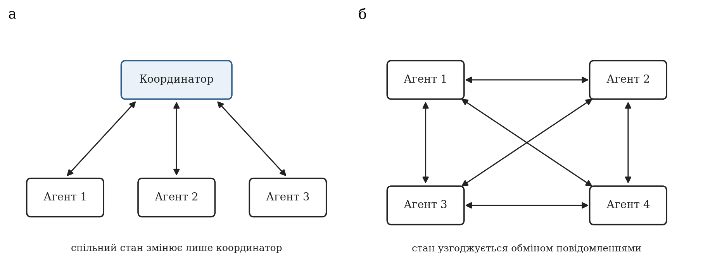
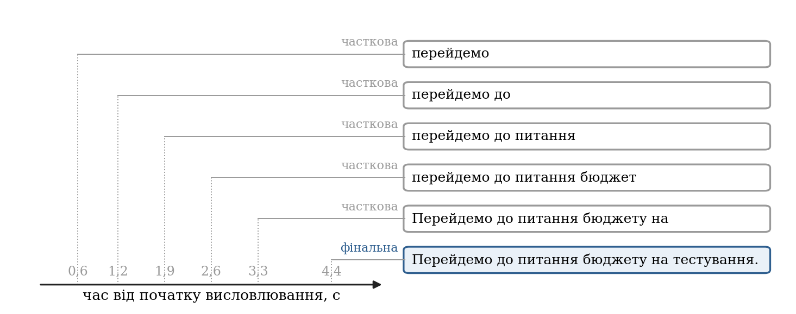
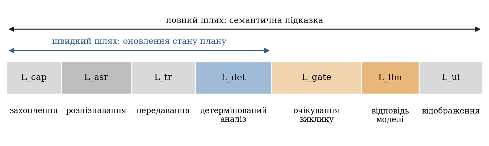
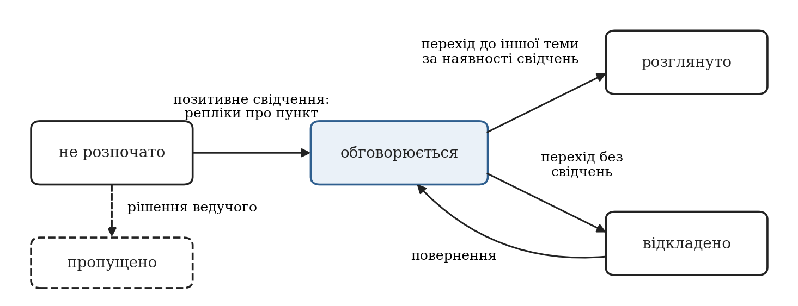
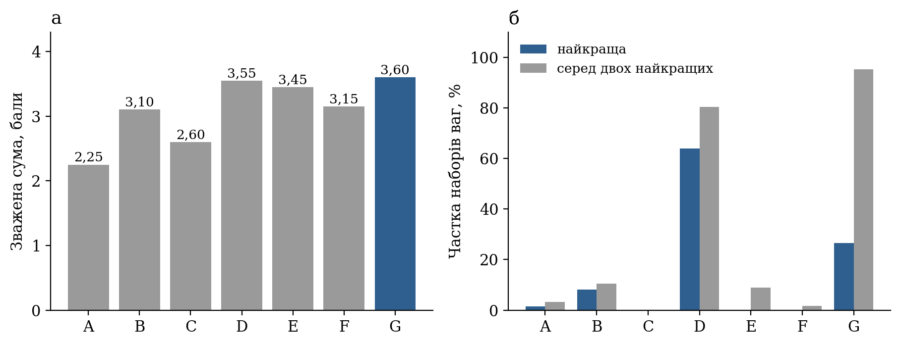

# ПЕРЕЛІК УМОВНИХ ПОЗНАЧЕНЬ, СКОРОЧЕНЬ І ТЕРМІНІВ

Адженда — порядок денний зустрічі: упорядкований перелік пунктів, які планується обговорити.

МАС — мультиагентна система.

ТЗ — технічне завдання на магістерську дисертацію.

ASR (Automatic Speech Recognition) — автоматичне розпізнавання мовлення.

DOM (Document Object Model) — об’єктна модель документа вебсторінки.

LLM (Large Language Model) — велика мовна модель.

WER (Word Error Rate) — частка помилок розпізнавання за словами.

Оверлей — панель інтерфейсу, що відображається поверх сторінки відеоконференції.

Сегмент транскрипту — фрагмент розпізнаного мовлення з позначкою мовця, часу та ознакою остаточності.

Часткова (проміжна) гіпотеза — попередній результат розпізнавання, який може бути переглянутий.

Фінальна гіпотеза — результат розпізнавання, який надалі не змінюється.

Токен — одиниця тексту, якою мовна модель вимірює обсяг запиту й відповіді.

p50, p95 — медіана та 95-й перцентиль розподілу величини.

# ВСТУП

Онлайн-зустрічі стали основною формою синхронної роботи розподілених команд. Разом із перевагами — відсутністю переїздів, простотою залучення учасників — вони загострили давню проблему нарад: обговорення відхиляється від запланованих питань, час на окремі пункти перевищується, частина порядку денного залишається нерозглянутою, а домовленості не фіксуються. Обов’язок стежити за планом покладається на ведучого, який водночас сам бере участь у розмові, тому увага до плану конкурує з увагою до змісту.

Платформи відеоконференцій пропонують вбудовані засоби на основі великих мовних моделей, однак вони орієнтовані переважно на нотатки й підсумок після зустрічі. Так, функція автоматичних нотаток у Google Meet формує документ із нотатками та дає змогу отримати проміжний підсумок, але доступна лише в окремих тарифних планах і для обмеженого переліку мов, серед яких немає української [1]. Засобу, який під час самої зустрічі зіставляв би перебіг розмови з наперед заданим порядком денним і ненав’язливо підказував ведучому, що обговорення відхилилося від теми або вичерпало відведений час, серед розглянутих у роботі штатних можливостей платформи немає.

Технічно така задача стала розв’язною завдяки двом обставинам. Перша — поява мовних моделей, здатних за одиниці секунд оцінити зміст короткого фрагмента розмови. Друга — розвиток підходів до побудови систем із кількох спеціалізованих агентів, де кожен агент відповідає за вузьку частину задачі, а їхню взаємодію впорядковує координатор [2]. Водночас поєднання цих можливостей у системі реального часу породжує нові труднощі: текст розмови надходить від розпізнавача мовлення з помилками та з переглядом уже показаних слів; кожне звернення до моделі має затримку й вартість; результати агентів надходять у різний час і можуть застаріти; текст розмови є неконтрольованим входом, який не повинен впливати на правила роботи системи.

Мета роботи — розробити інтелектуальний агентний асистент для супроводу онлайн-зустрічей у платформах відеоконференцій, який у реальному часі відстежує відповідність розмови порядку денному та формує для ведучого контекстні підказки.

Об’єкт дослідження — процеси інтелектуального аналізу тексту та контекстної взаємодії інтелектуальних агентів із користувачем у реальному часі під час синхронної онлайн-комунікації.

Предмет дослідження — моделі, алгоритми та програмні засоби координації агентів, аналізу порядку денного й семантичної інтерпретації транскрипту зустрічі із застосуванням великих мовних моделей.

Для досягнення мети технічне завдання визначає шість завдань:

1. Дослідити сучасні підходи до побудови мультиагентних систем і засоби оркестрації агентів для аналізу тексту й мовлення в реальному часі.
2. Спроєктувати архітектуру системи агентів із розподіленими ролями (агент-транскрибатор, агент-монітор адженди, агент-генератор підказок) і правила їх координації.
3. Розробити математичні й алгоритмічні основи оцінювання відхилення розмови від порядку денного із застосуванням мовної моделі.
4. Спроєктувати архітектуру інтеграції з інтерфейсом Google Meet, що охоплює отримання даних зустрічі та інтерактивне відображення підказок.
5. Реалізувати логіку взаємодії агентів між собою та із зовнішніми API мовних моделей, забезпечивши мінімальну затримку прийняття рішень.
6. Перевірити систему на сценаріях зустрічей, оцінити точність координації агентів і швидкість реакції.

Методи дослідження: аналіз наукових публікацій і офіційної технічної документації; методи теорії мультиагентних систем і скінченних автоматів — для моделювання ролей агентів і життєвого циклу пункту порядку денного; методи обробки природної мови — для зіставлення реплік із пунктами плану; багатокритеріальний аналіз із перевіркою чутливості — для вибору способу інтеграції; обчислювальний експеримент на синтетичних сценаріях і аналіз журналів пілотних сесій — для оцінювання точності, швидкодії та вартості.

Практичне значення одержаних результатів полягає у створенні працездатного прототипу: розширення браузера Chrome для Google Meet і серверної частини з агентами, які разом забезпечують відстеження порядку денного, підказки п’яти типів і підсумок зустрічі за оціненої вартості звернень до мовної моделі менше одного цента за годину зустрічі.

Звіт складається зі вступу, семи розділів, висновків і переліку використаних джерел. У розділі 1 сформульовано проблему й завдання. Розділ 2 містить теоретичний огляд підходів і технологій. Розділи 3–6 описують проєктування, алгоритми, інтеграцію мовної моделі та програмну реалізацію. У розділі 7 наведено результати експериментального оцінювання. У тексті послідовно розрізнено чотири види тверджень: відомості з джерел (із посиланням), проєктні рішення автора, оцінки, одержані моделюванням, і результати вимірювань.

# 1 ПОСТАНОВКА ЗАДАЧІ

## 1.1 Проблема супроводу онлайн-зустрічі

Зустріч із порядком денним можна розглядати як керований процес: є план (перелік пунктів із відведеним часом), є фактичний перебіг (послідовність реплік учасників) і є особа, відповідальна за їх узгодження, — ведучий. Супровід зустрічі полягає в тому, щоб вчасно помічати розбіжності між планом і перебігом та реагувати на них. Типових розбіжностей чотири: розмова перейшла на питання, якого немає в плані; обговорення пункту триває довше відведеного часу; учасники перейшли до наступного пункту, оминувши попередній; зустріч добігає кінця, а частину пунктів не розглянуто.

Кожну з цих ситуацій ведучий здатен помітити сам, проте його увага обмежена: він слухає, говорить, стежить за чатом і часом. Автоматизований асистент має зняти з нього саме рутинну частину — спостереження за планом — і при цьому не створити нового джерела відволікання. Звідси випливають дві вимоги, які визначають характер усієї системи. По-перше, асистент не веде діалогу з користувачем: він спостерігає й зрідка підказує, а відсутність підказки є нормальним станом. По-друге, підказка має бути обґрунтованою: користувач повинен бачити, на підставі яких реплік вона сформована, інакше довіра до системи швидко втрачається.

Задача ускладнюється тим, що асистент не має прямого доступу до змісту розмови. Він отримує текст від системи автоматичного розпізнавання мовлення, яка працює потоково: слова з’являються поступово, уже показані слова виправляються, а якість залежить від мови, акустичних умов і налаштувань платформи. Отже, асистент ухвалює рішення за неповними й частково помилковими даними та мусить бути стійким до цього.

Нарешті, систему реального часу обмежують затрати. Мовна модель, здатна оцінити зміст розмови, є платною зовнішньою службою: плата нараховується за обсяг опрацьованого тексту, а відповідь надходить через одну-дві секунди. Якщо звертатися до неї після кожної репліки, вартість години зустрічі сягає одиниць доларів, що було виявлено вже на першій версії прототипу (розділ 5). Тому питання «коли саме викликати модель» є таким самим предметом проєктування, як і питання «що саме в неї запитати».

## 1.2 Наявні засоби та їх обмеження

Засоби, якими сьогодні може скористатися учасник зустрічі в Google Meet, поділяються на три групи.

Перша група — вбудовані субтитри. Платформа розпізнає мовлення учасників і показує текст із зазначенням мовця [3]. Це джерело тексту, але не засіб аналізу: субтитри не зберігаються й не зіставляються з планом.

Друга група — автоматичні нотатки на основі мовної моделі. Функція «Take notes for me» формує документ із нотатками, який після завершення зустрічі зберігається на диску організатора, а під час зустрічі дає змогу тим, хто приєднався із запізненням, отримати проміжний підсумок. Функція потребує відповідного тарифного плану, підтримує вісім мов (української серед них немає) і розрахована на зустрічі однією мовою [1]. Вона відповідає на запитання «про що говорили», але не на запитання «чи рухаємося ми за планом».

Третя група — програмні інтерфейси для розробників. Meet REST API відкриває доступ до записів і транскриптів, але лише після завершення конференції [4]; інтерфейс для доступу до медіапотоків у реальному часі на момент дослідження перебував у статусі попереднього перегляду й вимагав окремої реєстрації [5]. Докладно ці інтерфейси розглянуто в підрозділі 2.4.

Порівняння зведено в табл. 1.1. Жоден із розглянутих засобів не поєднує трьох властивостей, потрібних для супроводу: роботи під час зустрічі, прив’язки до наперед заданого порядку денного та підтримки української мови. Саме цю прогалину заповнює розроблюваний асистент.

**Таблиця 1.1 — Наявні засоби Google Meet і потреби супроводу зустрічі**

| Засіб | Працює під час зустрічі | Зіставлення з порядком денним | Українська мова | Джерело |
|---|---|---|---|---|
| Вбудовані субтитри | Так | Ні | Залежить від налаштувань субтитрів | [3] |
| Автоматичні нотатки | Частково (проміжний підсумок) | Ні | Ні | [1] |
| Meet REST API (транскрипти) | Ні | Ні | Не застосовно | [4] |
| Розроблюваний асистент | Так | Так | Так, через субтитри платформи | Розділи 3–6 |

## 1.3 Формулювання задачі та критерії успіху

Змістовно задача формулюється так. Задано порядок денний — упорядкований перелік пунктів, кожен із назвою, необов’язковим описом і оцінкою тривалості. Під час зустрічі надходить потік сегментів транскрипту з позначками мовця й часу. Потрібно в кожен момент часу: визначати, який пункт обговорюється; вести стан кожного пункту (не розпочато, обговорюється, розглянуто, відкладено); виявляти відхилення від теми, перевищення часу та пропущені пункти; формувати для ведучого короткі підказки з посиланням на репліки, що їх обґрунтовують; після завершення зустрічі — надати підсумок зі статистикою участі й розподілу часу.

Критерії успіху випливають із завдань 5 і 6 технічного завдання та уточнені автором як проєктні цілі:

- оновлення стану порядку денного не повинне залежати від мовної моделі та має виконуватися за час, непомітний для користувача;
- затримка підказки, що потребує мовної моделі, не повинна перевищувати однієї хвилини від моменту, коли з’явився матеріал для неї;
- вартість звернень до моделі не повинна перевищувати 0,02 дол. США за годину зустрічі;
- відмова мовної моделі або мережі не повинна зупиняти відстеження плану;
- кожне рішення системи має бути простежуваним до конкретних реплік.

Числові значення в цих критеріях є цілями автора, а не вимогами технічного завдання, де швидкодію сформульовано якісно.

## 1.4 Відповідність завдань і розділів звіту

Щоб кожне завдання технічного завдання мало метод, результат і підтвердження, складено таблицю простежуваності (табл. 1.2). Вона ж слугує планом звіту.

**Таблиця 1.2 — Простежуваність завдань технічного завдання**

| Завдання ТЗ | Розділ | Основний результат | Чим підтверджено | Стан |
|---|---|---|---|---|
| 1. Дослідження підходів МАС і засобів оркестрації | 2 | Порівняння моделей координації, джерел тексту, способів інтеграції; матриця вибору | Аналіз джерел, аналіз чутливості | Виконано |
| 2. Архітектура агентів і правила координації | 3, 4 | Ролі агентів, протокол повідомлень, правила координації | Діаграми, автоматичні тести | Виконано |
| 3. Алгоритмічні основи оцінювання відхилення | 4, 5 | Лексичне зіставлення, автомат станів, семантична оцінка моделлю | Формули, тести, офлайн-експеримент | Виконано; якість семантичного шару не виміряно |
| 4. Інтеграція з Google Meet | 3, 6 | Розширення Chrome: читання субтитрів, оверлей | Перевірка на зустрічах, знімки інтерфейсу | Виконано; захоплення звуку вкладки не використовується |
| 5. Взаємодія агентів і LLM API з мінімальною затримкою | 5 | Фоновий виклик, правила запуску, ліміти, вимикач | Журнали пілотних сесій | Виконано |
| 6. Тестування й оцінювання | 7 | Точність детермінованого шару, швидкодія, вартість | Офлайн-експерименти, 11 пілотних сесій | Частково: немає розмічених живих даних, WER і наскрізної затримки |

Останній стовпець таблиці навмисно відображає й невиконане: оцінювання якості підказок мовної моделі на розмічених сценаріях, вимірювання WER для української та наскрізної затримки від мовлення до відображення підказки заплановано на наступний етап роботи й у звіті не подається як результат.

# 2 АНАЛІЗ ПІДХОДІВ І ТЕХНОЛОГІЙ

Розділ присвячено огляду підходів і технологій, на яких може будуватися інтелектуальний агентний асистент для онлайн-зустрічей, і теоретичному обґрунтуванню підходу, який доцільно покласти в основу такої системи. Огляд спирається на наукові публікації, монографії, відкриті специфікації IETF і W3C Community Group та офіційну документацію Google, Chrome, Anthropic і MDN. Оцінки, що належать авторові, названо такими прямо; експериментальних результатів розділ не містить.

## 2.1 Мультиагентні системи: агенти, ролі, централізована оркестрація та розподілена координація

### 2.1.1 Агент і середовище

У класичному визначенні, яке використовує монографія Вулдріджа, агент — це обчислювальна система, розміщена в деякому середовищі й здатна до автономних дій у ньому заради досягнення поставлених перед нею цілей; мультиагентна система (МАС) складається з кількох таких агентів, що взаємодіють між собою [6]. Серед властивостей, які зазвичай приписують агенту, називають автономність, реактивність, проактивність і соціальну здатність, тобто вміння взаємодіяти з іншими агентами [6]. Підручник Рассела й Норвіга пропонує описувати задачу агента через властивості середовища, у якому він діє, і розглядає проєктування агента як вибір архітектури, відповідної цим властивостям [7].

Скористаємося цим прийомом для задачі супроводу зустрічі. Агент не спостерігає зустріч безпосередньо: усе, що йому доступне, — це потік транскрипційних сегментів, отриманих від системи розпізнавання мовлення з похибками, затримками та перегляданими гіпотезами. Середовище, таким чином, лише частково спостережуване, динамічне (стан обговорення змінюється незалежно від дій агента) і стохастичне щодо якості входу. Воно також послідовне: значення поточної репліки залежить від попередніх, тому рішення не можна ухвалювати для кожної репліки ізольовано. Характеристику зведено в табл. 2.1.

**Таблиця 2.1 — Властивості середовища задачі супроводу зустрічі (класифікація за [7], оцінка автора)**

| Властивість | Значення для задачі | Наслідок для побудови системи |
|---|---|---|
| Спостережуваність | Часткова: доступний лише текст розпізнавання | Рішення мають супроводжуватися мірою впевненості та свідченнями |
| Детермінованість | Стохастичне: якість тексту непередбачувана | Потрібна стійкість до помилок і перегляду слів |
| Динамічність | Динамічне: розмова триває під час обчислень | Результат може застаріти до моменту готовності |
| Епізодичність | Послідовне: репліка залежить від контексту | Потрібна пам’ять про попередні репліки |
| Кількість агентів | Кілька спеціалізованих ролей | Потрібні правила координації |
| Дії | Обмежені: показати або не показати підказку | Ціна хибної дії — відволікання користувача |

Крім перелічених властивостей, задача має два часові масштаби. Перший визначається темпом мовлення і має порядок секунд: нова завершена репліка з’являється кожні кілька секунд. Другий визначається горизонтом пункту порядку денного і має порядок хвилин. Агент, що реагує на кожну репліку важким викликом великої мовної моделі, працює в першому масштабі за рахунок вартості та затримки; агент, що лише спостерігає хвилинні тенденції, запізнюється з підказками. Звідси природно випливає двошарова побудова: швидкі детерміновані механізми, що працюють у темпі мовлення, і повільніший семантичний шар, що працює в темпі зміни тем.

Нарешті, користувач такої системи — не учасник діалогу з агентом, а ведучий зустрічі, який лише періодично дивиться на підказки. Це суттєво відрізняє постановку від типових чат-агентів, де діалог із людиною є основним режимом: підказка має бути короткою, обґрунтованою і ненав’язливою, а відсутність підказки є нормальним результатом.

### 2.1.2 Ролі агентів як контракти

Для задачі супроводу зустрічі природно виділяються три функціональні ролі: агент-транскрибатор, що перетворює мовлення на текст; агент-монітор порядку денного, що зіставляє текст із планом; агент-генератор підказок, що формулює повідомлення для ведучого. До них додається координатор, який приймає події, визначає порядок викликів і зводить результати. У теорії МАС роль зручно розглядати як контракт: які дані агент читає, яке рішення приймає і що повертає [6].

Для систем зі спільним станом важливе питання — хто має право цей стан змінювати. Якщо кожен агент змінює його самостійно, виникають гонки й суперечливі оновлення; якщо агенти лише пропонують зміни, а застосовує їх єдиний компонент, система стає передбачуваною. Доцільно, отже, вимагати, щоб виконавчі агенти не змінювали спільний стан напряму, а повертали типізований опис зміни — дельту. Тоді єдиним місцем зміни стану стає координатор, а кожного виконавця можна перевіряти ізольовано на наборі «стан плюс подія дає дельту».

### 2.1.3 Моделі координації

В огляді практик побудови систем на основі мовних моделей найчастіше трапляється розрізнення між робочими процесами (workflow), де моделі й інструменти з’єднано заздалегідь визначеними шляхами в коді, і власне агентами, де модель сама керує ходом виконання та вибором інструментів [2]. Документація LangGraph формулює це розрізнення так само: у робочому процесі порядок виконання заданий наперед, в агента — визначається динамічно [8]. Anthropic описує п’ять типових шаблонів робочих процесів: послідовне з’єднання викликів, маршрутизацію, розпаралелювання, схему «оркестратор — виконавці» та цикл «генератор — оцінювач» [2]. Серед власне мультиагентних шаблонів документація LangChain виділяє підагентів як інструменти головного агента, передачу керування, маршрутизатор і довільний потік, що змішує детерміновану логіку з агентною поведінкою [9]. Основні властивості цих підходів зведено в табл. 2.2.

**Таблиця 2.2 — Моделі координації агентів і їх застосовність до супроводу зустрічі**

| Модель | Суть за джерелами | Відомі переваги | Відомі обмеження | Застосовність (оцінка автора) |
|---|---|---|---|---|
| Оркестратор — виконавці | Центральний вузол розбиває задачу, делегує виконавцям, збирає результат [2] | Одна точка рішень; можливий паралелізм | Велика кількість звернень до моделі, якщо оркестратором є сама модель | Висока, якщо оркестратор — звичайний код |
| Підагенти як інструменти | Маршрут іде через головний агент, що викликає підагентів [9] | Багатокрокові сценарії | Додаткові виклики моделі | Часткова |
| Передача керування | Агенти передають керування один одному залежно від стану [9] | Зручно для прямого діалогу з користувачем | Послідовне виконання | Низька: діалогу з користувачем немає |
| Маршрутизатор | Класифікатор спрямовує вхід до спеціалізованого обробника [2] | Явна логіка вибору | Потрібен класифікатор | Помірна: розділення часткових і фінальних сегментів |
| Довільний потік | Власний граф із детермінованими й агентними вузлами [9] | Повний контроль над порядком і затримкою | Більше власного коду | Висока |

За топологією взаємодії моделі координації поділяються на централізовані й розподілені (рис. 2.1). У централізованій схемі всі повідомлення проходять через координатора, який володіє спільним станом. У розподіленій агенти обмінюються повідомленнями безпосередньо, а узгоджений стан виникає як результат цього обміну.

Централізована схема має для розглядуваної задачі три переваги. По-перше, одна точка рішень про стан усуває гонки між агентами за право його змінювати. По-друге, порядок викликів (спершу дешевий детермінований аналіз, потім, за потреби, мовна модель) можна зафіксувати в коді, а не покладатися на рішення моделі. По-третє, відлагодження зводиться до відтворення послідовності вхідних подій. Її вада — координатор є єдиною точкою відмови та вузьким місцем; для системи, що обслуговує одну зустріч одним процесом, ця вада несуттєва.

Чи є сенс у розподіленій координації для цієї задачі? Звіт Anthropic про мультиагентну дослідницьку систему показує, що така побудова вигідна там, де задача допускає сильне розпаралелювання й інформація не вміщується в одне контекстне вікно; при цьому мультиагентний режим споживав приблизно у 15 разів більше токенів, ніж звичайний чат, а автори застерігають, що схема погано працює, коли агенти мусять ділити спільний контекст або мають багато взаємозалежностей [10]. Транскрипт зустрічі — типовий спільний контекст, а три функціональні ролі залежать одна від одної послідовно: монітор використовує текст транскрибатора, генератор підказок бере стан плану, оновлений монітором. Паралелізму, який виправдовував би розподілену побудову, тут немає, а накладні витрати на додаткові звернення до моделі були б прямими втратами затримки й вартості.

### 2.1.4 Надійність мультиагентних систем на основі мовних моделей

Огляд Го та співавторів систематизує мультиагентні системи на основі мовних моделей за середовищем, способом задання ролей агентів, способом комунікації та механізмами нарощування можливостей і констатує швидке зростання їх застосування для розв’язання складних задач і моделювання [11]. Водночас емпіричне дослідження Джемрі та співавторів показує, що приріст якості від мультиагентності на поширених тестових наборах часто мінімальний: на основі розмічених трас виконання семи популярних фреймворків автори побудували таксономію з 14 видів відмов, згрупованих у три категорії — вади проєктування системи, неузгодженість між агентами та недоліки перевірки результату, — і дійшли висновку, що значну частину відмов можна усунути кращим проєктуванням системи, а не заміною моделі [12].

Для задачі супроводу зустрічі з цієї таксономії випливають три практичні застереження. Перше стосується специфікації ролей: нечітко окреслена роль веде до того, що агент виконує чужу роботу або не виконує своєї. Друге — узгодженості: агент, який діє за застарілим уявленням про стан, породжує суперечливі дії. Третє — перевірки: результат мовної моделі не можна приймати без контролю звичайним кодом. Усі три застереження зводяться до одного принципу: що менше рішень про хід виконання залишено моделі, то менше місць, де система може відмовити непередбачувано.

### 2.1.5 Фреймворки оркестрації

Серед засобів оркестрації розглянуто чотири. AutoGen моделює застосунок як розмову між агентами, що поєднують мовні моделі, людину й інструменти [13]. MetaGPT кодує стандартні операційні процедури в послідовності підказок і розподіляє ролі за конвеєрним принципом, що, за твердженням авторів, зменшує каскадні галюцинації [14]. Підхід ReAct показує, що чергування міркувань і дій зменшує схильність моделі до галюцинацій [15]. LangGraph пропонує граф станів із детермінованими й агентними вузлами. Порівняння подано в табл. 2.3.

**Таблиця 2.3 — Засоби оркестрації агентів (характеристики за джерелами, оцінка придатності — автора)**

| Засіб | Модель взаємодії | Орієнтація | Придатність до пасивного спостереження за розмовою |
|---|---|---|---|
| AutoGen | Розмова між агентами | Колаборативне розв’язання відкритих задач | Низька: багато звернень до моделі на один крок |
| MetaGPT | Конвеєр ролей за процедурами | Багатоетапне створення артефактів | Низька: задача не є конвеєром виробництва артефактів |
| LangGraph | Граф станів | Довільні потоки з детермінованими вузлами | Середня: модель відповідає задачі, але додає залежність |
| Прямі виклики API | Власний код координації | Мінімальна абстракція | Висока: повний контроль над частотою викликів |

Перші два засоби орієнтовані на колаборативне розв’язання відкритих задач, де кількість звернень до моделі не є вузьким місцем. У задачі супроводу зустрічі ситуація протилежна: транскрипт пасивний, дії мінімальні, а кожне звернення коштує затримки та грошей. Anthropic радить починати з прямих викликів API і застосовувати фреймворки лише після розуміння їхньої внутрішньої роботи, оскільки додаткові шари абстракції приховують запити й відповіді та ускладнюють відлагодження [2]. Для системи, у якій потік складається з кількох послідовних кроків, ця порада видається обґрунтованою: координацію доцільно описати засобами асинхронного програмування мови реалізації, не вводячи окремого фреймворку.

### 2.1.6 Узгодження результатів у часі та стійкість до відмов

Окремого розгляду потребує узгодження результатів, отриманих у різний час. Детермінована обробка репліки триває частки мілісекунди, тоді як виклик мовної моделі — секунди; за цей час транскрипт росте, тож відповідь може стосуватися вже неактуальної частини розмови. Якщо до того ж дозволити кілька одночасних викликів, їхні відповіді можуть надійти в довільному порядку. Теоретично можливі три стратегії: блокувати обробку до отримання відповіді (просто, але затримує всю систему); дозволити паралельні виклики й упорядковувати відповіді (складно й дорого); виконувати не більше одного виклику одночасно у фоновому режимі, фіксуючи знімок контексту на момент запуску. Третя стратегія поєднує простоту з незалежністю швидкого шляху від повільного й тому видається найдоцільнішою.

Для тривалих збоїв зовнішньої служби в інженерній практиці застосовують шаблон автоматичного вимикача: після порогового числа послідовних помилок виклики до служби припиняються, через заданий інтервал вимикач переходить у напіввідкритий стан, і вдалий пробний виклик повертає його до норми [16]. Шаблон запобігає накопиченню запитів до недоступної служби й дає системі змогу працювати в режимі обмеженої функціональності. Загальні механізми, що впорядковують звернення до повільного й ненадійного виконавця, зведено в табл. 2.4.

**Таблиця 2.4 — Механізми впорядкування звернень до повільного виконавця**

| Механізм | Яку проблему розв’язує | Ціна |
|---|---|---|
| Єдиний одночасний виклик | Гонки відповідей, перевпорядкування | Нові дані чекають завершення поточного виклику |
| Мінімальний інтервал між викликами | Надмірна частота, вартість | Затримка реакції до величини інтервалу |
| Поріг нового матеріалу | Виклики без нової інформації | Короткі важливі репліки можуть чекати |
| Відкладений запуск після паузи | Матеріал, після якого настала тиша | Додатковий таймер у координаторі |
| Жорсткі ліміти на сесію | Некерований ріст витрат | Після ліміту — лише детерміновані функції |
| Автоматичний вимикач | Каскад відмов за недоступності служби | Час на відновлення після збою |
| Пригнічення повторів | Дублікати повідомлень користувачу | Потрібна пам’ять про показане |

## 2.2 Методи обробки мовлення й тексту в реальному часі: потокова транскрипція, часткові результати, контекстна інтерпретація

### 2.2.1 Потокове розпізнавання та часткові результати

Системи потокового розпізнавання мовлення віддають результат не одним блоком після завершення висловлювання, а послідовністю уточнень: на початку фрази гіпотеза коротка й нестабільна, далі вона довшає й переглядається, а після завершення висловлювання позначається фінальною (рис. 2.2). Web Speech API відображає це двома параметрами об’єкта розпізнавання: один визначає, чи триває сесія після першої фрази, інший — чи повертаються проміжні гіпотези [17].

Причина нестабільності проміжних гіпотез полягає в самій природі розпізнавання: модель уточнює слово, коли отримує наступний звуковий контекст. Роботи з перетворення моделей пакетного розпізнавання на потокові формалізують це як політику фіксації: у системі Whisper-Streaming текст вважається підтвердженим лише тоді, коли дві послідовні гіпотези збігаються на спільному префіксі (політика локальної згоди), що дає затримку близько 3,3 с на тестовому наборі довгих записів без попередньої сегментації [18]. Отже, між швидкістю появи тексту та його стабільністю існує принциповий компроміс: зменшити затримку можна лише ціною частішого перегляду вже показаних слів.

Для системи, що визначає стан обговорення, ця відмінність принципова. Слово, щойно розпізнане як назва пункту порядку денного, наступна гіпотеза може замінити іншим, і стан пункту «блиматиме». Звідси випливає правило двоканальної обробки: часткові гіпотези доцільно використовувати лише для відображення живого тексту користувачеві, а рішення про стан плану ухвалювати тільки за фінальними сегментами.

### 2.2.2 Перегляд показаного тексту й задача виділення приросту

Не кожне джерело тексту надає явну ознаку фінальності. Якщо текст отримується у вигляді рядка, який поступово довшає, — так поводяться субтитри відеоконференцій, — споживач мусить сам вирішувати, коли рядок достатньо стабільний. Найпростіше правило — вважати рядок завершеним, якщо він не змінювався протягом заданого інтервалу. Проте довга репліка не поміщається в один інтервал тиші: мовець робить паузи, рядок фіксується, а потім продовжує рости. Якщо після кожної фіксації передавати рядок повністю, одне й те саме мовлення буде передано кілька разів; відповідно зростуть лічильники слів, частки мовців і обсяг тексту, що потрапляє до мовної моделі.

Виникає задача виділення приросту: за текстом e, який уже передано, і поточним текстом рядка c знайти ту частину c, якої ще не було. Якби рядок лише дописувався, розв’язком був би суфікс c після префікса e. Але розпізнавач переглядає й раніше показані слова — змінює регістр, додає розділові знаки, виправляє окремі слова, — тому e не є точним префіксом c. Розв’язок має бути стійким до таких правок: порівнювати слова після нормалізації (без регістру й розділових знаків), шукати кінець уже переданого тексту поблизу очікуваної позиції, а якщо збігу немає — оцінювати, чи збігається початок рядка настільки, щоб вважати його тим самим висловлюванням. Ця задача споріднена з вирівнюванням послідовностей, але має жорстке обмеження на час: рішення потрібне за мілісекунди на кожну зміну рядка.

### 2.2.3 Джерела тексту для зустрічі

Розглянуто чотири джерела тексту (табл. 2.5): розпізнавання в браузері через Web Speech API; вбудовані субтитри платформи відеоконференцій; хмарні потокові служби розпізнавання; відкриті моделі на зразок Whisper.

Специфікація Web Speech API має статус чернетки звіту Community Group, тобто не є стандартом W3C; вона вимагає згоди користувача та видимої індикації запису й передбачає можливість розпізнавання на пристрої [19]. За довідкою MDN, у Chrome розпізнавання зазвичай виконує серверна служба, тобто аудіо передається зовнішньому сервісу [17]. Звідси випливає точне формулювання властивості приватності цього джерела: аудіо не надходить на сервер застосунку, але обробляється службою розпізнавання, яку надає браузер.

З погляду задачі супроводу зустрічі браузерне розпізнавання має три теоретичні вади, які не залежать від якості моделі. Перша: розпізнавач працює з мікрофоном незалежно від застосунку відеоконференції, тож вибір мікрофона в налаштуваннях конференції на нього не поширюється. Друга: стан «мікрофон вимкнено» є поняттям конференції, а не браузера, тому розпізнавання триватиме й тоді, коли учасники користувача не чують. Третя: мікрофон чує лише локального користувача, а якщо звук конференції відтворюється через динаміки — ще й відлуння чужого мовлення, яке буде приписане локальному користувачеві. Усі три вади є наслідком того, що розпізнавач і конференція — дві незалежні системи, які спостерігають той самий акустичний канал із різними налаштуваннями.

Вбудовані субтитри позбавлені цих вад, оскільки формуються самою платформою: вони враховують вибраний мікрофон і стан його вимкнення та містять підпис мовця для кожного учасника [3]. Їхня вада інша: документація не описує програмного інтерфейсу до субтитрів, тому отримати їх можна лише з розмітки сторінки, яка може змінитися без попередження.

Хмарні потокові служби, наприклад Google Cloud Speech-to-Text, приймають аудіопотік через gRPC і повертають проміжні та фінальні результати [20]; українська наявна в переліку підтримуваних мов. Модель Whisper навчено на 680 тис. годин багатомовних даних, і автори наголошують на її стійкості до умов запису [21]. Обидва варіанти потребують передавання аудіо на сервер застосунку, а отже — серверної інфраструктури, ключів доступу й окремого вирішення питань приватності.

**Таблиця 2.5 — Джерела тексту для зустрічі**

| Джерело | Що дає | Основні обмеження | Джерела |
|---|---|---|---|
| Web Speech API | Безкоштовне потокове розпізнавання з проміжними й фінальними результатами | Чернетка специфікації; аудіо обробляє зовнішня служба; лише локальний мікрофон, незалежний від налаштувань конференції | |
| Субтитри платформи | Текст усіх учасників із підписом мовця; узгоджені з мікрофоном конференції | Немає програмного інтерфейсу; залежність від розмітки; перегляд показаних слів | |
| Хмарне потокове ASR | Керована модель, потік через gRPC | Потрібні сервер, ключі й оплата; аудіо передається на сервер | |
| Whisper | Висока стійкість за твердженням авторів | Не потокова за побудовою; потребує політики фіксації та обчислювальних ресурсів | |

### 2.2.4 Оцінювання якості розпізнавання

Якість розпізнавання прийнято оцінювати часткою помилок за словами:

$$ WER = (S + D + I) / N,    (2.1)

де S — кількість замін слів, D — пропусків, I — вставок, N — кількість слів в еталонній транскрипції [22]. Для обчислення WER потрібен еталонний текст, тому якість конкретного джерела для української мови можна оцінити лише на підготовленому наборі записів із ручною розшифровкою. Слід також зауважити, що WER зважує всі слова однаково, тоді як для аналізу порядку денного помилка в ключовому слові назви пункту значно шкідливіша за помилку в службовому слові; тому низький WER не гарантує стабільного відстеження плану, і стійкість алгоритмів до спотворень тексту слід перевіряти окремо.

### 2.2.5 Затримка як сума складників

Сумарну затримку від мовлення до підказки доцільно розкласти на складники (рис. 2.3):

$$ L = L_cap + L_asr + L_tr + L_det + L_gate + L_llm + L_ui,    (2.2)

де L_cap — захоплення й буферизація аудіо; L_asr — формування фінального результату розпізнавачем; L_tr — передавання сегмента до місця аналізу; L_det — детермінований аналіз; L_gate — очікування дозволу на виклик моделі; L_llm — час відповіді моделі; L_ui — передавання результату й відображення. Формула не є вимірюванням, а визначає, що саме потрібно вимірювати та де шукати резерви.

Для інтерпретації значень корисні класичні межі часу реакції інтерфейсу, сформульовані Нільсеном: близько 0,1 с користувач сприймає як миттєву реакцію, близько 1 с не перериває плину думки, а близько 10 с — межа утримання уваги на завданні [23]. Ці межі стосуються реакції на дію користувача. Підказка асистента є ініціативним повідомленням, якого користувач не чекає, тому вимога до неї м’якша: вона має з’явитися, поки ситуація, якої вона стосується, ще актуальна. Для відхилення від теми це десятки секунд; для оновлення позначки активного пункту, на яку користувач дивиться свідомо, доречна межа в одну секунду.

Оскільки розподіл затримок мережевих служб має довгий хвіст, середнє значення погано характеризує досвід користувача; Дін і Барросо показали, що для інтерактивних систем визначальними є високі перцентилі розподілу [24]. Тому затримку слід подавати медіаною та 95-м перцентилем.

### 2.2.6 Контекстна інтерпретація та бюджет контексту

Мовна модель інтерпретує репліку лише з урахуванням контексту: фраза «повернімося до цього пізніше» нічого не означає без попередніх реплік. Водночас обсяг контексту не можна нарощувати довільно. По-перше, вхідні токени визначають вартість і час виклику. По-друге, якість використання контексту з його зростанням падає: Лю та співавтори показали, що моделі найкраще використовують інформацію, розташовану на початку або наприкінці вхідного контексту, і помітно гірше — розташовану посередині [25]. Матеріал Anthropic про інженерію контексту узагальнює це як обмежений «бюджет уваги» і формулює принцип: знаходити найменший набір високоінформативних токенів, який робить бажаний результат найімовірнішим [26].

Для потоку реплік із цього випливають два способи організації контексту. Ковзне вікно містить останні k реплік: воно просте, має сталу вартість і тримає найсвіжіший матеріал наприкінці запиту, де модель використовує його найкраще, проте «забуває» все, що вийшло за межі вікна. Ковзне резюме періодично стискає попередню розмову в короткий текст: воно зберігає далекий контекст, але потребує власних звернень до моделі й може накопичувати спотворення. Вибір між ними залежить від того, наскільки далеко в минуле мусить «бачити» рішення: для виявлення відхилення від теми достатньо останніх хвилин розмови, тоді як для підсумку зустрічі потрібен увесь транскрипт.

### 2.2.7 Транскрипт як недовірений вхід

Будь-який учасник зустрічі може вимовити фразу, яка після розпізнавання виглядатиме як інструкція для мовної моделі. Грешаке та співавтори показали, що застосунки, які вбудовують зовнішні дані в запит до моделі, стирають межу між даними й інструкціями, і ввели поняття непрямої ін’єкції підказок: зловмисник впливає на модель не через власний запит, а через дані, які застосунок сам передасть моделі [27]. Перелік ризиків OWASP для застосунків на основі мовних моделей ставить ін’єкцію підказок на перше місце й рекомендує, зокрема, обмежувати поведінку моделі системною підказкою, задавати й перевіряти формат відповіді, відокремлювати та позначати зовнішній вміст і дотримуватися принципу найменших привілеїв; при цьому зазначено, що жоден із заходів не дає повної гарантії [28].

Для асистента зустрічей із цього випливає архітектурний принцип: транскрипт розглядається як недовірений вхід. Його слід передавати моделі в явно відокремленому блоці даних; відповідь моделі не можна виконувати як команду — її має розбирати звичайний код, який приймає лише значення із закритих множин і лише ідентифікатори, що справді існують; а привілеї моделі слід обмежити так, щоб навіть успішна ін’єкція не могла зробити нічого, крім показу зайвої підказки.

### 2.2.8 Модель вартості звернень до мовної моделі

У системі, що аналізує розмову безперервно, кількість звернень до моделі визначається не кількістю запитів користувача, а тривалістю зустрічі й темпом мовлення. Вартість сесії можна записати так:

$$ C = Σₖ (T_in,k · p_in + T_out,k · p_out),  k = 1, …, N,    (2.3)

де N — кількість викликів за сесію, T_in,k і T_out,k — кількість вхідних і вихідних токенів k-го виклику, p_in і p_out — ціни вхідного й вихідного токена. Кількість викликів обмежена зверху трьома величинами:

$$ N ≤ min(D / Δ, S / w_min, N_max),    (2.4)

де D — тривалість сесії, Δ — мінімальний інтервал між викликами, S — кількість вимовлених слів, w_min — поріг нових слів для виклику, N_max — жорсткий ліміт. Із формул видно три незалежні множники вартості: ціна моделі, частота викликів і розмір одного виклику.

Ціни моделей відрізняються на порядок і більше. За прайс-листом Anthropic, чинним на дату звернення, найдешевша модель лінійки коштує 0,10 дол. США за мільйон вхідних і 0,50 дол. за мільйон вихідних токенів, а модель середнього класу — 2 і 10 дол. відповідно; пакетний режим дає знижку 50 %, але повертає результат із затримкою до доби [29]. Кешування незмінного початку запиту здешевлює повторне читання, проте діє лише для префікса, довшого за мінімальний поріг, який для найдешевшої моделі становить 512 токенів [30]. Документація радить спершу використовувати важелі, що не впливають на якість (кешування, скорочення входу, пакетний режим), і лише потім компроміси на кшталт вибору моделі чи обсягу міркувань, а моделі порівнювати за вартістю виконаного завдання, а не за ціною токена [31]. Відповідність важелів змінним моделі (2.3)–(2.4) подано в табл. 2.6.

**Таблиця 2.6 — Важелі зменшення вартості та змінні моделі, на які вони діють**

| Змінна | Важіль | Характер |
|---|---|---|
| p_in, p_out | Вибір моделі | Компроміс між якістю та вартістю |
| N | Мінімальний інтервал Δ, поріг слів w_min, ліміти | Компроміс між затримкою та вартістю |
| T_in | Розмір вікна, обрізання реплік, короткі ідентифікатори, стислі інструкції | Без втрат, якщо якість не знижується |
| T_in | Кешування префікса | Без втрат; діє лише для довгого префікса |
| T_out | Компактна схема відповіді; вимкнення прихованих міркувань | Перше без втрат, друге — компроміс |
| Усі | Пакетний режим | Несумісний із реальним часом; придатний для підсумку й оцінювання |

Цільовою функцією при цьому є не мінімум C, а мінімум вартості однієї корисної підказки за обмежень на якість і затримку: система, яка нічого не витрачає й нічого не підказує, задачі не розв’язує.

## 2.3 Аналіз адженди: зіставлення реплік із пунктами плану, визначення стану обговорення та виявлення зміни теми

### 2.3.1 Формальна постановка

Нехай адженда задана впорядкованою послідовністю пунктів A = (a₁, …, aₙ). Пункт aᵢ має ідентифікатор, назву, необов’язковий опис і оцінену тривалість Tᵢ у хвилинах. Стан пункту sᵢ належить скінченній множині станів. Нехай після надходження фінального сегмента в момент t сформовано вікно Wₜ останніх k фінальних сегментів. Задача має чотири підзадачі: визначити, яких пунктів стосується вікно; оновити стани; виявити відхилення від теми; зафіксувати свідчення — ідентифікатори сегментів, на підставі яких прийнято кожне рішення. Вхід формалізується функцією релевантності

$$ rᵢ(t) = sim(Wₜ, aᵢ) ∈ [0, 1],    (2.5)

де sim — міра схожості між вікном і пунктом. Відхилення від теми задається умовою, що за наявності активного пункту максимум релевантності за всіма пунктами залишається нижчим за поріг θ упродовж m послідовних фінальних сегментів:

$$ drift(t) = 1, якщо maxᵢ rᵢ(τ) < θ для всіх τ ∈ {t − m + 1, …, t}; інакше 0.    (2.6)

Пороги θ і m — параметри, які слід підбирати на розмічених даних. Перевищення часу задається простіше: витрачений на активний пункт час eᵢ перевищує оцінку Tᵢ у задану кількість разів.

### 2.3.2 Підходи до оцінювання релевантності

Для оцінювання rᵢ(t) можливі чотири підходи.

Лексичні правила порівнюють слова реплік із назвою й описом пункту та шукають усталені фрази переходу («перейдемо до», «наступне питання»). Вони майже миттєві й повністю пояснювані, але чутливі до словозміни й синонімії. Для мов із багатою словозміною, до яких належить українська, пряме порівняння словоформ недостатнє: назва «Архітектура системи» в мовленні трапляється як «архітектури системи» або «в архітектурі». Потрібне щонайменше грубе зведення до основи, а в загальному випадку — лематизація.

Методи лексичної когезії виявляють межі підтем за розподілом слів без знання плану. Алгоритм TextTiling розбиває текст на фрагменти за зміною словника і, за даними авторки, добре узгоджується з людськими оцінками меж [32]. Для розмов кількох учасників Галлі та співавтори запропонували сегментацію багатосторонньої розмови, оцінену на записах зустрічей [33]. Спільне обмеження цих методів у контексті нашої задачі подвійне: вони потребують достатньо довгих фрагментів, тобто працюють із запізненням, і знаходять межі тем, але не прив’язують їх до пунктів заданого плану.

Векторні подання речень порівнюють зміст, а не слова. Sentence-BERT формує вектори, схожість яких визначається косинусною мірою, і скорочує пошук найближчої пари серед 10 000 речень приблизно з 65 годин до кількох секунд порівняно з попарним застосуванням BERT [34]. Багатомовні варіанти одержують дистиляцією знань: модель-учень навчається відтворювати вектори одномовної моделі на перекладах, так що речення різними мовами з однаковим змістом потрапляють у близькі точки простору; автори показали дієвість підходу для понад 50 мов [35]. Придатність конкретних багатомовних моделей до живого розмовного мовлення українською в цих роботах не досліджено й потребує окремої перевірки.

Нарешті, мовна модель може класифікувати вікно безпосередньо, повертаючи пункт, тип події та свідчення. Її переваги — стійкість до перефразування й здатність оцінювати зміст; недоліки — затримка, вартість і потреба перевіряти відповідь кодом. Порівняння наведено в табл. 2.7.

**Таблиця 2.7 — Підходи до зіставлення реплік із пунктами адженди (оцінки автора)**

| Підхід | Пояснюваність | Затримка | Стійкість до словозміни й синонімії | Потреба в розмічених даних |
|---|---|---|---|---|
| Лексичні правила | Висока | Мінімальна | Низька | Немає |
| Лексична когезія | Середня | Залежить від довжини фрагмента | Низька | Немає |
| Векторна схожість | Середня | Низька або середня | Вища, залежить від моделі | Для підбору порога |
| Класифікація мовною моделлю | Залежить від обов’язкових свідчень | Висока | Висока | Для оцінювання |
| Гібрид правил і мовної моделі | Висока для типових випадків | Низька в середньому | Висока для випадків, що доходять до моделі | Помірна |

### 2.3.3 Міжмовна невідповідність плану й мовлення

Окремий випадок, у якому лексичні методи безсилі за побудовою, — невідповідність мови плану й мови розмови. У професійному спілкуванні українською назви пунктів часто записують англійською («Project Management», «Code Review»), тоді як у мовленні звучить транслітерований або перекладений відповідник («проджект менеджмент», «рев’ю коду»). Розпізнавач, налаштований на українську, запише почуте кирилицею, і жодне слово назви не збігатиметься з текстом репліки. Зворотна ситуація — українська назва й англомовна розмова — дає той самий результат.

Теоретично цю невідповідність здатні подолати лише методи, що працюють зі змістом: багатомовні векторні подання [35] або мовна модель. Для лексичного шару вона означає систематичний пропуск, який не усувається налаштуванням порогів. Тому в гібридній побудові семантичний шар повинен мати змогу не лише формулювати підказки, а й пропонувати, який пункт обговорюється, — інакше стан плану в таких зустрічах не змінюватиметься взагалі.

### 2.3.4 Стан пункту та асиметрія свідчень

Життєвий цикл пункту природно описується скінченним автоматом (рис. 2.4). Пункт починається в стані «не розпочато», переходить у стан «обговорюється», коли з’являються репліки про нього, а далі — або в «розглянуто», або у «відкладено». Одночасно обговорюється не більше одного пункту; це спрощення не дозволяє відобразити паралельне обговорення двох тем, але робить облік часу однозначним.

Ключова властивість моделі — асиметрія свідчень. Перехід у стан «розглянуто» вимагає позитивних свідчень, тобто реплік, у яких пункт справді обговорювався; відсутність згадки сама по собі завершення не означає. Якщо розмова залишила пункт, щодо якого свідчень не зібрано, коректний стан — «відкладено», з якого можна повернутися до обговорення. Ця асиметрія зменшує ризик найшкідливішої помилки: показати ведучому, що пункт закрито, коли його насправді оминули. Вона ж визначає різну ціну помилок двох родів: хибне «розглянуто» вводить в оману, тоді як хибне «відкладено» лише змушує ведучого глянути на план іще раз.

Із тієї самої причини відхилення від теми не варто ототожнювати з лексичною «незгадуваністю» пункту: змістовне обговорення може тривати кілька реплік без жодного слова з назви. Умова (2.6) коректна лише тоді, коли функція релевантності оцінює зміст; за лексичної оцінки вона давала б хибні спрацьовування. Отже, у гібридній побудові рішення про відхилення слід залишити семантичному шару, а детермінований шар має гарантувати лише, що під час відхилення активний пункт не зміниться і його час накопичуватиметься далі.

### 2.3.5 Простежуваність і впевненість

Кожне рішення про стан має бути простежуваним: пункт зберігає перелік сегментів-свідчень, а підказка — ідентифікатори сегментів, на які вона спирається. Це не лише вимога довіри користувача, а й засіб контролю мовної моделі: вимога навести свідчення з переліку наявних сегментів дає змогу кодом відкинути відповідь, у якій свідчення вигадано.

Значення впевненості, яке повертає мовна модель, є її самооцінкою без гарантії калібрування: число 0,8 не означає, що модель має рацію у 80 % таких випадків. Тому поріг над цією величиною слід розглядати як евристичний фільтр, який потребує перевірки на розмічених даних, а не як імовірнісну гарантію.

### 2.3.6 Метрики оцінювання

Виявлення переходів між пунктами є задачею виявлення подій, для якої застосовні точність, повнота та їх гармонійне середнє [36]:

$$ P = TP / (TP + FP),  R = TP / (TP + FN),  F1 = 2PR / (P + R),    (2.7)

де TP — правильно виявлені переходи, FP — хибні, FN — пропущені. Оскільки момент переходу в розмові розмитий, перехід доцільно вважати правильно виявленим, якщо система зафіксувала його в межах допуску в кілька реплік від еталонного моменту. Для задач сегментації тексту саме через цю розмитість запропоновано спеціальні метрики, що штрафують за майже правильні межі менше, ніж за грубо хибні [37]. Доповнює картину частка реплік, після яких активний пункт збігається з еталонним: вона показує, яку частину часу користувач бачить правильний стан плану.

Для підсумку зустрічі оцінювання складніше. Набір QMSum, що містить 1808 пар «запит — підсумок» для 232 зустрічей із кількох предметних областей, показав, що підсумовування довгих зустрічей залишається складною задачею навіть для сильних моделей [38]. Цей ресурс англомовний і не містить прив’язки реплік до пунктів наперед заданого порядку денного, тому для оцінювання відстеження плану українською потрібен власний розмічений набір сценаріїв.

Кількісні показники участі — хто скільки говорив і скільки часу витрачено на пункт — можна обчислювати без мовної моделі. Якщо системі доступний лише текст, частку мовця природно вимірювати у словах, а не в секундах; це слід зазначати під час відображення, оскільки темп мовлення в людей різний.

## 2.4 Варіанти інтеграції з Google Meet і браузером: API артефактів Meet, Meet Media API та Chrome Extensions

### 2.4.1 Програмні інтерфейси Google Meet

Meet REST API надає доступ до просторів зустрічей, записів конференцій, учасників і артефактів — записів і транскриптів. Файли артефактів з’являються на Google Диску організатора після завершення конференції, а записи транскрипту доступні через API протягом 30 днів після неї; тверджень про доступ до цих даних у реальному часі документація не містить [4]. Тому REST API придатний для аналізу після зустрічі, але не для підказок під час неї.

Meet Media API відкриває застосунку аудіо- та відеопотоки учасників у реальному часі. Вимоги суттєві: реєстрація проєкту в Google Cloud, клієнт WebRTC, згода організатора; кількість одночасних потоків обмежена, а сам інтерфейс на дату звернення мав статус Developer Preview [5]. Технічно це найповніше джерело даних, однак залежність від програми попереднього доступу означає, що рішення на його основі не може бути відтворене стороннім дослідником.

Meet add-ons SDK дозволяє вбудовувати застосунок у бічну панель або головну сцену Meet [39]. Оглядова документація описує доповнення як засіб спільної роботи учасників і не вказує, що доповнення отримує доступ до аудіо або субтитрів у реальному часі; отже, для задачі аналізу розмови цей варіант потребував би окремого джерела тексту.

### 2.4.2 Розширення браузера на платформі Manifest V3

Розширення Chrome складається з ізольованих контекстів виконання. Скрипт вмісту (content script) бачить і може змінювати DOM сторінки, але не має доступу до її змінних і до більшості API розширення [40]; із фоновим сервісним процесом (service worker) він обмінюється JSON-повідомленнями, які документація радить вважати потенційно скомпрометованими, оскільки сторінка може бути ворожою. Сервісний процес не є постійним: Chrome завершує його після 30 секунд бездіяльності, хоча, починаючи з версії 116, активне WebSocket-з’єднання продовжує його життя; стан рекомендовано зберігати у сховищі, а не в глобальних змінних [41].

Із цього життєвого циклу випливає особливість, важлива для будь-якого розширення з довготривалою сесією: після оновлення коду розширення старий сервісний процес і старі скрипти вмісту продовжують існувати у вже відкритих вкладках, доки розширення й сторінку не буде перезавантажено. Стан, що зберігався лише в пам’яті процесу, втрачається разом із процесом. Тому тривалий стан аналізу доцільно тримати поза розширенням — у процесі, життєвим циклом якого керує сама система.

API `chrome.tabCapture` дозволяє захопити медіапотік вкладки лише після дії користувача; отриманий ідентифікатор потоку можна передати в позаекранний документ (offscreen document) — приховану сторінку розширення для роботи з медіа, якої не може виконувати сервісний процес. Документація застерігає, що після захоплення звук вкладки перестає відтворюватися користувачу, доки потік не підключено до аудіовиходу [42]. Захоплений потік є змішаним звуком усіх учасників без поділу на мовців, тож для його використання потрібні і служба розпізнавання, і окремий спосіб визначення мовця.

Документація Chrome рекомендує запитувати мінімально потрібні дозволи й обмежувати перелік сайтів, на яких працює розширення [43]. Сховище розширення `storage.local` зберігає дані локально до видалення розширення; для чутливих даних документація рекомендує сеансове сховище, що тримає дані в пам’яті [44]. Звідси випливає, що ключі доступу до зовнішніх служб у сховищі розширення зберігати небажано: правильне місце для них — серверна частина.

### 2.4.3 Отримання тексту з розмітки сторінки

Скрипт вмісту може спостерігати за змінами розмітки через інтерфейс `MutationObserver`, який повідомляє про додавання, видалення та зміну вузлів DOM [45]. Це дає технічну змогу читати субтитри платформи в міру їх появи. Такий спосіб має три теоретичні властивості, які слід враховувати. Перша — крихкість: розмітка не є публічним інтерфейсом, тому її зміна може непомітно зупинити отримання тексту; пошук елементів слід будувати на найстабільніших ознаках (ролях і підписах доступності) і періодично повторювати. Друга — залежність від локалізації: підписи елементів залежать від мови інтерфейсу. Третя — відсутність явної ознаки фінальності: рядок субтитрів росте й переглядається, що повертає до задачі виділення приросту (п. 2.2.2).

Власний інтерфейс розширення на чужій сторінці доцільно розміщувати в тіньовому дереві DOM: стилі сторінки не впливають на елементи всередині тіньового дерева, а стилі тіньового дерева не поширюються на решту сторінки [46]. Це усуває взаємний вплив оформлення сторінки відеоконференції та панелі асистента.

Підсумок розгляду варіантів зведено в табл. 2.8.

**Таблиця 2.8 — Варіанти інтеграції з Google Meet**

| Варіант | Живі дані під час зустрічі | Статус інтерфейсу | Головна перешкода |
|---|---|---|---|
| A. Meet REST API | Ні, артефакти після завершення | Офіційний | Непридатний для реального часу |
| B. Meet Media API | Так, аудіо й відео | Офіційний, Developer Preview | Доступ до програми; згода організатора; WebRTC |
| C. Meet add-ons SDK | Не підтверджено | Офіційний | Потрібне окреме джерело тексту |
| D. Розширення: мікрофон і Web Speech API | Лише локальний користувач | API браузера, чернетка специфікації | Немає мовлення інших учасників; незалежність від мікрофона конференції |
| E. Розширення: субтитри з розмітки | Так, із підписом мовця | Неофіційний | Залежність від розмітки та мови субтитрів |
| F. Розширення: tabCapture і серверне ASR | Так, змішаний звук вкладки | Офіційний API | Потрібна служба ASR; аудіо йде на сервер; немає поділу на мовців |
| G. Поєднання D і E | Так | Змішаний | Два джерела потребують узгодження та усунення дублікатів |

## 2.5 Критерії вибору технологій: доступ до даних, затримка, точність, дозволи, складність інтеграції та відтворюваність

Вибір способу отримання даних зустрічі є задачею багатокритеріального вибору з малим числом альтернатив. Для неї застосовано зважену матрицю: кожна альтернатива оцінюється за кожним критерієм за шкалою від 1 до 5, а підсумок є зваженою сумою

$$ Sⱼ = Σᵢ wᵢ · xᵢⱼ,  Σᵢ wᵢ = 1,    (2.8)

де wᵢ — вага i-го критерію, xᵢⱼ — оцінка j-ї альтернативи за цим критерієм. Критеріїв шість (табл. 2.9). Ваги відображають призначення системи: її основна цінність — підказки під час зустрічі, тому найбільшу вагу мають доступ до мовлення всіх учасників і затримка.

**Таблиця 2.9 — Критерії вибору та їх ваги**

| Критерій | Зміст | Вага |
|---|---|---|
| Доступ до даних | Чи доступне мовлення всіх учасників під час зустрічі | 0,25 |
| Затримка | Час до моменту, коли текст доступний для аналізу | 0,20 |
| Точність | Якість тексту й підтримка української за документацією | 0,15 |
| Дозволи | Обсяг дозволів і шлях, яким рухається аудіо | 0,15 |
| Складність інтеграції | Обсяг робіт; вища оцінка означає простіше рішення | 0,10 |
| Відтворюваність | Чи може рішення повторити сторонній розробник | 0,15 |

Оцінки є судженнями автора на підставі підрозділів 2.2 і 2.4: REST API отримав мінімум за доступ і затримку, Meet Media API — максимум за них, але мінімум за відтворюваність; мікрофонний варіант найпростіший, однак охоплює лише локального користувача. За критерієм точності всі альтернативи отримали однакову середню оцінку, оскільки порівнянних даних про якість розпізнавання української для них немає; фактично цей критерій на результат не впливає, що слід вважати обмеженням аналізу. Результати подано в табл. 2.10 і на рис. 2.5.

**Таблиця 2.10 — Оцінки альтернатив (шкала 1–5) і зважена сума**

| Альтернатива | Доступ (0,25) | Затримка (0,20) | Точність (0,15) | Дозволи (0,15) | Складність (0,10) | Відтв. (0,15) | Сума |
|---|---|---|---|---|---|---|---|
| A. Meet REST API | 1 | 1 | 3 | 3 | 3 | 4 | 2,25 |
| B. Meet Media API | 5 | 5 | 3 | 1 | 1 | 1 | 3,10 |
| C. Meet add-ons SDK | 2 | 3 | 3 | 2 | 3 | 3 | 2,60 |
| D. Мікрофон і Web Speech API | 3 | 4 | 3 | 4 | 5 | 3 | 3,55 |
| E. Субтитри з розмітки | 4 | 4 | 3 | 4 | 3 | 2 | 3,45 |
| F. tabCapture і серверне ASR | 4 | 3 | 3 | 3 | 2 | 3 | 3,15 |
| G. Поєднання D і E | 4 | 4 | 3 | 4 | 3 | 3 | 3,60 |

Оскільки ваги й оцінки призначено експертно, виконано аналіз чутливості. Згенеровано 20 000 випадкових наборів ваг (рівномірний розподіл на симплексі, фіксоване зерно генератора), і для кожного визначено найкращу альтернативу. Варіант D виявився найкращим у 64,0 % випадків, G — у 26,6 %, B — у 8,1 %, A — у 1,4 %; варіанти C, E, F не перемогли жодного разу. До двох найкращих G входить у 95,3 % випадків, D — у 80,4 %. За збурення ваги одного критерію на ±50 % лідер змінюється з G на D лише тоді, коли вага доступу до даних зменшується вдвічі або вага складності зростає в півтора раза.

Результати слід тлумачити обережно. Різниця між G (3,60), D (3,55) і E (3,45) перебуває в межах невизначеності експертних оцінок, а за випадкових ваг D перемагає частіше, тож матриця не визначає переможця серед трьох варіантів на основі розширення браузера. Вона показує інше: варіанти A, C і F стабільно не потрапляють до лідерів, а привабливість Meet Media API зникає, щойно враховано його недоступність для відтворення. Вибір між D, E і G матриця залишає відкритим, і його мають визначити два міркування, яких зважена сума не відображає.

Перше міркування змістове: аналіз порядку денного неможливий без мовлення інших учасників, якого варіант D не дає. Доступ до даних у цій задачі є обмеженням, а не одним зі зважуваних доданків, тож D як єдине джерело відпадає. Друге стосується узгодженості джерел: варіант G успадковує від D незалежність розпізнавача від мікрофона конференції (п. 2.2.3) і додає власну проблему — два джерела описують одне й те саме мовлення локального користувача, тому потрібні правила пропуску та усунення дублікатів. Варіант E має єдине джерело для всіх учасників, узгоджене з налаштуваннями конференції, але цілком залежить від неофіційного каналу. Який із двох ризиків — неузгодженість двох джерел чи крихкість одного — на практиці вагоміший, теоретичний аналіз визначити не може; це питання для перевірки на реальних зустрічах.

## 2.6 Висновки з огляду й обґрунтування обраного для прототипу підходу

Огляд дає підстави для таких висновків.

Щодо координації агентів. Задача супроводу зустрічі характеризується частково спостережуваним, динамічним і послідовним середовищем із двома часовими масштабами, спільним контекстом і послідовною залежністю ролей. Для таких умов джерела [2], [10] і дані про відмови мультиагентних систем [12] узгоджено вказують на централізовану оркестрацію, у якій порядок викликів задано кодом, виконавці повертають описи змін, а стан змінює лише координатор. Фреймворк оркестрації для потоку з кількох послідовних кроків не є необхідним.

Щодо обробки тексту. Рішення про стан плану слід ухвалювати лише за фінальними сегментами; часткові гіпотези придатні тільки для відображення. Джерело тексту, що не надає ознаки фінальності, потребує власної стабілізації та виділення приросту, стійкого до перегляду вже показаних слів. Транскрипт є недовіреним входом, а відповідь мовної моделі має перевірятися кодом [28].

Щодо аналізу порядку денного. Жоден окремий підхід не поєднує низької затримки, пояснюваності та стійкості до перефразування. Доцільною є гібридна побудова: лексичні правила й автомат станів працюють на кожній репліці без затримки й без вартості, а мовна модель залучається рідше — для рішень, що потребують розуміння змісту: виявлення відхилення, пропущених пунктів і визначення обговорюваного пункту тоді, коли лексичного збігу немає, зокрема за міжмовної невідповідності. Перехід у стан «розглянуто» має вимагати позитивних свідчень.

Щодо вартості. Вартість визначається добутком ціни моделі, частоти викликів і розміру виклику, формули (2.3)–(2.4). Найдієвішими важелями є вибір найдешевшої достатньої моделі й обмеження частоти викликів; останнє збільшує складник L_gate затримки (2.2), тому компроміс між вартістю, затримкою та якістю має бути предметом експерименту.

Щодо інтеграції. Офіційні інтерфейси Google Meet або не дають даних у реальному часі, або недоступні для відтворення. Реалістичними є варіанти на основі розширення браузера, які отримують текст на боці клієнта й передають серверній частині лише його. Вибір між одним джерелом (субтитри платформи) і двома (субтитри разом із браузерним розпізнаванням) залишається відкритим до практичної перевірки.

Підхід, що випливає з огляду, зведено в табл. 2.11.

**Таблиця 2.11 — Підхід до побудови прототипу, обґрунтований оглядом**

| Питання | Рішення, що випливає з огляду | Підстава |
|---|---|---|
| Координація агентів | Централізований координатор у звичайному коді; виконавці повертають дельти | Послідовна залежність ролей, спільний контекст |
| Місце мовної моделі | Лише в ролі виконавця; порядок викликів моделлю не визначається | Таксономія відмов |
| Обробка тексту | Два канали: часткові гіпотези — для відображення, фінальні — для аналізу | Нестабільність проміжних гіпотез |
| Аналіз плану | Гібрид: лексичні правила й автомат станів плюс семантична оцінка моделлю | Табл. 2.7; міжмовна невідповідність |
| Контекст моделі | Ковзне вікно останніх реплік, найсвіжіше — наприкінці | |
| Безпека | Транскрипт як дані; перевірка відповіді кодом; мінімальні привілеї моделі | |
| Вартість | Найдешевша достатня модель; обмеження частоти; жорсткі ліміти | Формули (2.3)–(2.4); |
| Стійкість | Єдиний одночасний виклик, автоматичний вимикач, детермінований режим без моделі | |
| Інтеграція | Розширення браузера; текст отримується на клієнті | Табл. 2.8, 2.10 |

Огляд залишає відкритими п’ять питань, на які теоретичний аналіз відповіді не дає і які переходять у наступні розділи як предмет проєктування та експерименту:

- яке з джерел тексту — одне чи два — забезпечує узгоджений транскрипт на реальних зустрічах;
- якою є якість розпізнавання української доступними джерелами (WER);
- наскільки лексичний шар стійкий до помилок розпізнавання та яку частку переходів він пропускає за перефразування;
- якими є фактичні затримка й вартість звернень до мовної моделі та як вони залежать від параметрів обмеження частоти;
- чи достатньо ковзного вікна без резюме для якісних підказок.

